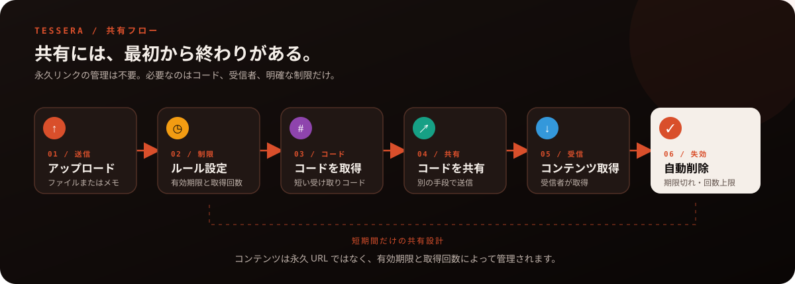
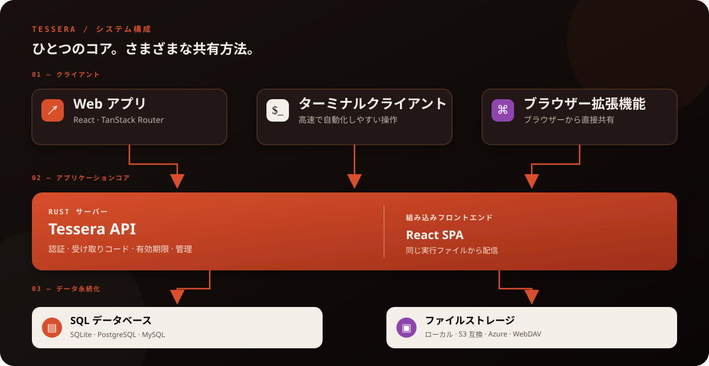

<p align="center">
  
</p>

<h1 align="center">Tessera</h1>

<h3 align="center">セルフホスト型・自動消去ファイル便。</h3>

<p align="center"><strong>ファイルを送信し、受け取りコードを共有。あとは時間に任せましょう。</strong></p>

<p align="center">
  <a href="README.md">English</a> · <a href="README.zh-CN.md">简体中文</a> · <a href="README.zh-TW.md">繁體中文</a> · <a href="README.ja.md">日本語</a>
</p>

<p align="center">
  <a href="LICENSE"></a>
  <a href="https://github.com/Limatura/tessera/stargazers"></a>
  <a href="https://github.com/Limatura/tessera/network/members"></a>
  
  
  
  
  
  
</p>


<p align="center"><a href="#-クイックスタート">🚀 クイックスタート</a> · <a href="#-アーキテクチャ">🧱 アーキテクチャ</a> · <a href="#-対応ストレージ">📦 ストレージ</a> · <a href="apps/fumadocs">📚 ドキュメント</a></p>

---

Tessera は、恒久的な共有リンクを残さずにファイルやテキストを受け渡したい人のための**匿名ファイル・テキスト共有サービス**です。

ファイルやメモをアップロードすると受け取りコードが発行されます。有効期限または受け取り回数の上限に達すると、コンテンツは保持し続ける必要がなくなります。自分でホストしてデータの保存先を管理でき、フロントエンドを内蔵した**単一バイナリ**として実行できます。

## ✨ Tessera の特長

| 機能 | 説明 |
|---|---|
| 🕶️ **匿名共有** | 受け取りコードでファイルやメモを共有。恒久的なアカウント運用に依存しません。 |
| ⏳ **自動期限切れ** | 有効期限と受け取り回数を設定し、共有コンテンツの長期残存を防ぎます。 |
| 📦 **柔軟なストレージ** | ローカルディスクを標準で使用し、S3 互換ストレージや Azure Blob などにも対応します。 |
| 🧩 **複数のクライアント、共通 API** | Web、ターミナルクライアント、ブラウザー拡張機能が同じ API を利用します。 |
| 🛠️ **管理画面** | `/admin` からインスタンス設定とストレージバックエンドを管理できます。 |
| 🪶 **単一ファイルでデプロイ** | フロントエンドは Rust サーバーに組み込まれ、別途 Node.js runtime やリバースプロキシを必要としません。 |
| 📜 **API 契約を重視** | OpenAPI はサーバーの handler から生成され、CI で同期状態が確認されます。 |


## 🔄 共有の流れ：アップロードから期限切れまで

恒久的なリンクを残すのではなく、必要な間だけコンテンツを受け渡します。

<p align="center">
  
</p>


## 🚀 クイックスタート

### Docker を使う

リポジトリのルートで実行します。

```bash
docker build -f apps/server/Dockerfile -t tessera .
docker run --rm -p 8787:8787 -v tessera-data:/data tessera
```

その後、**http://localhost:8787** を開きます。

イメージのビルド時にフロントエンドがコンパイルされ、サーバーに組み込まれます。永続化 volume は、コンテナを入れ替えた後も必要なデータを保持するために使用します。

> [!IMPORTANT]
> 初回起動時に Tessera は管理者アカウントを作成し、パスワードを**サーバーログに一度だけ表示します**。必ず安全な場所に保存してください。

### ソースコードから実行

必要なもの：Rust toolchain と pnpm。

```bash
pnpm install
pnpm --filter web build
pnpm server:dev
```

**http://127.0.0.1:8787** にアクセスしてください。

## 🧱 アーキテクチャ

<p align="center">
  
</p>

業務ロジックはすべてバックエンドが担当します。クライアントは API 経由でサーバーと通信するため、連携ツール側でサーバーのルールを再実装する必要はありません。
## 🗄️ 対応ストレージ

Tessera は標準でローカルの `blobs` ディレクトリを使用します。管理画面または CLI から、実行中にバックエンドを追加することもできます。

| ストレージ | 状態・備考 |
|---|---|
| ローカルファイルシステム | 標準設定。追加のオブジェクトストレージサービスは不要 |
| S3 互換ストレージ | Garage、RustFS、MinIO、SeaweedFS、VersityGW、s3proxy でテスト済み |
| Azure Blob Storage | Azurite でテスト |
| WebDAV | 小さなファイルのみ対応。大きなアップロードは拒否され、`413` を返します |
| AWS S3、Cloudflare R2、Backblaze B2 | S3 互換 API を使用。認証情報を設定し、opt-in ワークフローでテスト |
| Google Cloud Storage | バイナリには組み込まれていますが、現時点ではテストスイートによる検証は未実施 |

**WebDAV の制限：** WebDAV が受け付けるのは `share.inline_threshold_bytes` 未満のファイルです。既定値は 64 KiB です。アップロード経路で大きな payload をストリーミングできないため、Tessera はサイズ超過のファイルを事前に拒否します。

## ⚙️ 設定

多くの設定は **`/admin` 管理画面**で変更でき、次のリクエストから反映されます。待受ポートやデータベース接続など、プロセス起動後に変更できない設定は環境変数で指定します。

環境変数には `TESSERA_` プレフィックスを使用し、階層は `__` で区切ります。

```bash
TESSERA_SERVER__PORT=9000
TESSERA_DATABASE__URL=sqlite://data/tessera.db
TESSERA_SERVER__DATA_DIR=data
```

データベースは SQLite、PostgreSQL、MySQL に対応しています。デプロイ例：

- `tessera.personal.env.example` — 個人利用向けのプライベートインスタンス
- `tessera.public.env.example` — 不特定ユーザーからのアップロードを許可する公開インスタンス
- `contrib/tessera.service` — systemd service unit

CLI から設定を管理することもできます。

```bash
tessera-server settings list
tessera-server settings set share.default_expiry_hours 720
tessera-server settings reset-all
```

## 🧰 プロジェクト構成

```text
アプリ apps/
├── server/       Rust API、認証、ストレージ、内蔵 SPA
├── web/          React + TanStack Router Web アプリと /admin
├── tui/          対話型ターミナル UI
├── cli/          コマンドラインクライアント
├── extension/    ブラウザー拡張機能
├── dev/          外部サービスのローカル開発用スタブ
└── docs/         ドキュメントサイト（Git submodule）
共有パッケージ packages/
├── api/          OpenAPI から生成される TypeScript クライアントと schema
├── auth/         共通認証 hooks と権限ユーティリティ
├── config/       共通 TypeScript 設定
├── crypto/       ブラウザー側のエンドツーエンド暗号化ユーティリティ
├── env/          サーバーと Web の環境変数検証
├── i18n/         共通多言語ユーティリティ
└── ui/           共通 UI コンポーネントとスタイル
Rust crates/
├── tessera-core/   フレームワーク非依存のドメインルール
└── tessera-crypto/ Rust とブラウザーで共有する E2E 暗号化形式
openapi.json      自動生成される API 契約
```
## 🧑‍💻 開発

```bash
pnpm dev              # すべてのフロントエンドアプリを並行起動
pnpm server:dev       # Rust サーバーを起動
pnpm server:check     # サーバーの lint、テスト、ドキュメント、audit を実行
pnpm check            # TypeScript の lint とフォーマット確認
pnpm server:openapi   # openapi.json を再生成
```

対話型 API ドキュメントを有効にする場合：

```bash
TESSERA_FEATURES__DOCS=true pnpm server:dev
```

対話型ドキュメント UI の有効・無効にかかわらず、`openapi.json` は利用できます。UI は renderer を CDN から読み込むため、既定では無効です。

## 📚 関連ドキュメント

- [サーバーとデプロイの詳細](apps/server/README.md)
- [API 契約](openapi.json)
- [プライベート環境の例](tessera.personal.env.example)
- [公開環境の例](tessera.public.env.example)

## 📄 ライセンス

Tessera は **GNU Affero General Public License v3.0（AGPL-3.0）** を採用しています。詳細は [LICENSE](LICENSE) を参照してください。

<div align="center">

**恒久的な保存を減らし、自分のデータを自分で管理する。**

</div>
