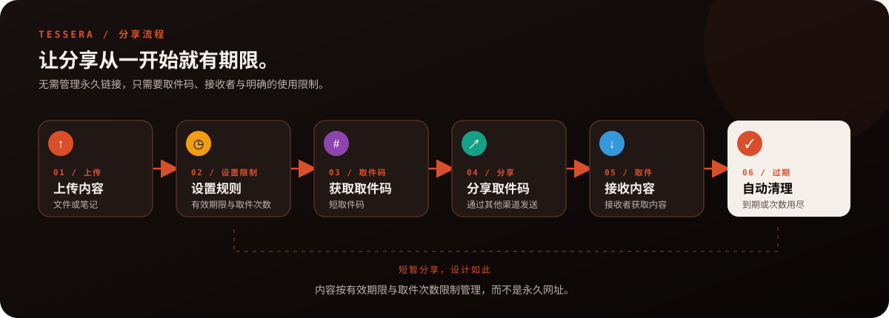
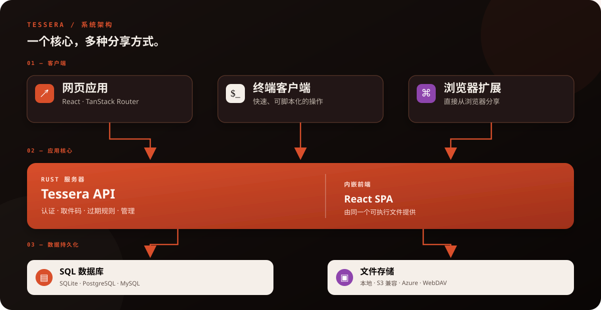

<p align="center">
  
</p>

<h1 align="center">Tessera</h1>

<h3 align="center">自托管、阅后即焚的文件快递。</h3>

<p align="center"><strong>发送文件，分享取件码，剩下的交给时间处理。</strong></p>

<p align="center">
  <a href="README.md">English</a> · <a href="README.zh-CN.md">简体中文</a> · <a href="README.zh-TW.md">繁體中文</a> · <a href="README.ja.md">日本語</a>
</p>

<p align="center">
  <a href="LICENSE"></a>
  <a href="https://github.com/Limatura/tessera/stargazers"></a>
  <a href="https://github.com/Limatura/tessera/network/members"></a>
  
  
  
  
  
  
</p>

<p align="center"><a href="#-快速开始">🚀 快速开始</a> · <a href="#-系统架构">🧱 系统架构</a> · <a href="#%EF%B8%8F-支持的存储后端">📦 存储后端</a> · <a href="https://github.com/Limatura/tessera-docs">📚 文档</a></p>

---

Tessera 是一个**匿名文件与文本分享服务**，适合希望快速交付内容、又不想留下永久分享链接的场景。

上传文件或笔记后即可获得取件码。当内容到期或达到取件次数上限后，内容便不再需要继续保留。你可以自行部署、掌控数据存储位置，并以**内嵌前端的单一可执行文件**运行服务。

## ✨ 为什么选择 Tessera？

| 功能 | 说明 |
| --- | --- |
| 🕶️ **匿名分享** | 通过取件码交付文件或笔记，无需将分享流程绑定到永久账号。 |
| ⏳ **自动过期** | 设置有效期限与取件次数，避免分享内容无限期留存。 |
| 📦 **灵活的存储方式** | 默认使用本地磁盘，也支持 S3 兼容存储、Azure Blob 等后端。 |
| 🧩 **多种客户端，共用 API** | 网页、终端客户端和浏览器扩展共用同一套 API。 |
| 🛠️ **管理后台** | 在 `/admin` 管理实例设置与存储后端。 |
| 🪶 **单文件部署** | 前端直接嵌入 Rust 服务器，无需额外的 Node.js runtime 或反向代理。 |
| 📜 **API 契约优先** | OpenAPI 由服务器 handler 生成，并由 CI 检查是否同步更新。 |

## 🔄 分享流程：从上传到过期

让内容短暂流转，而不是留下另一个永久链接。

<p align="center">
  
</p>

## 🚀 快速开始

### 使用 Docker

在仓库根目录运行：

```bash
docker build -f apps/server/Dockerfile -t tessera .
docker run --rm -p 8787:8787 -v tessera-data:/data tessera
```

然后打开 **http://localhost:8787**。

构建镜像时会编译前端并将其嵌入服务器。持久化 volume 用于保留容器替换后仍需存在的数据。

> [!IMPORTANT] 首次启动时，Tessera 会创建管理员账号，并且**只在服务器日志中显示一次密码**。请务必妥善保存。

### 从源码运行

需要 Rust toolchain 和 pnpm。

```bash
pnpm install
pnpm --filter web build
pnpm server:dev
```

然后访问 **http://127.0.0.1:8787** 。

## 🧱 系统架构

<p align="center">
  
</p>

所有业务逻辑均由后端负责。客户端通过 API 与服务器通信，因此集成工具无需重新实现服务器端规则。

## 🗄️ 支持的存储后端

Tessera 默认使用本地 `blobs` 目录，也可以通过管理后台或 CLI 在运行期间添加后端。

| 存储后端 | 状态／备注 |
| --- | --- |
| 本地文件系统 | 默认选项，无需额外的对象存储服务 |
| S3 兼容存储 | 已测试 Garage、RustFS、MinIO、SeaweedFS、VersityGW 和 s3proxy |
| Azure Blob Storage | 使用 Azurite 测试 |
| WebDAV | 仅适用于小文件；较大的上传会被拒绝并返回 `413` |
| AWS S3、Cloudflare R2、Backblaze B2 | 使用 S3 兼容 API；配置凭据后通过 opt-in 工作流测试 |
| Google Cloud Storage | 已编译进可执行文件，但目前尚未由测试套件验证 |

**WebDAV 限制：** WebDAV 只接受小于 `share.inline_threshold_bytes` 的文件，默认值为 64 KiB。由于其上传路径无法流式处理大型 payload，Tessera 会直接拒绝过大的文件，避免上传到一半才失败。

## ⚙️ 配置

大部分设置都可以在 **`/admin` 管理后台**修改，并在下一次请求时生效。监听端口、数据库连接等进程启动后无法变更的设置，必须通过环境变量指定。

环境变量使用 `TESSERA_` 前缀，嵌套层级以 `__` 分隔：

```bash
TESSERA_SERVER__PORT=9000
TESSERA_DATABASE__URL=sqlite://data/tessera.db
TESSERA_SERVER__DATA_DIR=data
```

数据库支持 SQLite、PostgreSQL 和 MySQL。部署示例：

- `tessera.personal.env.example` — 仅供自己使用的私人实例
- `tessera.public.env.example` — 允许陌生人上传的公开实例
- `contrib/tessera.service` — systemd service unit

也可以通过 CLI 管理设置：

```bash
tessera-server settings list
tessera-server settings set share.default_expiry_hours 720
tessera-server settings reset-all
```

## 🧰 项目结构

```text
应用程序 apps/
├── server/       Rust API、认证、存储与内嵌 SPA
├── web/          React + TanStack Router 网页应用与 /admin
├── tui/          交互式终端界面
├── cli/          命令行客户端
├── extension/    浏览器扩展
├── dev/          本地外部服务替身，用于开发测试
└── docs/         文档网站（Git submodule）
共享包 packages/
├── api/          由 OpenAPI 生成的 TypeScript 客户端与 schema
├── auth/         共用认证 hooks 与权限工具
├── config/       共用 TypeScript 配置
├── crypto/       浏览器端端到端加密工具
├── env/          服务器与网页环境变量验证
├── i18n/         共用多语言工具
└── ui/           共用 UI 组件与样式
Rust crates/
├── tessera-core/   与框架无关的领域规则
└── tessera-crypto/ Rust 与浏览器共用的端到端加密格式
openapi.json      自动生成的 API 契约
```

## 🧑‍💻 开发

```bash
pnpm dev              # 并行启动所有前端应用
pnpm server:dev       # 启动 Rust 服务器
pnpm server:check     # 运行服务器 lint、测试、文档与 audit
pnpm check            # TypeScript lint 与格式检查
pnpm server:openapi   # 重新生成 openapi.json
```

需要交互式 API 文档时：

```bash
TESSERA_FEATURES__DOCS=true pnpm server:dev
```

无论是否启用交互式文档界面，`openapi.json` 都会提供。交互式文档 UI 默认关闭，因为其 renderer 会从 CDN 加载。

## 📚 更多文档

- [服务器与部署详情](apps/server/README.md)
- [API 契约](openapi.json)
- [私人部署示例](tessera.personal.env.example)
- [公开部署示例](tessera.public.env.example)

## 📄 许可证

Tessera 使用 **GNU Affero General Public License v3.0（AGPL-3.0）**。详见 [LICENSE](LICENSE)。

<div align="center">

**减少永久留存，增加自主掌控。**

</div>
