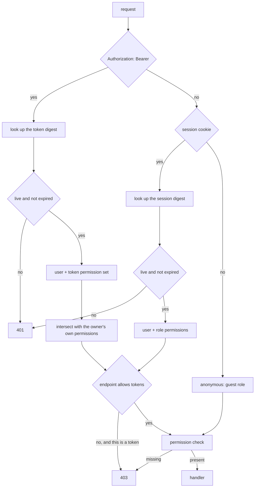

# Authentication

Two ways to prove who you are, deliberately kept apart.

Code: `auth/`, `api/auth.rs`, `db/repository/{user,session,api_token,role}.rs`.

Share passwords are a different thing entirely; see `retrieval.md`.

## Sessions and tokens are separate mechanisms

|  | Session cookie | Bearer token |
| --- | --- | --- |
| For | browsers | scripts, the CLI, ShareX, the Discord bot |
| Lifetime | short, renewed on use | long |
| Storage | `HttpOnly` cookie | pasted into a config file |
| Revocation | logout | individually |

Merging them into one token type used two ways is a common shortcut and a bad one. A browser credential wants to be short-lived, invisible to JavaScript and revoked on logout. An automation credential wants to be long-lived, written down and revoked individually. One type serving both is too weak for the first job or too awkward for the second.

The cookie is opaque. It means nothing without the row it points at.

**Both store only a digest.** A stolen database dump contains nothing that can be presented as a credential.

Some endpoints refuse token auth even with the right permission. Changing settings is one: a token pasted into a shell script should not be able to reconfigure the instance.

## How a request is identified

The intersection is why a token can be weaker than the user who made it and never stronger: revoking a permission from the user revokes it from every token they hold, without touching the tokens.

## Permissions

Users have a role; roles carry permissions. Anonymous callers get the guest role, which is a real row with real limits rather than a special case in the code.

Tokens carry their own permission subset, so a token can be weaker than the user who made it, never stronger.

## Throttling

Counters live in memory, not the database.

Failed-attempt counters are worthless data. Losing them on restart costs an attacker one restart's worth of guesses. Storing them means a database write on every wrong password, which turns the login endpoint into a way for an unauthenticated stranger to generate disk I/O.

The trade-off: a multi-process deployment would throttle per process. This ships as one process by design.

Separate limits for sign-ins, share-code lookups, share-password attempts, and mail sends.

## Working out who a request is from

Every throttle counts against a source address, and they all assume the address is something the caller cannot choose.

`X-Forwarded-For` is a header. On a direct connection it is exactly something the caller chooses, so trusting it unconditionally makes every throttle bypassable by setting a header.

`auth::proxy` resolves this: forwarded headers are only believed when the peer is in `server.trusted_proxies`. Behind a proxy that is the real client; without configuration it is the socket address.

Getting this wrong in either direction is a real failure. Trusting the header always means no throttle works. Never trusting it means everyone behind the proxy shares one bucket.

## The first administrator

Registration is open by default and the first account to register becomes the administrator. That is right for someone setting up their own instance and wrong for anything else.

An instance with registration closed has no way to create its first account. `auth::bootstrap` handles that: credentials supplied through the environment create an administrator that exists before anyone registers.

## Passwords

Argon2id. Parameters are configurable and validated at startup: a memory cost below what the algorithm needs for its lane count is rejected rather than silently weakened.

Share passwords have a lower minimum than account passwords, on purpose. See `retrieval.md`.

### Breached passwords

With `auth.pwned.enabled` on, a new password is looked up in Have I Been Pwned's list before it is accepted, on all three paths that set one: registering, changing a password, and finishing a reset.

What is sent is the first five characters of the password's SHA-1, and nothing else. The service answers with every suffix it holds under that prefix and the match is found here, so neither the password nor enough of its hash to identify it leaves the process. Answers are asked to be padded, which is why a suffix is only a match when its count is above zero: the padding entries come back with zero.

Off by default, because it is a request to somebody else's service on a path that has to work. When it is on and that service does not answer, the password is accepted and a line goes in the log: a breach list that is down must not stop somebody registering or resetting a password they have already lost. `auth.pwned.url` points at a self-hosted implementation for an instance with no way out to the internet.

A form can look a password up as it is typed, before it is sent: `GET /api/v1/auth/pwned/{prefix}` takes the first five characters of the SHA-1 and answers with the breached suffixes under them, padding removed, and the browser compares. The password stays in the browser and this server passes on the same five characters it already sends. Every lookup counts against `auth.throttle.pwned`, its own counter so that typing a password does not spend the address's sign-in attempts. A service that does not answer is a `503` here, since there is nothing to fall back to, and the form shows no warning; the check still runs when it is sent.

Tested in `tests/pwned.rs`, against a service that answers the way the real one does and records what it was asked. `the_real_service_still_answers_the_way_this_reads` puts the same questions to the real API and is `#[ignore]`d.

## Proving an address

`email_verified_at` on an account says when its address was last shown to reach the person. Three things set it: confirming a registration, a provider that vouches for the address (see `oidc.md`), and following a verification link. Changing the address clears it. Nothing on the server depends on it yet; it is there so a person can see which address they have confirmed.

The link is for the addresses registration never proved: one changed afterwards, the first administrator, an account registered while no mail was configured. `POST /api/v1/account/email/verification` sends it to the account's current address, and `POST /api/v1/account/email/verification/confirm` with the token from it sets the timestamp. Code: `api/verification.rs`, `db/repository/email_verification.rs`.

- **The link proves the address it was sent to, not the account's.** The row keeps the address, and confirming only succeeds while the account still has it. Otherwise asking for a link and then moving to an address you cannot receive would get the new one confirmed by mail that went to the old one.
- **Asking needs a session.** A leaked API token should not be a way to mail the owner on repeat.
- **Counted against the address it goes to**, on `auth.throttle.verification`. An account can set its address to anybody's, so without a limit this mails a stranger on demand. Its own counter, not the reset one, or the same trick would use up that stranger's resets.
- **Sent while the request waits**, unlike a reset. The caller is signed in and knows their own address, so the timing gives nothing away, and a relay that is down is a `503` rather than a success that never arrives.
- **Confirming needs no session**, because the link is opened wherever the mail is read. It lasts `mail.registration_ttl_hours`, works once, and every unusable link gets the same `400`.

Both answer `404` on an instance that sends no mail.

## Signing in a program from a browser

`tess login` runs where there may be no browser at all, over SSH for one, so it cannot send one to the sign-in page and wait for it to come back. It uses the device authorization grant (RFC 8628) instead. Code: `api/device.rs`, `db/repository/device_authorization.rs`.

1. The program calls `POST /api/v1/auth/device` with a name for itself and gets a device code, which it keeps, and a user code like `WDJB-MJHT`, which it shows.
2. The person opens `/device` on the site, signs in the usual way, enters the user code and approves (`POST /api/v1/auth/device/{user_code}/approve`) or denies.
3. The program polls `POST /api/v1/auth/device/token` every `interval` seconds. Until somebody answers it gets `device_authorization_pending`; after an approval it gets an API token, once.

- **Only the device code's digest is stored**, like every other secret. The user code is stored as typed, since it is looked up by what a person types, lives ten minutes, and can only approve a request, never redeem one.
- **The token is minted on redemption, not on approval.** Approval records who and which permissions; minting it earlier would mean keeping the secret somewhere until the program comes back.
- **The token may create, list and delete the approver's own shares**, less whatever of that the approver may not do. Approving needs `tokens:manage` and a session, for the same reason creating a token does.
- **The approval page shows what the program calls itself and the address it asked from.** The attack on this flow is a stranger starting a request and sending you the code, and that is the only place it can be noticed.
- **Starting one is counted against the address on `auth.throttle.source`**, every request and not only failures, since each writes a row anyone can ask for. User codes tried and not found count on `auth.throttle.lookup`, the same budget mistyped retrieval codes spend.
