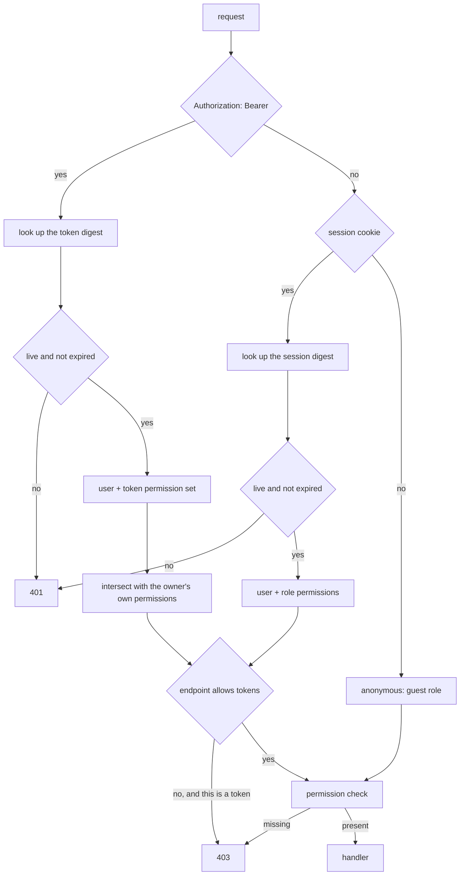

# Authentication

Two ways to prove who you are, deliberately kept apart.

Code: `auth/`, `api/auth.rs`, `db/repository/{user,session,api_token,role}.rs`.

Share passwords are a different thing entirely; see `retrieval.md`.

## Sessions and tokens are separate mechanisms

|  | Session cookie | Bearer token |
| --- | --- | --- |
| For | browsers | scripts, the CLI, ShareX, the Discord bot |
| Lifetime | short, renewed on use | long |
| Storage | `HttpOnly` cookie | pasted into a config file |
| Revocation | logout | individually |

Merging them into one token type used two ways is a common shortcut and a bad one. A browser credential wants to be short-lived, invisible to JavaScript and revoked on logout. An automation credential wants to be long-lived, written down and revoked individually. One type serving both is too weak for the first job or too awkward for the second.

The cookie is opaque. It means nothing without the row it points at.

**Both store only a digest.** A stolen database dump contains nothing that can be presented as a credential.

Some endpoints refuse token auth even with the right permission. Changing settings is one: a token pasted into a shell script should not be able to reconfigure the instance.

## How a request is identified

The intersection is why a token can be weaker than the user who made it and never stronger: revoking a permission from the user revokes it from every token they hold, without touching the tokens.

## Permissions

Users have a role; roles carry permissions. Anonymous callers get the guest role, which is a real row with real limits rather than a special case in the code.

Tokens carry their own permission subset, so a token can be weaker than the user who made it, never stronger.

## Throttling

Counters live in memory, not the database.

Failed-attempt counters are worthless data. Losing them on restart costs an attacker one restart's worth of guesses. Storing them means a database write on every wrong password, which turns the login endpoint into a way for an unauthenticated stranger to generate disk I/O.

The trade-off: a multi-process deployment would throttle per process. This ships as one process by design.

Separate limits for sign-ins, share-code lookups, share-password attempts, and mail sends.

## Working out who a request is from

Every throttle counts against a source address, and they all assume the address is something the caller cannot choose.

`X-Forwarded-For` is a header. On a direct connection it is exactly something the caller chooses, so trusting it unconditionally makes every throttle bypassable by setting a header.

`auth::proxy` resolves this: forwarded headers are only believed when the peer is in `server.trusted_proxies`. Behind a proxy that is the real client; without configuration it is the socket address.

Getting this wrong in either direction is a real failure. Trusting the header always means no throttle works. Never trusting it means everyone behind the proxy shares one bucket.

## The first administrator

Registration is open by default and the first account to register becomes the administrator. That is right for someone setting up their own instance and wrong for anything else.

An instance with registration closed has no way to create its first account. `auth::bootstrap` handles that: credentials supplied through the environment create an administrator that exists before anyone registers.

## Passwords

Argon2id. Parameters are configurable and validated at startup: a memory cost below what the algorithm needs for its lane count is rejected rather than silently weakened.

Share passwords have a lower minimum than account passwords, on purpose. See `retrieval.md`.
