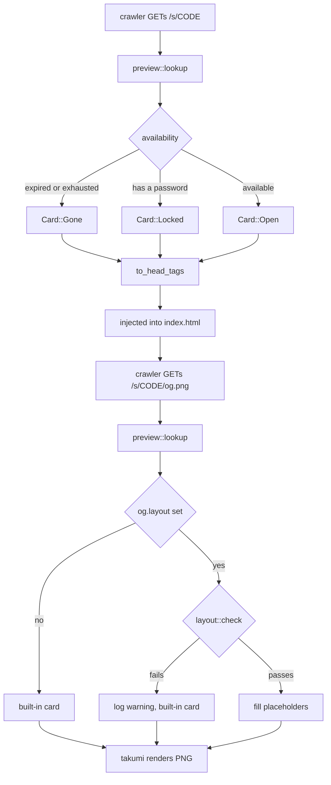
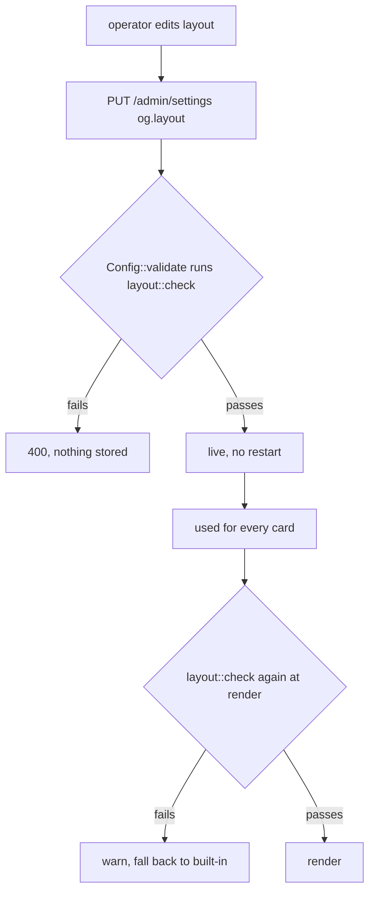

# Link previews

When a share link is pasted into Discord or Slack, the client fetches the URL and reads the HTML. It does not run JavaScript. So the `<meta>` tags must be in the bytes the server sends, and the preview image must be a real URL.

Code: `api/preview.rs`, `og/mod.rs`, `og/code.rs`, `og/layout.rs`. Feature flag: `og-images`, on by default.

## Where things are

| Piece                           | Where                                 |
| ------------------------------- | ------------------------------------- |
| What a share may reveal         | `api::preview::Card`                  |
| The meta tags                   | `api::preview::Preview::to_head_tags` |
| Tag injection into `index.html` | `assets::serve_share_page`            |
| Drawing the card                | `og::Cards::draw_with`                |
| Syntax colouring                | `og::code::highlight`                 |
| Layout rules                    | `og::layout::check`                   |
| Card route                      | `GET /s/{code}/og.png`                |
| What a card costs the host      | `public::draw`, `public::card_etag`   |
| Drawn cards                     | `og::cache`                           |
| Operator's layout               | the `og.layout` setting               |
| Fonts                           | `apps/server/assets/fonts/`           |
| Serving them to an editor       | `GET /fonts/{name}`                   |

## Request flow

Both routes go through `preview::lookup`, not `gate::open`.

## Two hard rules

**Previews never consume a retrieval.** Unfurlers fetch the link when it is pasted, before anyone clicks. If that counted, a one-time share would be destroyed before its reader saw it. `preview::lookup` does not touch counters; `gate::open` does.

**Locked shares reveal nothing but their title.** The preview is visible to everyone in the channel. Filename, size and file count are all withheld.

The title is the exception: the uploader typed it as a label for others, whereas the filename came off their disk. This has a real cost. A share titled "Q3 salaries" broadcasts that to the channel. With no title, nothing is shown.

## Why `Card` exists

`Preview::of` computes a `Card` (`Open` / `Locked` / `Gone`). Both the meta tags and the image render from it.

If the tags and the image each decided what was safe to show, one of them would eventually get it wrong. Two implementations of one rule is how that happens.

## Operator layouts

`og.layout` holds one HTML layout for the whole instance. It is not per-share, which would mean a knob on every upload form. `shares.og_config` exists in the schema but nothing writes it.

### Allowed

`div`, `span`, and the `style` attribute. Max 8 KB, max 12 levels deep.

Rejected: `img`, `svg`, `class`, `tw`, `url()`, `@import`, anything referencing an external resource.

### This is not a security boundary

Whoever can set a layout already runs the process. They could do more by editing the config file, which sets the same value.

The check exists so mistakes surface at save time. takumi has no HTTP client. It collects referenced URLs and hands them to the caller, which never fetches them, so an external image silently renders as nothing and unknown elements are silently dropped. Without validation, the first symptom is a broken card on someone else's screen.

### Checked twice

At save (`Config::validate`) and at render. Rules can tighten after a layout is stored. A layout that no longer passes falls back to the built-in card and logs a warning, rather than returning 500.

### Placeholders

`{{title}}` `{{label}}` `{{size}}` `{{code}}` `{{expires}}` `{{footer}}` `{{language}}`

Values come from the same `Card`. A locked share has no size, so `{{size}}` fills as empty string. The layout cannot opt out of this. The value simply isn't there.

## Previewing a layout

In the browser, with takumi's wasm build, so the editor and the server share an
engine. `@takumi-rs/wasm` and the `takumi` crate are released under the same
version number, so the two halves can be pinned to the same one.

Rust parses with `html5ever`; the JS side (`@takumi-rs/helpers/html`) uses a
hand-written regex tokenizer. Tested at matching pinned versions, comparing
rendered PNGs pixel by pixel across 25 cases (unclosed tags, mis-nesting, stray
close tags, uppercase, duplicate attributes, entities, `<style>` blocks,
unquoted attributes, `<table>` foster parenting, `
` and `<li>` auto-close,
nested `<form>`, adoption agency, `<script>` raw text, unclosed comment,
namespaced tags): all 25 identical. They agree because takumi's node tree is
coarse (boxes, text, style) and parser differences are mostly about error
recovery, which either collapses to the same tree or lands somewhere the
renderer ignores.

The browser needs the same six faces the server draws with, or the preview is
wrong about wrapping and CJK, which is exactly what an operator is checking.
`GET /fonts/{name}` serves them, named and ordered by `og::FACES`. They are
`immutable` for a year and typed `font/woff2`: the bytes cannot change without
the binary changing, so a reverse proxy can keep them and the 3.42 MB is paid
once for a whole site rather than once per operator, and the type is what stops
this server and the proxy each recompressing something already compressed.

## What a card costs the host

The route is public, unauthenticated and deliberately outside the throttle, so
an unfurler does not spend a share's retrievals on its way to a reader. It is
also the one route whose cost an operator sets: eight kilobytes of layout is
three milliseconds or sixteen seconds depending on whether it blurs anything.
Measured, 53 boxes with `filter: blur(40px)` take 16.4 seconds.

Three things keep that from being the host's problem.

**A returning unfurler is answered without drawing.** The entity tag is derived
from what the card *would say* — `Preview::fingerprint` over the title, the
words and the snippet, plus a digest of the layout — so it can be worked out
from a lookup and two digests. `If-None-Match` then costs no render at all.

That works because the countdown is already coarse: `expires_in` rounds the way
a person speaks, so the same share draws the same bytes for as long as the
sentence holds, and the tag changes exactly when the picture would. A raw
expiry in the tag would make every request a different tag while the picture
stayed identical.

**A card is drawn once.** `og::cache` keeps finished cards keyed by the same
entity tag, which is already a digest of everything the drawing reads, so an
entry serves every request that would have produced identical bytes and there
is nothing to invalidate: a card counting down gets a new tag, and a new entry,
exactly when its picture would have changed. That covers the burst a posted
link produces, where several unfurlers arrive at once and none of them holds
anything yet.

The budget is 64 MB of cards, not a number of them: a count says nothing about
memory when an entry is a PNG, and an instance holding a hundred thousand
shares must not turn that into a hundred thousand pictures. Least recently used
leaves first, and a single outsized card is not kept at all rather than
evicting everything on its way in.

**Drawing happens on a blocking thread.** One render is a single synchronous
call that cannot be cancelled; calling it inline would park a runtime worker for
its whole duration, and a few at once would stop the process answering anything.

**At most half the cores draw at once.** Over that, the request is refused
rather than queued: there is no cancelling a render, so a caller who waited and
gave up would have cost the same CPU and got nothing. Cards are the least
important thing this process does, and the other half is what keeps uploads and
retrievals moving while a crawler works through a sitemap.

## Tested invariants

- Drawing a card consumes no retrieval (drawn twice, then downloaded successfully).
- A locked card carries no filename, size, or code, including through a custom layout requesting everything.
- A note's snippet attaches only to `Card::Open`.
- `og:image` is an absolute URL.
- Configured `server.public_url` overrides the `Host` header.

## Measurements

|                            |                     |
| -------------------------- | ------------------- |
| Render one card            | 2.6 ms              |
| Card as PNG                | 18–24 KB            |
| First card per language    | 405 ms, then 1.3 ms |
| takumi                     | 5.02 MB             |
| syntect + two-face         | 2.39 MB             |
| Six fonts                  | 3.43 MB             |
| Binary without `og-images` | 19.8 MB             |
| Binary with                | 30.5 MB (budget 40) |

### No cache

Caching cards in the object store was considered, keyed by layout version, font config and share fields. At 2.6 ms per render that is not worth the invalidation logic, and the route already loads the share row for the tags.

It also keeps `{{expires}}` and retrieval counts accurate, since there is no stale copy.

### two-face, not plain syntect

syntect's bundled syntaxes cover 75 languages and do not include TypeScript, TOML, Kotlin, Swift, Zig, Dockerfile or Nix. two-face covers 199, for 0.57 MB more.

### Six fonts

Full coverage rationale is in `assets/fonts/README.md`. Two traps:

- `DroidSansFallback` claims Hangul support but only covers Compatibility Jamo (individual letters, 97.9%). Hangul Syllables, which is actual written Korean, is 3 of 11,172. Korean needs its own file.
- Noto Color Emoji is 9.2 MB as woff2, over budget. Monochrome is 0.45 MB and suits the dark card.

## Gotchas

Both found by rendering and looking, not by reading code.

**`<pre>` renders as one line.** takumi uses flexbox layout, where newlines inside `<pre>` are just whitespace. Nine lines of code became one line running off the card. `og::code` builds markup from syntect's styled ranges instead, one `div` per line.

**Indentation cannot be spaces.** Layout engines collapse whitespace runs. Indent width is measured, stripped from the text, and applied as `padding-left`. This is why a monospace font is embedded: padding measured in character widths only works when characters are equal width.

## Not built

- sao's icons. The padlock is currently two rounded boxes.
- The admin editor UI.
- Per-share layouts. `shares.og_config` is unwritten.
- Colour emoji. Over budget. The intended answer is letting operators add their own fonts, which needs an admin API that does not exist yet.
