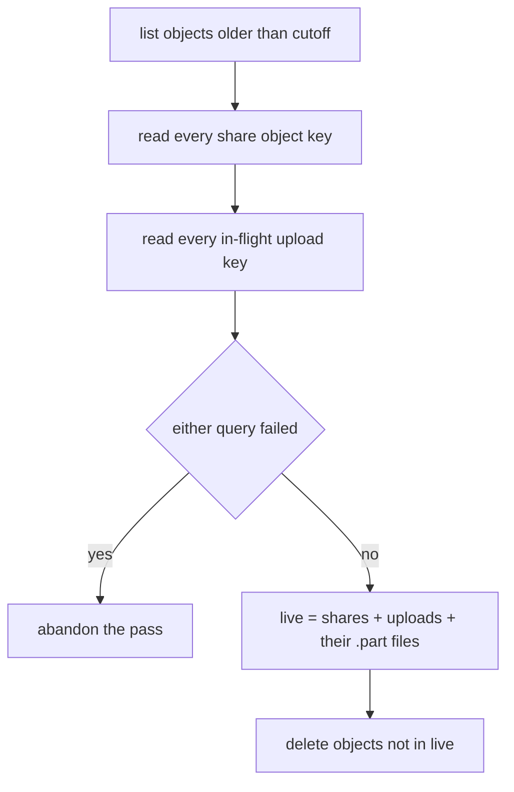

# Maintenance sweeps

Everything the sweep does is also done opportunistically elsewhere: an expired session presented to the server is deleted on sight, a dead share stops being served the moment it dies.

The sweep exists for what nobody comes back for: a browser that was closed, a laptop that was replaced, a share whose recipient never followed the link. Without it those only accumulate, and on a long-lived personal instance that growth is unbounded and invisible.

Code: `maintenance.rs`.

## What runs

| Pass | What it removes |
| --- | --- |
| `sweep_dead_shares` | Shares past their expiry or retention window, and their objects |
| `sweep_abandoned_uploads` | Resumable sessions nobody finished, and their multipart uploads |
| Session and token expiry | Rows nothing will present again |
| `reconcile_once` | Objects in the store that no row names |
| Log retention | Log files older than `logs.retention_days` |
| Webhook events | Events delivered or given up on more than a week ago |

Each pass also writes today's row of `stats_snapshots` (stored bytes, shares, live shares, bytes served), replacing the one an earlier pass wrote that day, and drops rows older than 366 days. That is the history behind `GET /admin/stats/history`. It starts the day it is first deployed: the sweep deletes a dead share's size along with it, so earlier days cannot be worked out afterwards.

Dead shares matter most: they are the only ones holding bytes. A row is a couple of hundred; the payload can be gigabytes, and no database action reaches the blob store.

## Orphan reconciliation

An object with no row is paid for and unreachable. Finding them means listing the store and subtracting everything the database knows about.

**A failed query abandons the pass.** It does not proceed with a partial set. An object missing from `live` is an object this deletes, so an incomplete `live` set is data loss.

**The cutoff exists** because an upload in progress has an object the database does not know about yet. Only objects older than the window are considered.

**Upload keys contribute two entries:** the key itself, and the key plus `.part`, which is the file the local-disk sink appends to.

**Split files contribute every segment.** Reading only the first segment would leave the rest orphaned; that bug shipped once and is why `all_object_keys` reads `file_segments` rather than a single column.

## Abandoned resumable uploads

A resumable session holds a real multipart upload. S3 bills for its parts until someone aborts it.

The contract: **abort first, and only remove the row if the abort succeeded.** A row removed after a failed abort leaves parts nothing can ever find again.

For a split upload this means every segment. One session across two backends is two multipart uploads.

## When it runs

On an interval, and once at start-up. The task takes a `CancellationToken` so a shutting-down server does not leave a pass half-finished.

Retention windows are settings, so they change without a restart. `POST /api/v1/admin/settings/preview` reports how many shares a shorter window would collect before it is applied.
