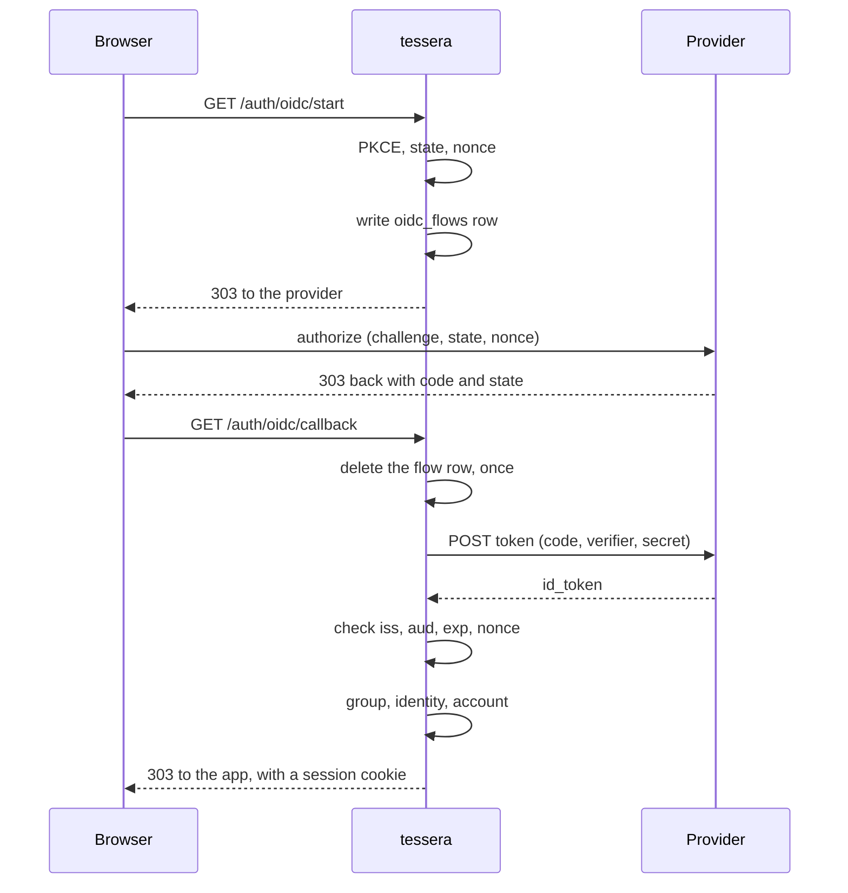
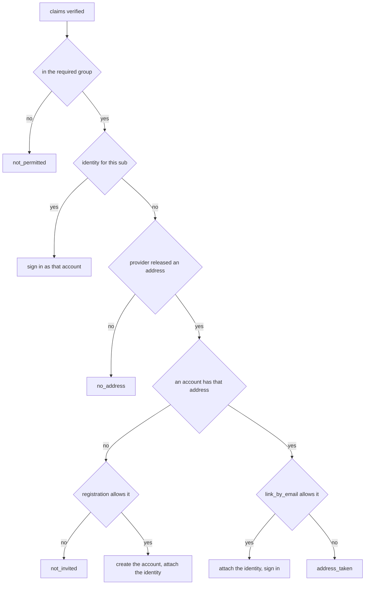
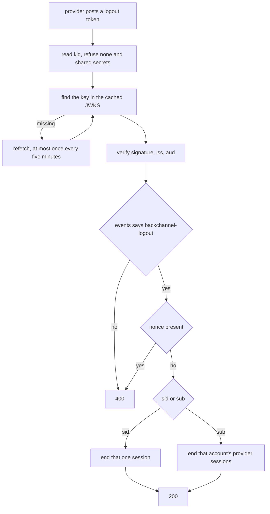

# Signing in through an identity provider

An operator who already runs Authentik, Authelia, Keycloak or Pocket ID should not have to hand out a second password. This is the path that lets them not.

Off by default. Setting `auth.oidc.issuer` and `auth.oidc.client_id` turns it on.

Code: `auth/oidc/`, `api/oidc.rs`, `db/repository/oidc.rs`. Passwords moved to their own table in the same change; see `migrations.md` for why that could not be a nullable column.

## Where things are

| Piece | Where |
| --- | --- |
| The provider's own document | `auth::oidc::discovery` |
| Leaving for the provider | `auth::oidc::flow` |
| Trading the code for a token | `auth::oidc::token` |
| Reading and checking the token | `auth::oidc::claims` |
| Group admission, choosing a name | `auth::oidc::admit` |
| The endpoints | `api::oidc` |
| GitHub and Discord | `auth::oauth` |
| Identities and flows, as rows | `db::repository::oidc` |
| Tables | migration `m20260905_000001_oidc` |
| The provider's signing keys | `auth::oidc::jwks` |
| Reading a logout token | `auth::oidc::logout` |
| The flow, end to end | `tests/oidc.rs`, against a provider that runs |

## Who this is for

Three shapes of instance, and the settings that separate them.

| | Registration | `link_by_email` | `required_group` |
| --- | --- | --- | --- |
| One person, own NAS | closed | off | empty |
| A few friends | invite | on | empty |
| A small team behind an SSO | open | on | set |

The middle row is the one worth explaining. An instance whose friends already have accounts wants the provider attached to those accounts rather than a second set beside them, and that only works if an address can be matched. The last row is the opposite case: the provider is the authority on who belongs, so registration can be open, and the group claim is what keeps it from being open to the whole directory.

`client_secret` is set from the panel like the rest, encrypted at rest; see `configuration.md`.

## The flow

Everything the browser carries is checked against something it never saw. `state` is matched to a row this server wrote. `nonce` is matched to a value in that row. The PKCE verifier never leaves this process at all.

### Why the flow lives in a table

`state`, `nonce` and the PKCE verifier have to survive a round trip through the provider. A signed cookie also works, and would be one fewer table.

The cookie has to be `SameSite=Lax` exactly. `Strict` withholds it on the top-level navigation back from the provider, and the failure looks like an unrelated error to whoever hits it. A row has no such rule to get wrong, the sweep already clears four other short-lived tables, and the endpoints are throttled like the other unauthenticated ones.

### The state is taken back exactly once

`consume` deletes the row and returns the flow only if that delete was the one that removed it. The database decides, so a callback opened twice, or replayed out of browser history, works the first time and finds nothing after.

Reading the row and then deleting it leaves a window where two attempts both see it.

An expired flow is still returned, and still removed, so the callback can say "this took too long" rather than "no such sign-in". Those are different things to be told.

### The redirect URI comes from configuration only

Elsewhere the server's own address falls back to the `Host` header when `server.public_url` is unset. Getting that wrong means a preview card with a broken image.

Getting it wrong here means the authorisation code is delivered somewhere else. So `flow::redirect_uri` reads `server.public_url` and refuses when it is empty. A provider matches the redirect URI by exact string equality against what was registered with it anyway, so a value that changes per request could not be registered.

### PKCE is sent even though it is not required

A client with a secret may skip it: the secret already proves who is exchanging the code. It is sent anyway. It is the only thing that helps when a code leaks through a redirect chain, a proxy log or browser history, and it costs one hash.

## What is believed, and why the signature is not checked

An ID token is a JWT. The usual handling fetches the provider's JWKS, matches the key id, verifies the signature, then reads the claims. This does not do that.

That is a conditional exemption, not a shortcut. OpenID Connect Core section 3.1.3.7 rule 6 says that when the ID token is received through direct communication between the client and the token endpoint, TLS server validation may be used to validate the issuer in place of checking the signature. That is exactly this path: the token arrives in the body of a response to a request this server made, to an `https` URL that came out of a document fetched from the configured issuer, over a connection whose certificate was checked. Nothing untrusted carried it.

**The exemption ends the moment a token arrives any other way.** An implicit or hybrid flow returns the token through the browser, which is the party the signature protects against. A back-channel logout token is pushed to us unprompted. Either one needs JWKS fetching, key rotation and signature verification added first. Adding the flow and leaving the reading as it is turns a documented exemption into a hole.

The note is in `claims.rs` at the top, and a test named `the_signature_is_not_read` pins the current behaviour so that whoever changes it has to read the note.

Everything else the specification asks for is checked:

| Claim | Rule |
| --- | --- |
| `iss` | Exact string equality with the configured issuer, trailing slash aside |
| `aud` | Must contain the configured client id, whether it is a string or a list |
| `exp` | Must be in the future, with sixty seconds of clock tolerance |
| `nonce` | Must equal the one in the flow row. Missing is a failure, not an absence |
| `sub` | Must be present and not blank |

The issuer check is also what the discovery document is checked against when it is fetched, so a document that names a different issuer than the URL it came from is refused once rather than once per sign-in. That is where a mix-up attack starts.

## What the provider decides, and what it does not

The provider decides **who may sign in**. tessera decides **what they may do**.

An account admitted through a provider lands in `auth.default_role`, exactly like one that registered with a password, and is moved by an administrator afterwards. There is no claim that grants a role. A directory administrator is not automatically an administrator here, and a group named `admins` at the provider means nothing until somebody says what it maps to.

That is a deliberate stopping point rather than a missing feature. Role mapping is easy to add and hard to take back: once roles follow a claim, a change in the directory silently changes who can delete other people's shares here.

### `required_group` fails closed

With `auth.oidc.required_group` empty, everyone the provider admits is admitted. With it set, that group has to appear in the claim named by `auth.oidc.group_claim`.

A claim that is absent, empty, or in a shape this does not recognise yields no groups, and no groups never contains the required one. A provider that quietly stopped releasing the claim locks people out. That is the direction to be wrong in.

Providers disagree about the shape, so three are read: a list of strings, a single string, and a list of objects with a `name`. They also disagree about the name, which is why it is configuration and not a constant. Some use a URI.

## Becoming an account

The subject is what an account is keyed on. It is the provider's own identifier for the person, stable and never reused within one issuer. An address is not: providers let people change it, and some do not check it at all.

### Why an address is still required

The `email` scope is optional in the specification, so a provider need not release one. Rather than making the column nullable, a sign-in that arrives without an address is refused with a message naming the scope to grant.

Everything from password reset to notification assumes an address exists. Relaxing that to serve a provider that can be configured to release one is a large change for a small case. Authentik, Authelia, Keycloak, Google and GitHub all can.

### Matching an address is a switch, and it is not enough on its own

An instance whose people registered with passwords first wants the provider attached to those accounts, not a second set beside them. Matching on the address is how that happens.

It is also how a stranger takes over an account, if the provider hands out addresses it never checked. So the operator says how far this provider's addresses are to be trusted, in `auth.oidc.link_by_email`, and anything short of that is refused with `address_taken` rather than silently creating a second account:

- `never`, the default: no address links anything.
- `when_verified`: the provider has to say `email_verified` is true, in the token or in userinfo. Userinfo is asked when the token leaves the claim out, and only a verdict about the same address counts.
- `always`: whatever the provider says. For a provider the operator runs and hands accounts out on.

`when_verified` used to be the only way on, and it did nothing against providers that do not send the claim: Synology's SSO Server does not have it, Entra ID leaves it out for work accounts, and Authentik's default mapping sends `false`. `always` is the answer for those, and a trade the operator makes knowingly: a provider that lets anybody sign up with any address becomes a way to take over accounts here. GitHub and Discord have no such setting, because neither hands over an address it has not checked.

`POST /admin/settings/oidc/discovery` returns the provider's `claims_supported`, so the panel can say, when the document is read, that a provider without `email_verified` in it will never link under `when_verified`.

Tested by `how_far_a_provider_is_trusted_decides_whether_it_links`, `a_verdict_from_userinfo_counts_for_an_address_from_the_token` and `a_verdict_about_another_address_does_not_count`.

This matters most with a large public provider. Anyone can obtain an account there, so an instance that both registers strangers and matches on unverified addresses is handing out other people's accounts.

### Choosing a name

`preferred_username`, then the local part of the address, then `name`, then `user`. Each candidate is squeezed into what a username may be rather than refused: lower-cased, stripped of characters the rules do not allow, padded if too short, trimmed if too long.

A person signing in for the first time cannot fix a name the provider chose, so an unusable one has to become a usable one here.

Collisions take a number, not a random tail. `alice2` is recognisably the same person's account; `alice-x7f2` is not.

## Who a provider may make an account for

`auth.registration` decides registering with a password. Whether a first sign-in through a provider makes an account is `allow_registration` on that provider, one of three:

- `inherit`, the default: as `auth.registration` says, invitation included. What every instance did before this existed.
- `always`: whatever `auth.registration` says, and without an invitation. The provider letting somebody through is what admits them.
- `never`: only accounts that already exist, or that their owners attach, sign in this way.

The combination this exists for is `auth.registration = closed` with the provider on `always`: accounts are made at the identity provider, this instance has no sign-up form of its own, and the people the provider admits get an account here the first time they arrive. With OIDC, `required_group` is still what narrows that down. GitHub and Discord have no groups, so `always` there opens this instance to every account at either.

Tested by `a_provider_can_make_accounts_whatever_registration_says`, `never_still_lets_an_existing_identity_in` and `github_makes_accounts_only_as_its_own_setting_says`.

## When the provider signs somebody out

A provider can disable somebody, and a session that outlives that is exactly what single sign-on exists to prevent.

`sessions.origin` is `password` or `oidc`. It is also what `identities.provider` holds, because there is one provider and that is its name; the day a second one is configured, both have to carry its name, because a logout token from one must not end sessions another started.

`sessions.provider_sid` holds the provider's own identifier for its side of the session, taken from the ID token's `sid` when the provider released one. Most rows have none: every password sign-in, and every provider that does not send it.

### The endpoint

`POST /api/v1/auth/oidc/backchannel-logout` takes a form-encoded `logout_token`. The provider pushes it; nobody signs in to call it.

**Two answers, two shapes.** This endpoint alone answers `{"error", "error_description"}` rather than tessera's `{"code", "message"}`, because the caller is an identity provider following the specification, not a client of this API. A provider that cannot parse the refusal retries a token that will never work.

**A subject nobody here knows is a success.** The provider asked for a state that already holds. Refusing would have it retry something that cannot change.

**Password sessions are left alone.** The provider has no say over a credential it did not issue, which is what the `origin` filter is for.

### Why this token's signature is checked

An ID token arrives over a channel this server opened, which is why `claims.rs` may skip the signature. A logout token arrives the other way round: somebody posts it to a public endpoint and says it is from the provider. Nothing about the connection says who sent it.

So this is the one place that fetches the provider's keys. `alg: none` is refused, and so is anything symmetric: the client secret is a shared secret, and accepting one would let whoever can read the configuration mint logouts.

### Replay, without remembering every token

The specification makes `jti` tracking optional, and a table of spent identifiers is a table to sweep.

Instead, both queries only end sessions **created before the token's `iat`**. A kept copy cannot end a session made since, which is the only thing replaying one would achieve, and a token older than five minutes is refused outright.

### The key cache has no expiry

A key that is in the set is the same key however old the copy is, so fetching on a timer buys nothing. A rotation arrives as a key id that is not there, and that is what triggers a fetch.

That fetch is floored at one every five minutes. The endpoint is unauthenticated by necessity, so anyone can post a token naming a key id that will never exist; without the floor, each one would be a request to the provider.

### What is still not built

**`end_session_endpoint`**, where somebody is sent to sign out of the provider itself. Google's document does not have one, so nothing can assume it exists.

**A shorter lifetime for provider sessions**, as a backstop for a provider that does not support back-channel logout at all.

## Failures are redirects, not responses

The callback is a top-level browser navigation. A `403` with a JSON body would be rendered as raw JSON in the address bar with no way back into the application.

So every outcome, refusals included, is a `303` to the sign-in page with a stable code in the query string, and the frontend turns that into a sentence.

| Code | What happened |
| --- | --- |
| `unavailable` | No provider configured, or its document could not be fetched |
| `stale` | The callback does not match a sign-in we started, or it took too long |
| `refused` | The provider refused, or its answer could not be believed |
| `no_address` | The provider released no address |
| `not_permitted` | Not in the required group |
| `not_invited` | Registration is closed, or the invitation was not usable |
| `address_taken` | An account has that address and was not linked |
| `disabled` | The account exists here but may not sign in |
| `already_linked` | That provider identity belongs to another account |

Back-channel logout is not in that table: it answers a provider, not a browser, and never redirects.

The codes are deliberately coarse. "Your provider did not release an address" is worth saying because somebody can act on it. The difference between a wrong nonce and an expired token is not, and spelling it out tells whoever is probing which of their guesses was closer.

## How this is tested

`tests/oidc.rs` runs a stand-in provider on a loopback port and drives the real
endpoints against it: the discovery document is fetched over the network, the
code is exchanged at a real token endpoint, and the browser's `Location` is what
the assertions read. What that reaches, and the unit tests cannot, is the order
the steps happen in and what each refusal does.

It covers the sign-in, coming back to the same account, replay, an unknown
state, both ways a provider can refuse, a token from another sign-in, no address
released, an address released from userinfo instead, the group requirement in
both directions, a closed instance, attaching and detaching, the last-way-in
guard, and a subject already claimed by somebody else.

Back-channel logout is covered against real signatures: the fixture holds two
keys, so a token whose key id resolves but whose signature was made with the
other one is a case the tests can actually produce. Also covered: an unsigned
token, another issuer, another client, no logout event, a `nonce` where there
must not be one, a token naming nobody, one kept too long, and one kept just
long enough to be valid but older than the session it names.

Each of those was checked by breaking the thing it covers and watching it fail:
removing the nonce comparison, making `consume` stop deleting, dropping the
last-way-in guard, skipping the group check, dropping the issuer and audience
checks, dropping the `origin` filter, and dropping the replay bound on each of
the two queries separately.

### GitHub and Discord

`tests/oauth.rs` drives GitHub end to end against a server it runs, which
`auth.github.base_url` makes possible. Covered: the sign-in, a renamed account
being the same account, two ids being two accounts, a private address found
through `/user/emails`, an unverified address refused, a verified address that
is not primary refused, a token that cannot read addresses reported as
`no_address`, a redirect with no nonce, a state that works once, and a closed
instance.

Discord is exercised at its adapter rather than through the endpoint, because
it has no self-hosted edition and so no setting pointing at one. Inventing a
knob to make a test easier would be configuration that lies about why it
exists. Everything Discord-specific is in the answers it gives, and that is
what those tests read.

Broken on purpose, and each turned tests red: keying on the login instead of
the id, dropping the primary-and-verified rule, ignoring `verified` on Discord,
and sending a nonce to a provider that has no token to echo it back in.

### Why the provider speaks `http`

A test cannot obtain a certificate a client would trust, so `is_private_or_tls`
allows `http` on a loopback address and nothing else. The host is compared
against the three spellings of loopback rather than resolved: a name that
resolves to `127.0.0.1` today may not tomorrow.

The rule is narrow because the reason for requiring TLS is narrow. An
authorisation code and a client secret would otherwise be readable on the wire,
and the signature exemption above holds only while the channel is TLS. On
loopback the bytes are handed between two processes on one machine and never
reach a network, so both arguments still hold.

## The document is fetched once a day

An issuer's document changes rarely, and a sign-in should not wait on a second server that has nothing new to say. It is fetched on the first sign-in and kept for a day.

When a refresh fails and there is a previous copy, the previous copy is used. Endpoints do not move, and a provider having a bad minute should not stop people signing in. With nothing cached at all the sign-in is refused and says so.

Nothing is fetched at start-up. A provider that is slow or down would otherwise decide whether this process starts, and everything else it serves has nothing to do with signing in.

Changing `auth.oidc.issuer` throws the cache away. That document belongs to the old issuer, including the name that `iss` is checked against.

## Trying a provider out from the panel

`POST /admin/settings/oidc/discovery` reads a provider's document and answers with its `issuer`, `scopes_supported` and `backchannel_logout_supported`, which is what the panel's form needs to fill itself in. It takes either the issuer or the `.well-known` URL; the suffix is removed before the fetch.

**Why the server and not the browser.** Discovery says a provider *should* let a browser read its document, not that it must, and plenty do not: Synology DSM answers with an `Access-Control-Allow-Origin` of some other registered application, so the panel's own fetch is refused by CORS. This server sends no `Origin`, so the same read works, and it is the read a sign-in will make: reaching the document from here says the sign-in path can reach it, which a fetch from somebody's browser could never establish.

It is a fetch of an address the caller names, so it keeps the rules the issuer setting keeps: `settings:write`, `is_private_or_tls`, the ten-second timeout, and only the three fields above are passed back out. It does not touch the cache below: the URL is one somebody is trying, and a document fetched from an unsaved value must not decide what a real sign-in talks to.

Tested by `the_panel_can_read_a_provider_document_through_the_server`, `reading_a_document_does_not_decide_what_sign_in_talks_to` and `an_address_the_document_cannot_be_read_from_is_refused`.

## Attaching and detaching

Somebody who registered with a password can attach a provider afterwards, and detach it again. `GET /auth/oidc/link` starts the same flow as signing in, with `purpose` set to `link` and the account recorded in the row.

The callback stops earlier for a link. The account is already signed in, so there is nothing to prove and no session to start: the only question is whether the subject is free.

| The subject is | What happens |
| --- | --- |
| Not attached anywhere | Attached to this account |
| Already this account's | Nothing, and reported as success |
| Somebody else's | Refused with `already_linked` |

The last row is refused rather than moved. Two accounts claiming one subject means somebody is about to be signed in as the wrong person, and the primary key on `(provider, subject)` refuses it at the database as well.

Both endpoints require a session, not an API token, for the same reason changing a password does: attaching a provider is a way into the account, and a leaked token should not be able to add one.

### Detaching cannot lock somebody out

An account with no password and no other identity has one way in. Removing it leaves none, and nothing would notice until the next sign-in.

So `DELETE /auth/oidc/identities/{provider}` counts first, and refuses with a `409` naming the fix. `GET /auth/oidc/identities` reports the same fact as `is_last_way_in`, so the page can grey the button out rather than letting somebody find out by pressing it. It is sent by the server because the client would otherwise have to know whether a password exists, which nothing else tells it.

The check lives in the handler rather than the repository because it needs the credentials table as well as the identities one.

### The way back in

`reset-password` on the machine works on an account that has never had a password: the write is an upsert, so it creates the credential row rather than finding nothing to update. Pinned by `an_account_with_no_password_can_be_given_one`.

That is the recovery path for an instance whose provider went away, and the reason detaching can afford to be strict.

## Providers that are not OpenID Connect

GitHub and Discord publish no discovery document and issue no ID token, so each
is a hand-written adapter in `auth::oauth` rather than a row of configuration.
Adding a third means writing a third.

Everything after "who is this" is shared: the flow row, the one-shot `state`,
PKCE, the registration policy, choosing a username, attaching to an account
that already exists. What differs is one step.

| | OpenID Connect | GitHub and Discord |
| --- | --- | --- |
| Endpoints | discovered | constants in the adapter |
| Who signed in | the ID token | an API call, shaped per provider |
| Replay | `nonce` and `state` | `state` alone |
| Groups | `required_group` | not read |

### What is keyed on

The provider's numeric identifier, never a name. Discord's own documentation
says a username is "not unique across the platform". A GitHub login can be
changed, and a released one can be claimed by somebody else. Keying on either
hands an account to whoever picks the name up.

### The address, which is the part with teeth

Both refuse to release a verified address without a scope, and both have a way
of looking like they released one when they did not.

**GitHub** answers `email: null` on `/user` whenever the address is private,
which is the default for plenty of accounts. The address comes from
`/user/emails` instead, which needs `user:email`, and the entry to take is the
one that is both `primary` and `verified`. Taking the first entry, or taking
`primary` without `verified`, hands out accounts to whoever added an
unconfirmed address.

**Discord** carries `email` and `verified` on `/users/@me`, both behind the
`email` scope, and `email` can be null even with it. An unverified address is
dropped here rather than carried with a flag, because a flag is something every
later caller has to remember to check.

The scopes are validated at start-up. Removing one leaves an instance that
refuses every sign-in with `no_address`, and it is better to be told than to
find out.

### Why there is no nonce

There is no token to put one in. What ties the callback to the sign-in that
asked for it is `state`, and the flow row makes that single-use by being
deleted. The redirect carries no `nonce` parameter at all, because asking for
an echo that cannot come back would only look like a check.

### `auth.github.base_url`

For GitHub Enterprise Server, which serves the same endpoints under an
organisation's own name and its API at `/api/v3`. Empty means github.com.
Discord ignores it: there is no self-hosted Discord.

## Not built

- **Role mapping from a claim.** The stopping point is deliberate; see above.
- **A third kind of provider.** `identities.provider` and the adapter layer make one more a matter of writing an adapter rather than a migration.
