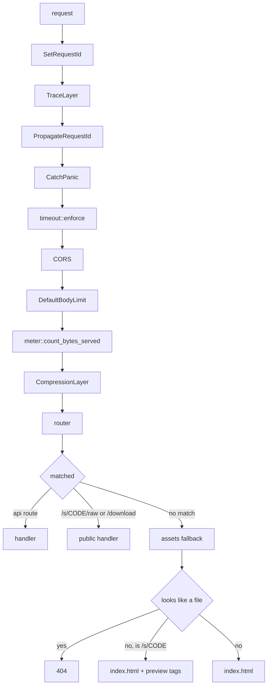

# A request, end to end

What wraps a handler, in what order, and why that order. Read this before adding middleware or wondering where a status code came from.

Code: `api/mod.rs` (assembly), `api/timeout.rs`, `api/meter.rs`, `error.rs`, `assets.rs`.

## The middleware stack

`.layer` wraps, so the **last call is the outermost**. A request enters at the top of this diagram and works down; a response goes back up.



### Why this order

| Layer | Position | Reason |
| --- | --- | --- |
| `SetRequestId` | outermost | Stamped before anything else, so every log line and every error response for this request correlates |
| `TraceLayer` | outside the panic catcher | A panic should still be traced |
| `CatchPanic` | outside the timeout | A panicking handler becomes a `500` rather than a dropped connection |
| `timeout::enforce` | inside the panic catcher | Reads the budget per request rather than holding the value it was built with, and exempts the routes that receive a file |
| `DefaultBodyLimit` | outside the meter | Refuses oversized bodies before anything counts them |
| `meter::count_bytes_served` | **outside** compression | Counts bytes on the wire, not bytes the handler produced |
| `CompressionLayer` | innermost | Closest to the handler, so the final body is compressed exactly once |

The metering position is measured, not assumed: for a 64 KiB run of one repeated character, the two counts differ by a factor of six hundred.

### The timeout is not a `TimeoutLayer`

A `TimeoutLayer` is built once from a configured value and holds it. Settings change without a restart, so the budget has to be read per request.

It is also the only place that can see which route a request is for before deciding whether a wall-clock budget applies at all. An upload receiving a large file over a slow link is not a stuck request.

## The SPA fallback

Anything the router does not match falls through to `assets`.

- A path with a file extension that does not exist is a `404`. `foo.js` missing means a broken build, not a client-side route.
- A path with no extension is a client-side route: serve `index.html`.
- `/s/{code}` is the one client-side route the server knows something about, because its link gets pasted where something will unfurl it. It gets `index.html` with preview tags spliced into the `<head>`; see `link-previews.md`.

The frontend is compiled into the binary with `rust-embed`. `server.assets_dir` serves from disk instead, for developing the frontend without a Rust rebuild.

## Errors

One `Error` enum in `error.rs`, one `ErrorCode` that clients branch on, and a body shape that never changes:

```json
{ "code": "value_length", "message": "...", "details": { "field": "password", "min": 12, "max": 1024, "actual": 7 } }
```

- **`code`** names the one thing that went wrong, in `snake_case`: `invalid_credentials`, `username_taken`, `share_expired`. It is what a client branches on and translates. The HTTP status says which class it is; the code says which case.
- **`message`** is English, for logs, the CLI and a client with no translation of the code. Free to change.
- **`details`** is always an object, holding what a translated message needs: which field, what the limit is, how long to wait. A field that broke a format rule carries the rule by name (`needs_digit`, `missing_at`), so the message can say which.

Every code is declared once, in the `error_codes!` list, with its status and its message; the list is the enum, so the OpenAPI document and the frontend's generated types carry every value. A handler refuses something with `Error::new(ErrorCode::…)`, and there is no variant that takes free text on its own, so nothing can be refused without a code. Tests in `error.rs` hold every code, and every rule name in this crate and the domain one, to `snake_case`.

Mapping happens in one place, so a handler returning `Err(Error::NotFound)` cannot accidentally produce a different status than another handler doing the same thing.

Internal failures in the database, the storage layer, IO or config all map to `internal` and a generic message. The detail goes to the log with the request ID, not to the caller.

## The OpenAPI document

`openapi.json` at the repository root is a build artefact of `api/mod.rs`, produced by the `tessera-openapi` binary. The frontend, the CLI and the Discord bot generate clients from it.

**A doc comment on a handler is its OpenAPI description.** Editing a comment changes the contract file, and `tests/contract.rs` will fail until it is regenerated:

```
cargo run --bin tessera-openapi
cargo insta accept
```

Two guarantees, deliberately separate: a snapshot catches accidental contract changes, and a drift check catches an intended change that was never written back to `openapi.json`.

### Why OpenAPI rather than a Rust-to-TypeScript exporter

- **The consumers are not all TypeScript.** A Discord bot, a CLI and ShareX read this too.
- **Half the public surface is not a procedure.** `/s/{code}/raw` answers `text/plain`; `/s/{code}/download` answers `206` with `Range`, `If-Range` and `Content-Disposition`. Those are HTTP contracts, not return types.
- **The browsable docs need it.** Scalar renders the document at `/docs`.
