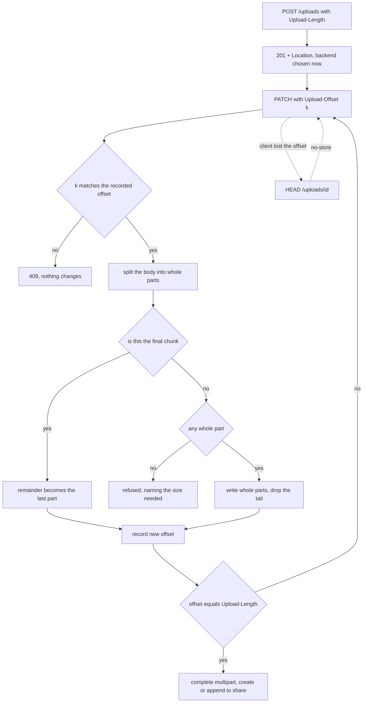

# Resumable uploads

An upload that survives a dropped connection. Speaks tus, which is the protocol every resumable-upload client already knows.

Code: `api/uploads.rs`, `upload/sink.rs`, `db/repository/upload.rs`.

## The protocol

```text
POST  /uploads         Upload-Length: N   → 201 + Location
HEAD  /uploads/{id}                       → 200 + Upload-Offset
PATCH /uploads/{id}    Upload-Offset: k   → 204 + Upload-Offset
```

Three rules from the spec are load-bearing:

- **A `PATCH` with a mismatched `Upload-Offset` answers `409` and changes nothing.** Without it, two clients writing the same upload interleave and the resulting file is neither of theirs.
- **`HEAD` must send `Cache-Control: no-store`.** A cached offset is a corrupted upload, and it is a proxy rather than the client that would cache it.
- **The offset the server reports is what the server accepted**, not what the client sent.

## The offset dance



## Two sinks

`object_store` has two ways to build one object from several requests, and only one works everywhere.

|               | `MultipartStore`                  | Local file        |
| ------------- | --------------------------------- | ----------------- |
| Backends      | aws, azure, gcp                   | `LocalFileSystem` |
| How           | part IDs that outlive the request | append to a file  |
| Offset is     | sum of accepted parts             | the file's length |
| Minimum chunk | one part (5 MiB floor)            | none              |
| Abort         | `abort_multipart`                 | `unlink`          |

`LocalFileSystem` has no multipart concept to expose, so there is nothing to work around: a file opened for appending _is_ a resumable upload.

## The part-size floor

S3 refuses every part but the last below 5 MiB. A client that sends 2 MiB and pauses leaves bytes that cannot become a part yet.

tusd parks those in a sibling `.part` object and prepends them on resume. **This does not.** Only whole parts are written; the offset reported back is the end of the last whole part. The client re-sends the tail.

The cost is bounded: at most one part, only after an interruption. What it buys is no second object with its own lifetime to create, find, prepend and clean up.

The final chunk is exempt: there the remainder _is_ the last part, and the last part may be short.

### The loop this could cause

A client that always sends less than one part would advance nothing and re-send from the same offset forever.

So a `PATCH` that was not the last and moved the offset by zero is refused, naming the size it needed. A tus client at its defaults sends the whole file in one `PATCH` and never meets this. One configured with a small chunk size does, and gets told rather than looping.

Only multipart stores have the floor. A local file takes whatever arrives.

### Naming confusion worth knowing

`upload::sink::REMAINDER_SUFFIX` is `".part"`, and it names the file the **local-disk** sink appends to. It is not the multipart remainder, which is never persisted.

## Destination is chosen at creation

`?code=` on the `POST` means "append to that share when this finishes". Leaving it off means "make a new one".

Deciding at creation rather than at completion means the finish step has no choices left to make.

## What does not happen here

**Resumable uploads do not split across backends.** They go through `place_resumable`, which picks one backend. The session declares its size up front so the planner would fit, but it needs `upload_segments` rows in state `planned` and a writer that survives across requests. See `splitting.md`.

## Cleanup

An abandoned session holds a real multipart upload, and S3 bills for its parts until someone aborts it. `maintenance` sweeps them; see `maintenance.md`.

The local sink's `.part` file is included in what the sweep considers live, so a session in progress is not collected out from under itself.

## Testing note

Garage enforces neither the 5 MiB floor nor equal part sizes, measured against `dxflrs/garage:v2.3.0`. So the CI run against a real store cannot catch a mistake in the part arithmetic. That arithmetic is pinned by unit tests in `upload/sink.rs` instead.
