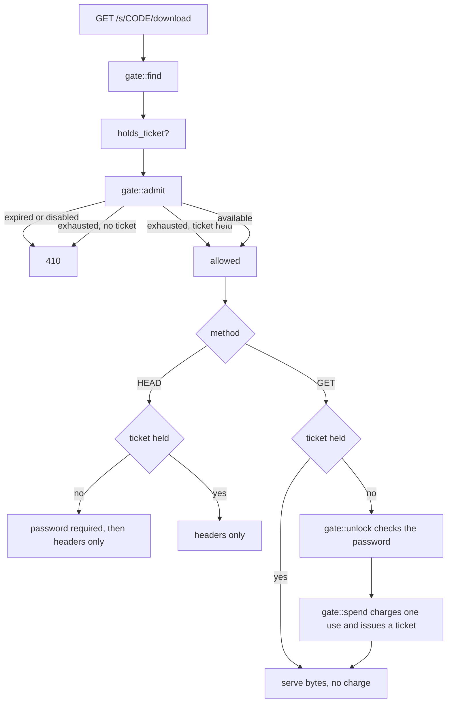

# Retrieval and counting

A share can expire, be password-protected, be disabled by an operator, and have a limited number of retrievals. Four routes read a share and all four must agree about those rules. If `/raw` skipped the password check, the password would be decorative.

All the checks live in `api/gate.rs`. Routes differ only in what they may do with the result.

## Where things are

| Piece | Where |
| --- | --- |
| All the checks | `api::gate` |
| Public routes | `api::public` (`/s/{code}/raw`, `/s/{code}/download`) |
| The share page and its metadata | `assets::serve_share_page`, `api::shares::show` |
| Download tickets | `db::repository::share_ticket` |
| Lookup and password throttles | `auth::throttle` |

## The four callers

| Route | What it needs | Consumes a use |
| --- | --- | --- |
| `GET /s/{code}` (the page) | `preview::lookup`, which touches no counters | no |
| `GET /api/v1/shares/{code}` | `gate::open` | no |
| `GET /s/{code}/raw` | `gate::find` + ticket logic | yes, once |
| `GET /s/{code}/download` | same | yes, once |

`gate::open` finds the share and refuses it if it is expired, disabled or exhausted. The transfer routes cannot use it. Whether a share may be handed out depends on whether the caller holds a ticket, and looking that up needs the share first, so they call `gate::find` and make the judgement themselves.

## Authorising and spending are separate

A download is not one request. `Range` makes it several. A dropped connection makes it several more. Browsers prefetch before anyone clicks.

If counting were per-request, a resumed download would burn three uses of a three-use share, and an interrupted transfer would destroy a burn-after-reading share before its reader saw anything.

So `gate::spend` charges once and returns a ticket. The ticket can be presented as many times as the transfer needs.

## Tickets outrank exhaustion, nothing else

Spending the last retrieval leaves the share exhausted _before_ any bytes have moved. Refusing on that would make a one-use share impossible to collect: the download that paid for it would be turned away by its own payment.

So `gate::admit` lets a ticket-holder through `Exhausted`.

It does **not** let them through `Expired` or `Disabled`. The difference is who decided:

- Exhausted. This reader's own retrieval coming back around.
- Expired. The uploader said "not after this".
- Disabled. An operator said "not any more".

A transfer still running when the share expires stops there.

## HEAD does not count

axum routes `HEAD` to the same handler as `GET`. Without an explicit branch, a link checker, a browser prefetch or a chat client probing the URL would spend someone's one-time share. That is the exact failure tickets exist to prevent, reached by a route nobody thinks about.

`HEAD` without a ticket still requires the password, because `HEAD` reveals the size and a locked share should not describe itself.

## Password handling

The password travels in the `X-Share-Password` header, not a query parameter. Query strings end up in access logs, shell history, and the `Referer` a page sends to whatever it links to next.

`gate::find` deliberately does not check the password. Argon2 verification is expensive and there is no reason to pay it for a share that already expired. `gate::unlock` does the check, and only after `admit` has passed.

Share passwords have a lower minimum than account passwords. A share password is a second factor on an already-unguessable link, and it gets read out over the phone. Four digits is a reasonable thing to want.

## Throttling

Two separate limits in `auth::throttle`:

- **Lookup.** How many unknown codes one source may try. Checked before the database query, so a refused source costs a comparison rather than a round trip.
- **Password.** How many wrong passwords for a given share.

An unparsable code and an unused one return the same `404`. Distinguishing them would tell someone walking the code space which shapes are worth trying.

## Access logging

`record_access` runs at the one point both transfer routes agree content is being handed over. `HEAD` does not reach it, for the same reason it does not spend a use.

Logging failures are swallowed and logged as warnings. Optional record-keeping must not turn into an outage on the path that matters.

## Tested invariants

Test names, so the claims are checkable.

| Rule | Test |
| --- | --- |
| `HEAD` spends nothing | `a_head_request_describes_without_spending` |
| `HEAD` is not an access-log entry | `a_head_request_is_not_an_access` |
| A resumed transfer is charged once | `a_resumed_transfer_is_charged_once` |
| A ticket belongs to one share | `a_ticket_does_not_travel_between_shares` |
| A ticket does not outrank an expiry | `a_ticket_does_not_outlive_the_expiry` |
| A ticket does not outrank a disable | `a_ticket_does_not_survive_a_disable` |
| The retrieval that empties a share still collects it | `a_one_time_share_survives_the_unlock_that_emptied_it` |
| A one-use share is gone afterwards | `a_one_time_share_is_gone_after_its_retrieval` |
| A wrong password does not burn the link | `a_rejected_password_does_not_burn_the_link` |
| Asking the wrong route spends nothing | `asking_the_wrong_route_does_not_spend_a_retrieval` |

All in `apps/server/tests/shares.rs`, except the password one which is in `auth.rs`.

Link previews spend nothing either. See `link-previews.md`.
