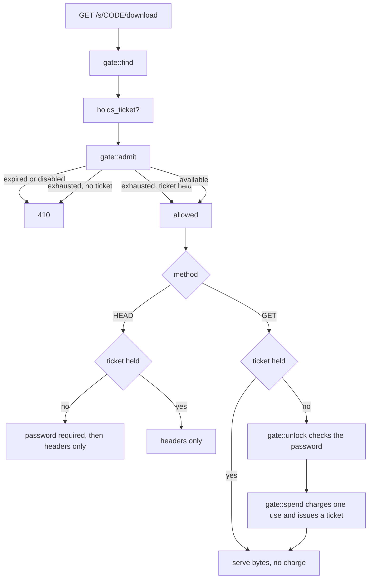

# Retrieval and counting

A share can expire, be password-protected, be disabled by an operator, and have a limited number of retrievals. Four routes read a share and all four must agree about those rules. If `/raw` skipped the password check, the password would be decorative.

All the checks live in `api/gate.rs`. Routes differ only in what they may do with the result.

## Where things are

| Piece | Where |
| --- | --- |
| All the checks | `api::gate` |
| Public routes | `api::public` (`/s/{code}/raw`, `/s/{code}/download`) |
| The share page and its metadata | `assets::serve_share_page`, `api::shares::show` |
| Download tickets | `db::repository::share_ticket` |
| Lookup and password throttles | `auth::throttle` |

## The four callers

| Route | What it needs | Consumes a use |
| --- | --- | --- |
| `GET /s/{code}` (the page) | `preview::lookup`, which touches no counters | no |
| `GET /api/v1/shares/{code}` | `gate::open` | no |
| `GET /s/{code}/raw` | `gate::find` + ticket logic | yes, once |
| `GET /s/{code}/download` | same | yes, once |

`gate::open` finds the share and refuses it if it is expired, disabled or exhausted. The transfer routes cannot use it. Whether a share may be handed out depends on whether the caller holds a ticket, and looking that up needs the share first, so they call `gate::find` and make the judgement themselves.

## Authorising and spending are separate



A download is not one request. `Range` makes it several. A dropped connection makes it several more. Browsers prefetch before anyone clicks.

If counting were per-request, a resumed download would burn three uses of a three-use share, and an interrupted transfer would destroy a burn-after-reading share before its reader saw anything.

So `gate::spend` charges once and returns a ticket. The ticket can be presented as many times as the transfer needs.

## Tickets outrank exhaustion, nothing else

Spending the last retrieval leaves the share exhausted _before_ any bytes have moved. Refusing on that would make a one-use share impossible to collect: the download that paid for it would be turned away by its own payment.

So `gate::admit` lets a ticket-holder through `Exhausted`.

It does **not** let them through `Expired` or `Disabled`. The difference is who decided:

- Exhausted. This reader's own retrieval coming back around.
- Expired. The uploader said "not after this".
- Disabled. An operator said "not any more".

A transfer still running when the share expires stops there.

## HEAD does not count

axum routes `HEAD` to the same handler as `GET`. Without an explicit branch, a link checker, a browser prefetch or a chat client probing the URL would spend someone's one-time share. That is the exact failure tickets exist to prevent, reached by a route nobody thinks about.

`HEAD` without a ticket still requires the password, because `HEAD` reveals the size and a locked share should not describe itself.

## Password handling

The password travels in the `X-Share-Password` header, not a query parameter. Query strings end up in access logs, shell history, and the `Referer` a page sends to whatever it links to next.

`gate::find` deliberately does not check the password. Argon2 verification is expensive and there is no reason to pay it for a share that already expired. `gate::unlock` does the check, and only after `admit` has passed.

Share passwords have a lower minimum than account passwords. A share password is a second factor on an already-unguessable link, and it gets read out over the phone. Four digits is a reasonable thing to want.

## Throttling

Two separate limits in `auth::throttle`:

- **Lookup.** How many unknown codes one source may try. Checked before the database query, so a refused source costs a comparison rather than a round trip.
- **Password.** How many wrong passwords for a given share.

An unparsable code and an unused one return the same `404`. Distinguishing them would tell someone walking the code space which shapes are worth trying.

## Access logging

`record_access` runs at the one point both transfer routes agree content is being handed over. `HEAD` does not reach it, for the same reason it does not spend a use.

Logging failures are swallowed and logged as warnings. Optional record-keeping must not turn into an outage on the path that matters.

## Tested invariants

Test names, so the claims are checkable.

| Rule | Test |
| --- | --- |
| `HEAD` spends nothing | `a_head_request_describes_without_spending` |
| `HEAD` is not an access-log entry | `a_head_request_is_not_an_access` |
| A resumed transfer is charged once | `a_resumed_transfer_is_charged_once` |
| A ticket belongs to one share | `a_ticket_does_not_travel_between_shares` |
| A ticket does not outrank an expiry | `a_ticket_does_not_outlive_the_expiry` |
| A ticket does not outrank a disable | `a_ticket_does_not_survive_a_disable` |
| The retrieval that empties a share still collects it | `a_one_time_share_survives_the_unlock_that_emptied_it` |
| A one-use share is gone afterwards | `a_one_time_share_is_gone_after_its_retrieval` |
| A wrong password does not burn the link | `a_rejected_password_does_not_burn_the_link` |
| Asking the wrong route spends nothing | `asking_the_wrong_route_does_not_spend_a_retrieval` |

All in `apps/server/tests/shares.rs`, except the password one which is in `auth.rs`.

Link previews spend nothing either. See `link-previews.md`.

## Held for a scan

With a malware scanner configured, content waits for its verdict before it is handed out. `/raw`, `/download`, `/segments` and `unlock` answer `423` with `Retry-After` until then, and check before `permit`, so being turned away never spends a retrieval. See `scanning.md`.

## One file of several

A share with several files downloads as an archive. `?file=N`, the file's position from zero, asks for that file alone: served as itself, under its own name, resumable, with no archive around it. The same parameter narrows `/segments` and `/segments/{i}` to that file.

An end-to-end encrypted file share has to use it on `/download`, whether it holds one file or several. An archive of sealed files is nothing an archiver can open. Requiring it of every encrypted file share, and not only those with several files, means the refusal needs nothing the share does not already say publicly, so it is decided before a retrieval is spent and without giving away a locked share's file count. `/raw` refuses an encrypted note for the same kind of reason: sealed bytes labelled as text are nothing a reader can use. See `encryption.md`.

Tested by `an_encrypted_share_is_fetched_one_file_at_a_time` and `one_file_of_a_plain_share_comes_without_an_archive`.

## Sent to the store

A download can be answered with `307` to the store itself, so its bytes never cross this server. Only when all of these hold:

- the share has **no password and no use limit**
- it is **one file in one piece**: an archive does not exist until it is sent, and a split file is several objects
- its backend has **direct access** switched on, and is S3 or GCS
- the store's clock is close enough to trust (see below)
- it is a `GET`: a `HEAD` is not a download

Anything that does not hold is served from here, as before. Being sent somewhere is an optimisation, and failing to be is not an error.

### Why never a password or a use limit

A URL to the store is a bearer credential for its lifetime. On a password-protected share it would be a copy of the file that needs no password; on a one-time share, a second collection the count never sees. A presigned URL cannot be limited to one use or one client, so neither can be repaired at the store. Doing that needs a stateful gateway in front of the store, which is not something this server can assume exists.

### The URL lives fifteen seconds, by the store's clock

Long enough to start the transfer, which the store then finishes however long it takes, and short enough that a URL copied out of a browser is not much of a gift. A resumed download comes back here and gets a fresh one.

The store judges those seconds by its own clock, so `storage::clock` measures it: a signed `HEAD` for an object that does not exist, reading the `Date` the store answers with. A store ahead gets what it is ahead added on. One more than ten seconds behind, or that cannot be measured, is not sent anybody. Measured at most every ten minutes per backend.

### What is counted

`permit` runs first, so the expiry check and the access log happen exactly as for a served download.

What the request asked for goes into `bytes_redirected`: the file's size, or the range's length. Requested, not delivered, because the store does not say what it sent. `bytes_served` stays what left this process, which for a redirect is nothing; folding requested sizes into it would count abandoned downloads in full, the one thing it was built not to do.

The redirect carries `Cache-Control: no-store`. A cached redirect replays an expired URL and skips everything checked on the way to it.

### What the store's answer carries

The file name and `application/octet-stream` are signed into the URL (`response-content-disposition`, `response-content-type`), so the store answers with the same name and type this server would. The hardening headers `serve` adds (`nosniff`, the CSP) cannot travel that way; an attachment of an opaque type is what keeps a browser from rendering it.

## Joining the pieces in the browser

A file split across backends is several objects, and one URL names one object, so `/download` serves it from here. The browser can save that bandwidth by fetching each piece itself:

```text
GET /s/{code}/segments        → { "size_bytes": N, "segments": [ { "offset": 0, "length": … }, … ] }
GET /s/{code}/segments/{i}    → 307 to the store, for that piece
```

Both answer `404` unless **every** piece could be fetched directly, by the rules the section above keeps. A file half of which can be fetched is one the browser would join and then fail to finish, so it is not offered at all, and a client that gets a `404` uses `/download` as it did before.

A file that was never split lists one piece. That is deliberate: a client joins every share the same way rather than asking which kind it has.

**The listing carries no URLs.** One lives fifteen seconds and joining a large file takes minutes, so a list of them would be a list of expired URLs by the time the browser reached the end. Each piece is asked for when it is wanted.

Neither endpoint costs a retrieval, for the same reason a `HEAD` does not: describing a layout is not handing anything over. Each piece handed over counts its own length in `bytes_redirected`.

**This one needs bucket CORS.** Following a redirect from a link is a navigation; fetching a piece from a script is a cross-origin request, so the bucket has to allow `GET` (and `Range`) from the site's origin. See `storage.md`.

