# tessera

## Tables

| Name | Columns | Comment | Type |
| ---- | ------- | ------- | ---- |
| [schema_metadata](schema_metadata.md) | 3 | Which version wrote this database. Read at start-up to refuse a downgrade. | table |
| [users](users.md) | 13 | Accounts. An empty `role_id` means signed in and allowed nothing, which is a real state rather than a fault. A deleted account leaves a scrubbed row behind rather than disappearing, because `shares.user_id` points at it and "nobody uploaded this" is a different fact from "whoever uploaded it is gone". | table |
| [sessions](sessions.md) | 11 | One sign-in. Expired rows stay, because this table is also the sign-in history and a person needs to be able to see whether somebody else got in. Real removal is `auth.login_history_days`. `origin` says which credential started it, so a provider signing somebody out can end the sessions it issued and leave password ones alone. `provider_sid` is the provider's own identifier for its side, when it released one. | table |
| [api_tokens](api_tokens.md) | 9 | Credentials for programs. Only a digest is stored; the value itself stops existing the moment it is handed over. | table |
| [shares](shares.md) | 24 | One share, whatever it holds. The code, the password, the counters and the expiry live here because those rules do not depend on the content. The content does not: it is in `file_shares` and `text_shares`, because a share can hold several files and a column cannot hold several. `role_id` is the role at the moment of upload, `guest` for anonymous, so changing somebody's role later does not retroactively change who an old share counted against. `user_id` being empty means either anonymous or an uploader whose account was deleted, and nothing tells the two apart. `bytes_served` counts bytes that left this process, not bytes that arrived: a proxy in front inflates it by whatever it holds, and a request a CDN answered is never seen at all. `bytes_redirected` is what downloads sent to the store asked for: requested, not delivered, and kept apart from `bytes_served`, which counts only what left this process. | table |
| [share_tickets](share_tickets.md) | 5 | The pass handed out after a correct password. It exists so that seeing and fetching stay separate: a preview should not spend one of a share's downloads. | table |
| [password_reset_tokens](password_reset_tokens.md) | 6 | One-shot links for setting a password. | table |
| [pending_registrations](pending_registrations.md) | 8 | A registration waiting on its address. The account does not exist until the mail is opened, so what would become one waits here instead. That is also what keeps "is this address registered" from being a question anyone can ask. | table |
| [invites](invites.md) | 7 | Invitation codes. Digests only, as above. | table |
| [file_shares](file_shares.md) | 12 | One file of a file share. One row per share today; `position` is there for when a share can hold several. | table |
| [text_shares](text_shares.md) | 5 | The text of a text share. `content` cannot be null, because "the text is somewhere else" is the state this table exists to make impossible. | table |
| [roles](roles.md) | 8 | The name of a set of permissions. Nothing else decides who may do what. | table |
| [role_permissions](role_permissions.md) | 2 | Which permissions a role holds. The permissions themselves are defined in code rather than stored, because granting one nothing checks grants nothing. | table |
| [api_token_permissions](api_token_permissions.md) | 2 | What one token may do. What it can actually do is the intersection of this and its owner's permissions, so demoting a person narrows every token they hold at the same moment. | table |
| [uploads](uploads.md) | 15 | A file still arriving. A half-uploaded thing is not a `file_shares` row, because every row of that table is content somebody can fetch and this is not yet. `object_key` is chosen when the upload opens and never recomputed, so a resumed upload writes back to the same place. `declared_bytes` is what the client said, and quota counts that rather than what has arrived, or two people could claim the same free space at once. | table |
| [access_events](access_events.md) | 5 | Who fetched which share, and when. Off by default. A counter is one integer and says nothing about who went where; a row here is an address and a browser string about somebody who followed a link and agreed to nothing. Anonymity is part of why people choose this software, so turning it on is the operator's decision rather than one a default made for them, and it needs saying on the page, because the people being recorded are the last to know. `ip_address` can be null: behind an untrusted proxy the visible address is the proxy's, and recording it would be recording the wrong party. | table |
| [settings](settings.md) | 3 | Settings changed from the panel, one row each. The load order is defaults, then the file, then the environment, then this, and this wins: it is the only layer somebody deliberately changed on this machine. Only what can take effect without a restart is here. A bound socket, a built connection pool and an installed log subscriber cannot, so those live in the environment, and the panel never has to say "saved, now restart". Secrets are excluded too: a stored one is plaintext in a table and comes back out of whatever endpoint reads settings. The column is `name` rather than `key` because `key` is reserved in MySQL. | table |
| [file_segments](file_segments.md) | 7 | Where the bytes of one file actually are: a backend, a key, an offset and a length. A list rather than a column pair, because a file too large for any single backend has to be spread across several. Every row has one segment until splitting is turned on. `backend` is a name rather than a foreign key on purpose: the set of backends is configuration, and a row naming one nobody configures any more has to be readable enough to say so instead of failing at start-up. | table |
| [storage_backends](storage_backends.md) | 9 | A blob store this instance can write to, added from the panel. The credentials are sealed with `security.secret_key`, which comes from the environment, so a database dump on its own opens nothing. Without a key, adding a backend is refused rather than written in plaintext. The name is the primary key because `file_segments.backend` names it and that reference has to stay readable after the row is gone. `direct_access` says whether a browser may be sent to the store directly, for a download or an upload's parts; off unless an operator turns it on, because only they know whether a browser can reach it. | table |
| [upload_segments](upload_segments.md) | 10 | Where a resumable upload is putting each piece, when it is spread over more than one backend. A `complete` segment is holding real space in a real bucket while its share does not exist yet, and nothing else could see that: the space was spent, the planner could not count it, and a free-tier bucket filled up with no query able to explain why. Cleaning up means aborting every `open` row and deleting the object behind every `complete` one. | table |
| [upload_parts](upload_parts.md) | 4 | Each part a store has accepted for a multipart upload. Kept because completing one means handing every part back exactly as it was, and no way of listing them is agreed on by all three clouds. A local filesystem has no rows here; it appends. | table |
| [identities](identities.md) | 4 | One way an account signs in through a provider. Keyed on `(provider, subject)` because the subject is the provider's own identifier for the person: stable, and never reused within one issuer. An address is not, since providers let people change theirs and some never check it. The `provider` column exists so a second provider is configuration rather than a migration. | table |
| [credentials](credentials.md) | 4 | One password, for an account that has one. A side table rather than a column on `users`, because `identities` is already one row per way of signing in and a password as a column would make one method a column and the other a row. No row means no password, which is exactly what an account that has only ever used a provider is. | table |
| [auth_flows](auth_flows.md) | 10 | A sign-in that has left for a provider and has not come back. Holds the CSRF token, the PKCE secret, and the nonce when the provider issues one, until the callback arrives; then the row is deleted, which is what makes a callback answerable once. A table rather than a signed cookie: a cookie would have to be `SameSite=Lax` exactly, because `Strict` withholds it on the navigation back from the provider and that failure looks like an unrelated error. `nonce` is null for a plain OAuth 2.0 provider, which issues no token to put one in. | table |
| [user_preferences](user_preferences.md) | 3 | One person's own choices, one row each. So far that is appearance: a mode, a neutral theme and an accent, held as JSON because language and time zone are already asked for and each would otherwise be a migration. Every field is optional, and absent means no opinion: somebody who picked only an accent keeps following the instance's default for the rest, including after the operator changes it. The names come from fixed lists in `tessera_core::appearance` and are checked before they are stored, because they end up as attributes on the `<html>` element. No colour is ever stored; each name selects a block of CSS that ships with the frontend. | table |
| [email_verifications](email_verifications.md) | 7 |  | table |
| [stats_snapshots](stats_snapshots.md) | 6 |  | table |
| [totp_authenticators](totp_authenticators.md) | 5 | An account's authenticator app, one at most. The secret is sealed with `security.secret_key` rather than hashed, because checking a code means computing it. `confirmed_at` is null while it is being set up, and then sign-in does not ask for a code, so a QR code scanned wrong cannot lock anybody out. `last_used_step` refuses the same code twice. | table |
| [recovery_codes](recovery_codes.md) | 5 | Single-use codes for an account whose authenticator is lost. Only the SHA-256 of each is stored. A used one keeps its row with `used_at` set, so how many are left can be counted. | table |
| [mfa_challenges](mfa_challenges.md) | 4 | A sign-in that passed its password and waits for a code. Keyed on the digest of the ticket the client holds, and deleted when the sign-in finishes, so a ticket works once. A row rather than a session with a flag, so nothing that accepts a session can mistake half a sign-in for a whole one. | table |
| [passkeys](passkeys.md) | 11 | Passkeys: a fingerprint, a face or a hardware key in place of a password. Holds the credential id and its public key exactly as the authenticator sent it, a COSE structure, so nothing here depends on how the server checks one and a dump lets nobody in. Looked up by `credential_hash`, the SHA-256 of the id, because an id can be longer than MySQL will index. `sign_count` going backwards means two copies of one key; most synced passkeys keep it at zero. | table |
| [webauthn_challenges](webauthn_challenges.md) | 5 | A challenge handed to a browser and not yet answered. Keyed on its digest and deleted when answered, so each works once. `purpose` keeps a sign-in challenge from registering a key, and `user_id` says whose account a registration adds to; a sign-in has none until the answer names one. | table |
| [device_authorizations](device_authorizations.md) | 10 | A program without a browser, such as the command line client, waiting for a person to approve it from one that has. The program holds the device code and only its digest is stored; the person types the short `user_code` on the site. Approval records who and with which permissions, and the token itself is minted when the program next asks, so the table never holds a usable secret. Deleted on redemption. | table |
| [webhooks](webhooks.md) | 7 |  | table |
| [webhook_deliveries](webhook_deliveries.md) | 10 |  | table |

## Relations

```mermaid
erDiagram

"users" }o--o| "roles" : ""
"users" }o--o| "users" : ""
"sessions" }o--|| "users" : ""
"api_tokens" }o--|| "users" : ""
"shares" }o--o| "roles" : ""
"shares" }o--o| "users" : ""
"share_tickets" }o--|| "shares" : ""
"password_reset_tokens" }o--|| "users" : ""
"file_shares" }o--|| "shares" : ""
"text_shares" |o--|| "shares" : ""
"role_permissions" |o--|| "roles" : ""
"api_token_permissions" |o--|| "api_tokens" : ""
"uploads" }o--o| "roles" : ""
"uploads" }o--o| "users" : ""
"uploads" }o--o| "shares" : ""
"access_events" }o--|| "shares" : ""
"file_segments" |o--|| "file_shares" : ""
"upload_segments" |o--|| "uploads" : ""
"upload_parts" |o--|| "uploads" : ""
"identities" }o--|| "users" : ""
"credentials" |o--|| "users" : ""
"auth_flows" }o--o| "users" : ""
"user_preferences" |o--|| "users" : ""
"email_verifications" }o--|| "users" : ""
"totp_authenticators" |o--|| "users" : ""
"recovery_codes" }o--|| "users" : ""
"mfa_challenges" }o--|| "users" : ""
"passkeys" }o--|| "users" : ""
"webauthn_challenges" }o--o| "users" : ""
"device_authorizations" }o--o| "users" : ""
"webhooks" }o--o| "users" : ""
"webhook_deliveries" }o--|| "webhooks" : ""

"schema_metadata" {
  TEXT key PK
  TEXT value
  INTEGER updated_at
}
"users" {
  TEXT id PK
  TEXT username
  TEXT email
  INTEGER must_change_password
  TEXT email_verified_at
  TEXT created_at
  TEXT updated_at
  TEXT state
  TEXT deleted_at
  TEXT deleted_by FK
  TEXT role_id FK
  INTEGER quota_bytes
  INTEGER max_file_bytes
}
"sessions" {
  TEXT id PK
  TEXT user_id FK
  TEXT secret_hash
  TEXT created_at
  TEXT last_seen_at
  TEXT expires_at
  TEXT created_ip
  TEXT created_user_agent
  TEXT ended_reason
  TEXT origin
  TEXT provider_sid
}
"api_tokens" {
  TEXT id PK
  TEXT user_id FK
  TEXT name
  TEXT secret_hash
  TEXT display_prefix
  TEXT created_at
  TEXT last_used_at
  TEXT expires_at
  TEXT revoked_at
}
"shares" {
  TEXT id PK
  TEXT code
  TEXT user_id FK
  TEXT kind
  TEXT password_hash
  INTEGER use_limit
  INTEGER use_count
  TEXT expires_at
  TEXT disabled_at
  TEXT title
  TEXT og_config
  TEXT management_token_hash
  INTEGER view_count
  TEXT last_accessed_at
  TEXT created_at
  TEXT updated_at
  INTEGER copy_count
  INTEGER bytes_served
  TEXT role_id FK
  INTEGER bytes_redirected
  TEXT encryption
  TEXT key_salt
  TEXT sealed_details
  TEXT end_announced_at
}
"share_tickets" {
  TEXT id PK
  TEXT share_id FK
  TEXT secret_hash
  TEXT created_at
  TEXT expires_at
}
"password_reset_tokens" {
  TEXT id PK
  TEXT user_id FK
  TEXT secret_hash
  TEXT created_at
  TEXT expires_at
  TEXT used_at
}
"pending_registrations" {
  TEXT id PK
  TEXT username
  TEXT email
  TEXT password_hash
  TEXT secret_hash
  TEXT created_at
  TEXT expires_at
  TEXT invite_id
}
"invites" {
  TEXT id PK
  TEXT code_hash
  TEXT note
  INTEGER max_uses
  INTEGER used
  TEXT created_at
  TEXT expires_at
}
"file_shares" {
  TEXT id PK
  TEXT share_id FK
  INTEGER position
  TEXT filename
  TEXT content_type
  INTEGER size_bytes
  TEXT storage
  TEXT object_key
  TEXT created_at
  TEXT sealed_name
  TEXT scan_state
  TEXT scan_detail
}
"text_shares" {
  TEXT share_id PK
  TEXT language
  BLOB content
  TEXT scan_state
  TEXT scan_detail
}
"roles" {
  TEXT id PK
  TEXT name
  TEXT description
  INTEGER is_system
  TEXT created_at
  TEXT updated_at
  INTEGER quota_bytes
  INTEGER max_file_bytes
}
"role_permissions" {
  TEXT role_id PK
  TEXT permission PK
}
"api_token_permissions" {
  TEXT token_id PK
  TEXT permission PK
}
"uploads" {
  TEXT id PK
  TEXT share_id FK
  TEXT user_id FK
  TEXT token_hash
  TEXT filename
  TEXT content_type
  INTEGER declared_bytes
  INTEGER offset_bytes
  TEXT created_at
  TEXT updated_at
  TEXT expires_at
  TEXT role_id FK
  TEXT encryption
  TEXT key_salt
  TEXT sealed_name
}
"access_events" {
  TEXT id PK
  TEXT share_id FK
  TEXT occurred_at
  TEXT ip_address
  TEXT user_agent
}
"settings" {
  TEXT name PK
  TEXT value
  TEXT updated_at
}
"file_segments" {
  TEXT file_id PK
  INTEGER seq PK
  TEXT backend
  TEXT object_key
  INTEGER offset_bytes
  INTEGER length_bytes
  TEXT created_at
}
"storage_backends" {
  TEXT name PK
  TEXT url
  TEXT options
  INTEGER is_default
  TEXT created_at
  TEXT updated_at
  INTEGER capacity_bytes
  INTEGER read_only
  INTEGER direct_access
}
"upload_segments" {
  TEXT upload_id PK
  INTEGER seq PK
  TEXT backend
  TEXT object_key
  INTEGER offset_bytes
  INTEGER length_bytes
  TEXT multipart_id
  TEXT state
  TEXT created_at
  TEXT updated_at
}
"upload_parts" {
  TEXT upload_id PK
  INTEGER seq PK
  INTEGER part_number PK
  TEXT content_id
}
"identities" {
  TEXT provider PK
  TEXT subject PK
  TEXT user_id FK
  TEXT created_at
}
"credentials" {
  TEXT user_id PK
  TEXT password_hash
  TEXT created_at
  TEXT updated_at
}
"auth_flows" {
  TEXT state PK
  TEXT provider
  TEXT nonce
  TEXT verifier
  TEXT purpose
  TEXT user_id FK
  TEXT invite_code
  TEXT created_at
  TEXT expires_at
  TEXT return_to
}
"user_preferences" {
  TEXT user_id PK
  TEXT appearance
  TEXT updated_at
}
"email_verifications" {
  TEXT id PK
  TEXT user_id FK
  TEXT email
  TEXT secret_hash
  TEXT created_at
  TEXT expires_at
  TEXT used_at
}
"stats_snapshots" {
  TEXT day PK
  INTEGER stored_bytes
  INTEGER shares
  INTEGER live_shares
  INTEGER bytes_served
  TEXT recorded_at
}
"totp_authenticators" {
  TEXT user_id PK
  TEXT secret
  TEXT confirmed_at
  INTEGER last_used_step
  TEXT created_at
}
"recovery_codes" {
  TEXT id PK
  TEXT user_id FK
  TEXT code_hash
  TEXT created_at
  TEXT used_at
}
"mfa_challenges" {
  TEXT secret_hash PK
  TEXT user_id FK
  TEXT created_at
  TEXT expires_at
}
"passkeys" {
  TEXT id PK
  TEXT user_id FK
  TEXT credential_hash
  TEXT credential_id
  TEXT public_key
  INTEGER sign_count
  TEXT name
  INTEGER backup_eligible
  INTEGER backed_up
  TEXT created_at
  TEXT last_used_at
}
"webauthn_challenges" {
  TEXT secret_hash PK
  TEXT purpose
  TEXT user_id FK
  TEXT created_at
  TEXT expires_at
}
"device_authorizations" {
  TEXT device_code_hash PK
  TEXT user_code
  TEXT client_name
  TEXT requested_from
  TEXT user_id FK
  TEXT permissions
  TEXT approved_at
  TEXT denied_at
  TEXT created_at
  TEXT expires_at
}
"webhooks" {
  TEXT id PK
  TEXT user_id FK
  TEXT url
  TEXT events
  TEXT format
  TEXT secret
  TEXT created_at
}
"webhook_deliveries" {
  TEXT id PK
  TEXT webhook_id FK
  TEXT event
  TEXT body
  INTEGER attempts
  TEXT next_attempt_at
  TEXT delivered_at
  INTEGER last_status
  TEXT last_error
  TEXT created_at
}
```

---

> Generated by [tbls](https://github.com/k1LoW/tbls)
