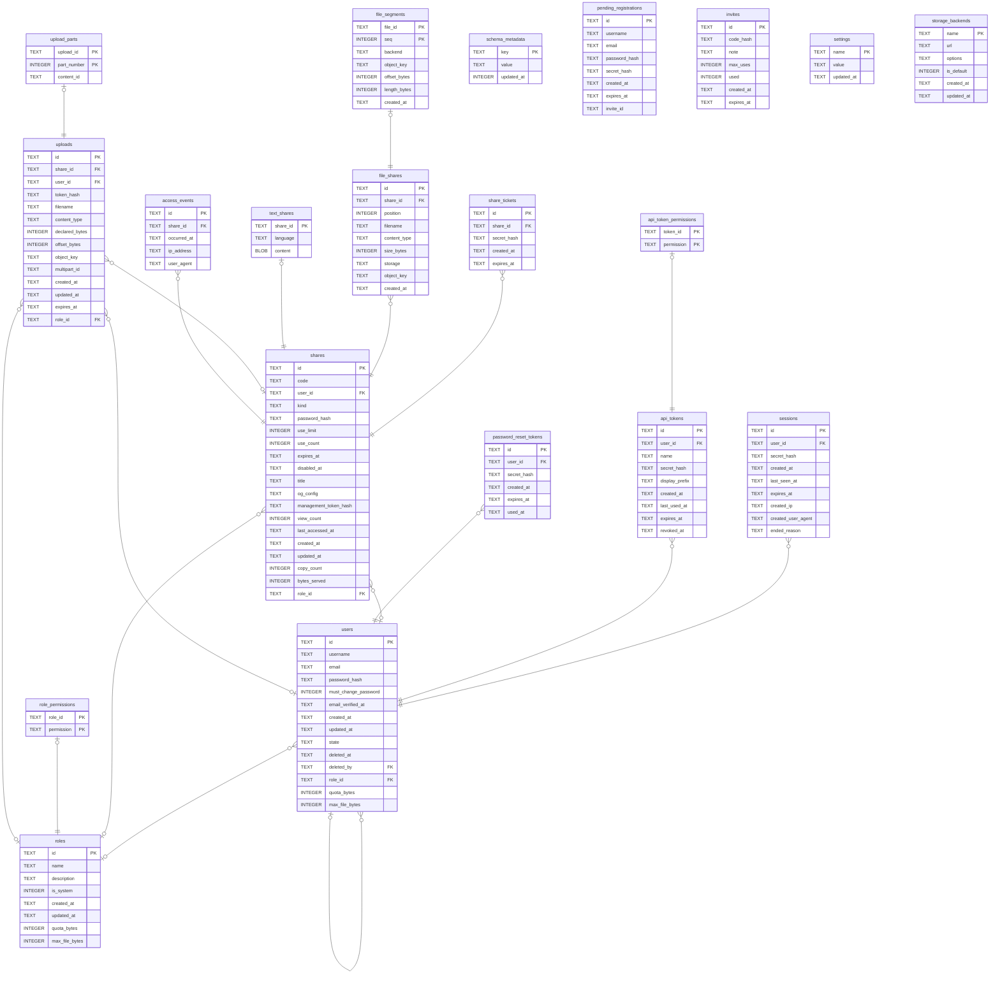

# tessera

## Tables

| Name | Columns | Comment | Type |
| ---- | ------- | ------- | ---- |
| [schema_metadata](schema_metadata.md) | 3 | 這個資料庫是哪一版寫的。降版啟動時用來擋下來。 | table |
| [users](users.md) | 14 | 帳號。role_id 是空的代表登入了但什麼都不能做,那是真的狀態不是錯誤。刪掉的不會消失,只會變成一列洗乾淨的殘骸——因為 shares.user_id 指著它,而「沒有人上傳過」和「上傳的人不在了」是兩件不同的事。 | table |
| [sessions](sessions.md) | 9 | 一次登入。過期了也留著,因為這張表同時是登入紀錄——使用者要看得出有沒有別人進來過。真正的清除靠 `auth.login_history_days`。 | table |
| [api_tokens](api_tokens.md) | 9 | 給程式用的憑證。只存摘要,原始值發出去之後就不再存在。 | table |
| [shares](shares.md) | 19 | 一次分享,不管內容是什麼。取用碼、密碼、次數、到期都在這裡,因為那些規則跟內容是什麼無關。內容完全不在這裡——它在 file_shares 和 text_shares,因為一份分享可以有好幾個檔案,而欄位裝不下「好幾個」。role_id 是上傳當下的角色快照,匿名上傳是 guest——事後改一個人的角色不會回溯改變舊分享算在誰頭上,而 user_id 是空同時代表「匿名」和「上傳者帳號被刪了」,分不出來。bytes_served 是「離開這個 process 的位元組」,不是「到達使用者的」——前面掛 proxy 的話它握著的那一小段會被多算,而 CDN 快取掉的請求根本不會被看到。 | table |
| [share_tickets](share_tickets.md) | 5 | 輸對密碼之後拿到的通行證。存在的理由是「看得到」和「拿得到」要分開——預覽頁不該花掉一次取用次數。 | table |
| [password_reset_tokens](password_reset_tokens.md) | 6 | 重設密碼的一次性連結。 | table |
| [pending_registrations](pending_registrations.md) | 8 | 還沒驗證的註冊。帳號在信件被點開之前不存在,所以資料先放這裡——這樣「這個 email 註冊了沒」問不出來。 | table |
| [invites](invites.md) | 7 | 邀請碼。同樣只存摘要。 | table |
| [file_shares](file_shares.md) | 9 | 檔案分享的每一個檔案。現在一次分享一列,#42 之後會是多列,`position` 就是為此存在的。 | table |
| [text_shares](text_shares.md) | 3 | 文字分享的內容本身。`content` 不可為空——「文字的內容在別的地方」正是這張表要消滅的狀態。 | table |
| [roles](roles.md) | 8 | 一組權限的名字。誰能做什麼只由這裡決定,沒有別的地方。 | table |
| [role_permissions](role_permissions.md) | 2 | 角色包含哪些權限。權限本身是程式定義的,不是資料——沒有人檢查的權限給了也是空的。 | table |
| [api_token_permissions](api_token_permissions.md) | 2 | 一張 token 能做什麼。實際生效的是這裡跟主人權限的交集,所以主人被降權,他手上的 token 同時就窄了。 | table |
| [uploads](uploads.md) | 14 | 還在傳的檔案。一份還沒傳完的東西不是 file_shares 的一列——那張表的每一列都代表「拿得到的內容」,而這裡的東西還拿不到。object_key 開檔時就決定,之後不再重算,因為續傳要能接回同一個位置。declared_bytes 是客戶端宣告的大小,配額算的是這個而不是已經到的,不然兩個人可以同時宣告用光同一份空間。 | table |
| [upload_parts](upload_parts.md) | 3 | 分片上傳裡 store 已經收下的每一片。存著是因為 complete_multipart 要把每一片原封不動交回去,而沒有一種列法是三家雲端都同意的。本地檔案系統不會有這裡的列——它用 append。 | table |
| [access_events](access_events.md) | 5 | 誰在什麼時候取走了哪一份分享。預設不寫——計數器是一個整數,不會透露誰去過哪裡;這裡的一列是位址加瀏覽器字串,關於一個拿到連結、什麼都沒答應過的人。匿名是有人選這套軟體的理由之一,所以把它關掉是操作者的決定,不是預設值幫他做的。開了要在頁面上講,被記錄的人是最後一個知道的。ip_address 可以是 NULL——前面掛著不受信任的 proxy 時,看得到的位址是 proxy 的,記下去等於記錯人。 | table |
| [settings](settings.md) | 3 | 從後台改過的設定,一列一個。載入順序是 預設 → 設定檔 → 環境變數 → 這裡,這裡贏——因為它是唯一一層有人在這台機器上刻意改過的,其他都跟著部署來(image 自己就設了六個環境變數)。只放能熱改的東西:socket 已經 bind 的、pool 已經建好的(而且讀這張表需要它)、log subscriber 開機裝一次的,都不在這裡,那些走環境變數。所以後台永遠不用說「存好了請重啟」。機密也不放,會明文躺在這裡而且會被 API 回出去。欄位叫 name 不叫 key,因為 key 是 MySQL 保留字。 | table |
| [file_segments](file_segments.md) | 7 |  | table |
| [storage_backends](storage_backends.md) | 6 |  | table |

## Relations

---

> Generated by [tbls](https://github.com/k1LoW/tbls)
