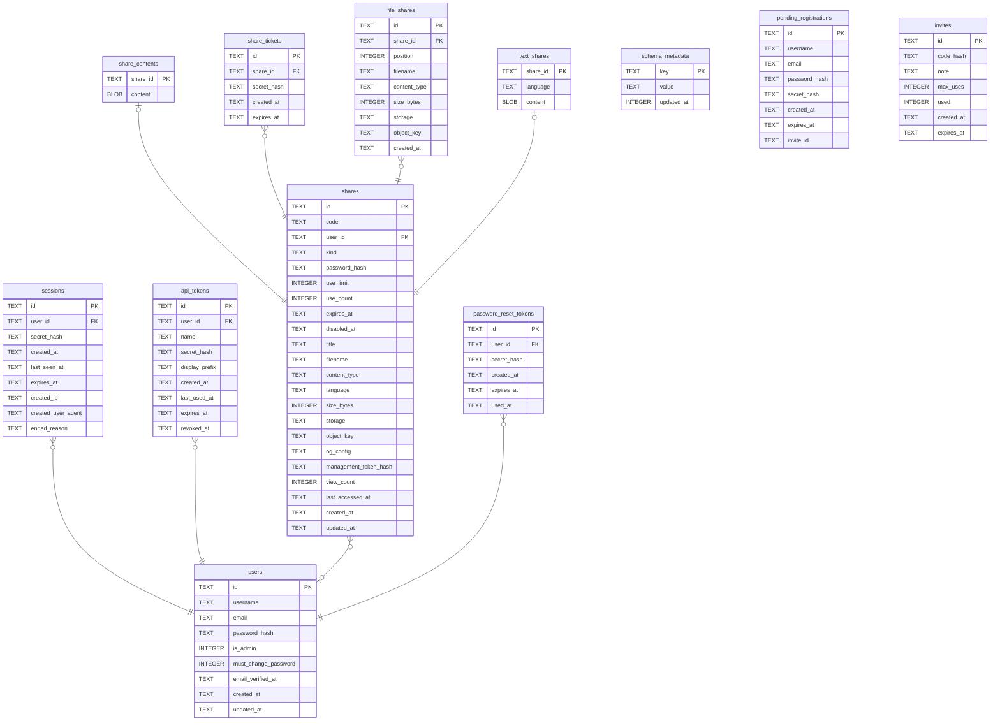

# tessera

## Tables

| Name | Columns | Comment | Type |
| ---- | ------- | ------- | ---- |
| [schema_metadata](schema_metadata.md) | 3 | 這個資料庫是哪一版寫的。降版啟動時用來擋下來。 | table |
| [users](users.md) | 9 | 帳號。 | table |
| [sessions](sessions.md) | 9 | 一次登入。過期了也留著,因為這張表同時是登入紀錄——使用者要看得出有沒有別人進來過。真正的清除靠 `sessions_retention_days`。 | table |
| [api_tokens](api_tokens.md) | 9 | 給程式用的憑證。只存摘要,原始值發出去之後就不再存在。 | table |
| [shares](shares.md) | 22 | 一次分享,不管內容是什麼。取用碼、密碼、次數、到期都在這裡,因為那些規則跟內容是什麼無關。內容本身在下面那幾張表。 | table |
| [share_contents](share_contents.md) | 2 | 舊的內容欄位,正在退場。內容改由上面兩張表持有,這張表等讀取端完全切換之後會刪掉。 | table |
| [share_tickets](share_tickets.md) | 5 | 輸對密碼之後拿到的通行證。存在的理由是「看得到」和「拿得到」要分開——預覽頁不該花掉一次取用次數。 | table |
| [password_reset_tokens](password_reset_tokens.md) | 6 | 重設密碼的一次性連結。 | table |
| [pending_registrations](pending_registrations.md) | 8 | 還沒驗證的註冊。帳號在信件被點開之前不存在,所以資料先放這裡——這樣「這個 email 註冊了沒」問不出來。 | table |
| [invites](invites.md) | 7 | 邀請碼。同樣只存摘要。 | table |
| [file_shares](file_shares.md) | 9 | 檔案分享的每一個檔案。現在一次分享一列,#42 之後會是多列,`position` 就是為此存在的。 | table |
| [text_shares](text_shares.md) | 3 | 文字分享的內容本身。`content` 不可為空——「文字的內容在別的地方」正是這張表要消滅的狀態。 | table |

## Relations

---

> Generated by [tbls](https://github.com/k1LoW/tbls)
