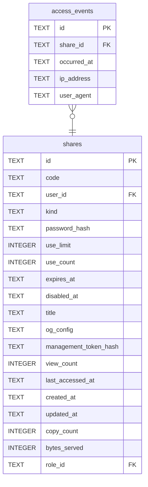

# access_events

## Description

Who fetched which share, and when. Off by default. A counter is one integer and says nothing about who went where; a row here is an address and a browser string about somebody who followed a link and agreed to nothing. Anonymity is part of why people choose this software, so turning it on is the operator's decision rather than one a default made for them, and it needs saying on the page, because the people being recorded are the last to know. `ip_address` can be null: behind an untrusted proxy the visible address is the proxy's, and recording it would be recording the wrong party.

<details>
<summary><strong>Table Definition</strong></summary>

```sql
CREATE TABLE access_events (
    id           TEXT NOT NULL PRIMARY KEY,
    share_id     TEXT NOT NULL REFERENCES shares (id) ON DELETE CASCADE,
    occurred_at  TEXT NOT NULL,
    -- What the request looked like. Both are what the caller presented.
    ip_address   TEXT,
    user_agent   TEXT
)
```

</details>

## Columns

| Name | Type | Default | Nullable | Children | Parents | Comment |
| ---- | ---- | ------- | -------- | -------- | ------- | ------- |
| id | TEXT |  | false |  |  |  |
| share_id | TEXT |  | false |  | [shares](shares.md) |  |
| occurred_at | TEXT |  | false |  |  |  |
| ip_address | TEXT |  | true |  |  |  |
| user_agent | TEXT |  | true |  |  |  |

## Constraints

| Name | Type | Definition |
| ---- | ---- | ---------- |
| id | PRIMARY KEY | PRIMARY KEY (id) |
| - (Foreign key ID: 0) | FOREIGN KEY | FOREIGN KEY (share_id) REFERENCES shares (id) ON UPDATE NO ACTION ON DELETE CASCADE MATCH NONE |
| sqlite_autoindex_access_events_1 | PRIMARY KEY | PRIMARY KEY (id) |

## Indexes

| Name | Definition |
| ---- | ---------- |
| idx_access_events_share | CREATE INDEX idx_access_events_share ON access_events (share_id, occurred_at) |
| idx_access_events_occurred | CREATE INDEX idx_access_events_occurred ON access_events (occurred_at) |
| sqlite_autoindex_access_events_1 | PRIMARY KEY (id) |

## Relations



---

> Generated by [tbls](https://github.com/k1LoW/tbls)
