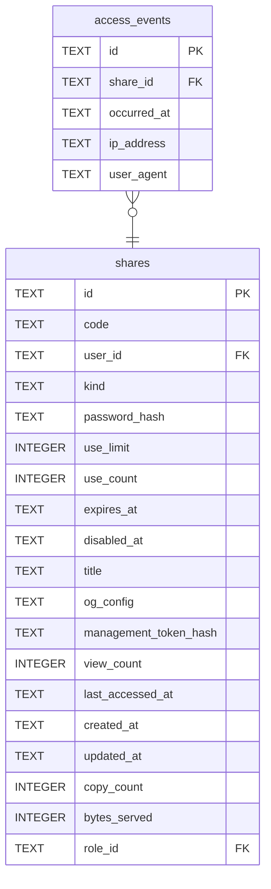

# access_events

## Description

誰在什麼時候取走了哪一份分享。預設不寫——計數器是一個整數,不會透露誰去過哪裡;這裡的一列是位址加瀏覽器字串,關於一個拿到連結、什麼都沒答應過的人。匿名是有人選這套軟體的理由之一,所以把它關掉是操作者的決定,不是預設值幫他做的。開了要在頁面上講,被記錄的人是最後一個知道的。ip_address 可以是 NULL——前面掛著不受信任的 proxy 時,看得到的位址是 proxy 的,記下去等於記錯人。

<details>
<summary><strong>Table Definition</strong></summary>

```sql
CREATE TABLE access_events (
    id           TEXT NOT NULL PRIMARY KEY,
    share_id     TEXT NOT NULL REFERENCES shares (id) ON DELETE CASCADE,
    occurred_at  TEXT NOT NULL,
    -- What the request looked like. Both are what the caller presented.
    ip_address   TEXT,
    user_agent   TEXT
)
```

</details>

## Columns

| Name | Type | Default | Nullable | Children | Parents | Comment |
| ---- | ---- | ------- | -------- | -------- | ------- | ------- |
| id | TEXT |  | false |  |  |  |
| share_id | TEXT |  | false |  | [shares](shares.md) |  |
| occurred_at | TEXT |  | false |  |  |  |
| ip_address | TEXT |  | true |  |  |  |
| user_agent | TEXT |  | true |  |  |  |

## Constraints

| Name | Type | Definition |
| ---- | ---- | ---------- |
| id | PRIMARY KEY | PRIMARY KEY (id) |
| - (Foreign key ID: 0) | FOREIGN KEY | FOREIGN KEY (share_id) REFERENCES shares (id) ON UPDATE NO ACTION ON DELETE CASCADE MATCH NONE |
| sqlite_autoindex_access_events_1 | PRIMARY KEY | PRIMARY KEY (id) |

## Indexes

| Name | Definition |
| ---- | ---------- |
| idx_access_events_share | CREATE INDEX idx_access_events_share ON access_events (share_id, occurred_at) |
| idx_access_events_occurred | CREATE INDEX idx_access_events_occurred ON access_events (occurred_at) |
| sqlite_autoindex_access_events_1 | PRIMARY KEY (id) |

## Relations



---

> Generated by [tbls](https://github.com/k1LoW/tbls)
