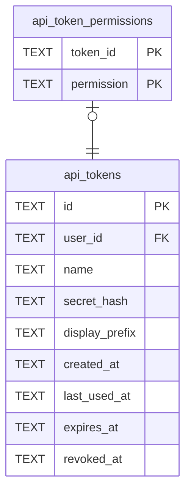

# api_token_permissions

## Description

What one token may do. What it can actually do is the intersection of this and its owner's permissions, so demoting a person narrows every token they hold at the same moment.

<details>
<summary><strong>Table Definition</strong></summary>

```sql
CREATE TABLE api_token_permissions (
    token_id   TEXT NOT NULL REFERENCES api_tokens (id) ON DELETE CASCADE,
    -- A `tessera_core::Permission`, stored as its `resource:verb` spelling.
    permission TEXT NOT NULL,
    PRIMARY KEY (token_id, permission)
)
```

</details>

## Columns

| Name | Type | Default | Nullable | Children | Parents | Comment |
| ---- | ---- | ------- | -------- | -------- | ------- | ------- |
| token_id | TEXT |  | false |  | [api_tokens](api_tokens.md) |  |
| permission | TEXT |  | false |  |  |  |

## Constraints

| Name | Type | Definition |
| ---- | ---- | ---------- |
| token_id | PRIMARY KEY | PRIMARY KEY (token_id) |
| permission | PRIMARY KEY | PRIMARY KEY (permission) |
| - (Foreign key ID: 0) | FOREIGN KEY | FOREIGN KEY (token_id) REFERENCES api_tokens (id) ON UPDATE NO ACTION ON DELETE CASCADE MATCH NONE |
| sqlite_autoindex_api_token_permissions_1 | PRIMARY KEY | PRIMARY KEY (token_id, permission) |

## Indexes

| Name | Definition |
| ---- | ---------- |
| idx_api_token_permissions_token | CREATE INDEX idx_api_token_permissions_token ON api_token_permissions (token_id) |
| sqlite_autoindex_api_token_permissions_1 | PRIMARY KEY (token_id, permission) |

## Relations



---

> Generated by [tbls](https://github.com/k1LoW/tbls)
