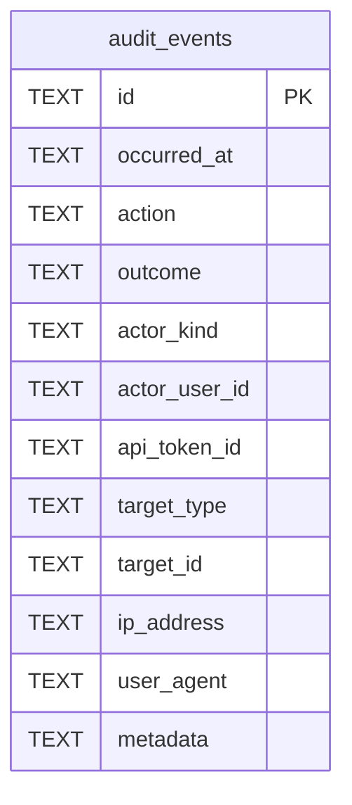

# audit_events

## Description

Who did what: sign-ins, administrators' changes and what happened to shares, one row each. Not `access_events`: most of these have no share, and an administrator's action is always recorded while the access log is off by default. No foreign keys, on purpose: "who deleted that share" has to outlive the share and the account. `metadata` is JSON written as text and never holds a secret, an invite code or what was typed into a failed sign-in. Kept for `audit.retention_days`.

<details>
<summary><strong>Table Definition</strong></summary>

```sql
CREATE TABLE audit_events (
    id             TEXT NOT NULL PRIMARY KEY,
    occurred_at    TEXT NOT NULL,
    action         TEXT NOT NULL,
    outcome        TEXT NOT NULL,
    actor_kind     TEXT NOT NULL,
    actor_user_id  TEXT,
    api_token_id   TEXT,
    target_type    TEXT,
    target_id      TEXT,
    ip_address     TEXT,
    user_agent     TEXT,
    metadata       TEXT
)
```

</details>

## Columns

| Name | Type | Default | Nullable | Children | Parents | Comment |
| ---- | ---- | ------- | -------- | -------- | ------- | ------- |
| id | TEXT |  | false |  |  |  |
| occurred_at | TEXT |  | false |  |  |  |
| action | TEXT |  | false |  |  |  |
| outcome | TEXT |  | false |  |  |  |
| actor_kind | TEXT |  | false |  |  |  |
| actor_user_id | TEXT |  | true |  |  |  |
| api_token_id | TEXT |  | true |  |  |  |
| target_type | TEXT |  | true |  |  |  |
| target_id | TEXT |  | true |  |  |  |
| ip_address | TEXT |  | true |  |  |  |
| user_agent | TEXT |  | true |  |  |  |
| metadata | TEXT |  | true |  |  |  |

## Constraints

| Name | Type | Definition |
| ---- | ---- | ---------- |
| id | PRIMARY KEY | PRIMARY KEY (id) |
| sqlite_autoindex_audit_events_1 | PRIMARY KEY | PRIMARY KEY (id) |

## Indexes

| Name | Definition |
| ---- | ---------- |
| idx_audit_events_action | CREATE INDEX idx_audit_events_action ON audit_events (action, occurred_at) |
| idx_audit_events_target | CREATE INDEX idx_audit_events_target ON audit_events (target_type, target_id, occurred_at) |
| idx_audit_events_actor | CREATE INDEX idx_audit_events_actor ON audit_events (actor_user_id, occurred_at) |
| idx_audit_events_occurred | CREATE INDEX idx_audit_events_occurred ON audit_events (occurred_at) |
| sqlite_autoindex_audit_events_1 | PRIMARY KEY (id) |

## Relations



---

> Generated by [tbls](https://github.com/k1LoW/tbls)
