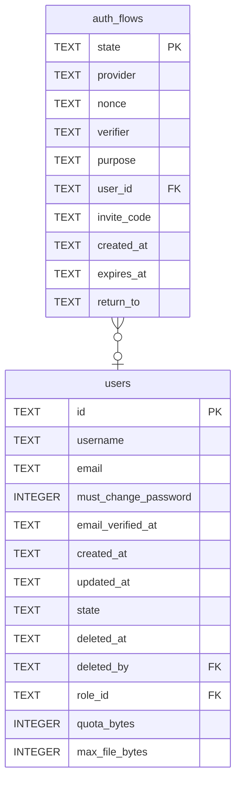

# auth_flows

## Description

A sign-in that has left for a provider and has not come back. Holds the CSRF token, the PKCE secret, and the nonce when the provider issues one, until the callback arrives; then the row is deleted, which is what makes a callback answerable once. A table rather than a signed cookie: a cookie would have to be `SameSite=Lax` exactly, because `Strict` withholds it on the navigation back from the provider and that failure looks like an unrelated error. `nonce` is null for a plain OAuth 2.0 provider, which issues no token to put one in.

<details>
<summary><strong>Table Definition</strong></summary>

```sql
CREATE TABLE auth_flows (
    state       TEXT NOT NULL PRIMARY KEY,
    -- Which provider this flow is for, matching `identities.provider`. The
    -- callback is one endpoint for all of them and this is how it knows whose
    -- token endpoint to go to.
    provider    TEXT NOT NULL,
    -- Absent for a provider that issues no ID token. See above.
    nonce       TEXT,
    verifier    TEXT NOT NULL,
    -- `login` or `link`.
    purpose     TEXT NOT NULL,
    -- Set when `purpose` is `link`: whose account this will be attached to.
    user_id     TEXT REFERENCES users (id) ON DELETE CASCADE,
    -- Carried through the provider and back, so an invitation can be spent by
    -- somebody who has never had a password here. The provider never sees it.
    invite_code TEXT,
    created_at  TEXT NOT NULL,
    expires_at  TEXT NOT NULL
, return_to TEXT)
```

</details>

## Columns

| Name | Type | Default | Nullable | Children | Parents | Comment |
| ---- | ---- | ------- | -------- | -------- | ------- | ------- |
| state | TEXT |  | false |  |  |  |
| provider | TEXT |  | false |  |  |  |
| nonce | TEXT |  | true |  |  |  |
| verifier | TEXT |  | false |  |  |  |
| purpose | TEXT |  | false |  |  |  |
| user_id | TEXT |  | true |  | [users](users.md) |  |
| invite_code | TEXT |  | true |  |  |  |
| created_at | TEXT |  | false |  |  |  |
| expires_at | TEXT |  | false |  |  |  |
| return_to | TEXT |  | true |  |  |  |

## Constraints

| Name | Type | Definition |
| ---- | ---- | ---------- |
| state | PRIMARY KEY | PRIMARY KEY (state) |
| - (Foreign key ID: 0) | FOREIGN KEY | FOREIGN KEY (user_id) REFERENCES users (id) ON UPDATE NO ACTION ON DELETE CASCADE MATCH NONE |
| sqlite_autoindex_auth_flows_1 | PRIMARY KEY | PRIMARY KEY (state) |

## Indexes

| Name | Definition |
| ---- | ---------- |
| idx_auth_flows_expires | CREATE INDEX idx_auth_flows_expires ON auth_flows (expires_at) |
| sqlite_autoindex_auth_flows_1 | PRIMARY KEY (state) |

## Relations



---

> Generated by [tbls](https://github.com/k1LoW/tbls)
