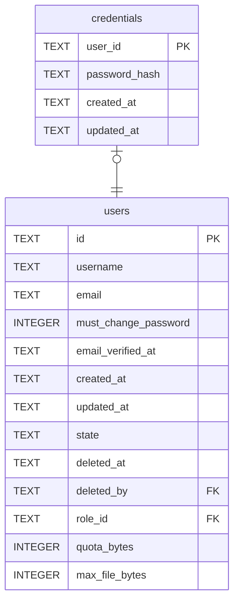

# credentials

## Description

<details>
<summary><strong>Table Definition</strong></summary>

```sql
CREATE TABLE credentials (
    user_id       TEXT NOT NULL PRIMARY KEY REFERENCES users (id) ON DELETE CASCADE,
    -- PHC-format Argon2 string.
    password_hash TEXT NOT NULL,
    created_at    TEXT NOT NULL,
    updated_at    TEXT NOT NULL
)
```

</details>

## Columns

| Name | Type | Default | Nullable | Children | Parents | Comment |
| ---- | ---- | ------- | -------- | -------- | ------- | ------- |
| user_id | TEXT |  | false |  | [users](users.md) |  |
| password_hash | TEXT |  | false |  |  |  |
| created_at | TEXT |  | false |  |  |  |
| updated_at | TEXT |  | false |  |  |  |

## Constraints

| Name | Type | Definition |
| ---- | ---- | ---------- |
| user_id | PRIMARY KEY | PRIMARY KEY (user_id) |
| - (Foreign key ID: 0) | FOREIGN KEY | FOREIGN KEY (user_id) REFERENCES users (id) ON UPDATE NO ACTION ON DELETE CASCADE MATCH NONE |
| sqlite_autoindex_credentials_1 | PRIMARY KEY | PRIMARY KEY (user_id) |

## Indexes

| Name | Definition |
| ---- | ---------- |
| sqlite_autoindex_credentials_1 | PRIMARY KEY (user_id) |

## Relations



---

> Generated by [tbls](https://github.com/k1LoW/tbls)
