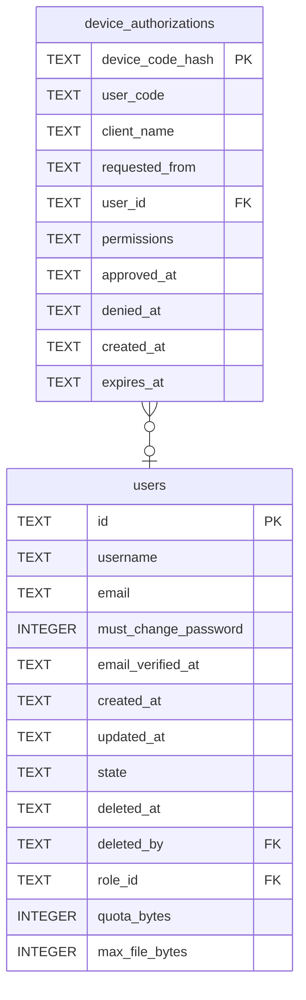

# device_authorizations

## Description

A program without a browser, such as the command line client, waiting for a person to approve it from one that has. The program holds the device code and only its digest is stored; the person types the short `user_code` on the site. Approval records who and with which permissions, and the token itself is minted when the program next asks, so the table never holds a usable secret. Deleted on redemption.

<details>
<summary><strong>Table Definition</strong></summary>

```sql
CREATE TABLE device_authorizations (
    device_code_hash TEXT NOT NULL PRIMARY KEY,
    user_code        TEXT NOT NULL UNIQUE,
    client_name      TEXT NOT NULL,
    requested_from   TEXT NOT NULL,
    user_id          TEXT REFERENCES users (id) ON DELETE CASCADE,
    permissions      TEXT,
    approved_at      TEXT,
    denied_at        TEXT,
    created_at       TEXT NOT NULL,
    expires_at       TEXT NOT NULL
)
```

</details>

## Columns

| Name | Type | Default | Nullable | Children | Parents | Comment |
| ---- | ---- | ------- | -------- | -------- | ------- | ------- |
| device_code_hash | TEXT |  | false |  |  |  |
| user_code | TEXT |  | false |  |  |  |
| client_name | TEXT |  | false |  |  |  |
| requested_from | TEXT |  | false |  |  |  |
| user_id | TEXT |  | true |  | [users](users.md) |  |
| permissions | TEXT |  | true |  |  |  |
| approved_at | TEXT |  | true |  |  |  |
| denied_at | TEXT |  | true |  |  |  |
| created_at | TEXT |  | false |  |  |  |
| expires_at | TEXT |  | false |  |  |  |

## Constraints

| Name | Type | Definition |
| ---- | ---- | ---------- |
| device_code_hash | PRIMARY KEY | PRIMARY KEY (device_code_hash) |
| - (Foreign key ID: 0) | FOREIGN KEY | FOREIGN KEY (user_id) REFERENCES users (id) ON UPDATE NO ACTION ON DELETE CASCADE MATCH NONE |
| sqlite_autoindex_device_authorizations_2 | UNIQUE | UNIQUE (user_code) |
| sqlite_autoindex_device_authorizations_1 | PRIMARY KEY | PRIMARY KEY (device_code_hash) |

## Indexes

| Name | Definition |
| ---- | ---------- |
| idx_device_authorizations_expires_at | CREATE INDEX idx_device_authorizations_expires_at ON device_authorizations (expires_at) |
| sqlite_autoindex_device_authorizations_2 | UNIQUE (user_code) |
| sqlite_autoindex_device_authorizations_1 | PRIMARY KEY (device_code_hash) |

## Relations



---

> Generated by [tbls](https://github.com/k1LoW/tbls)
