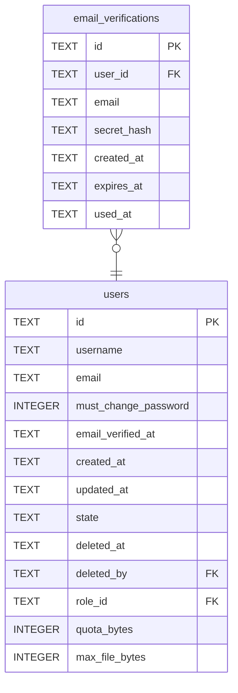

# email_verifications

## Description

<details>
<summary><strong>Table Definition</strong></summary>

```sql
CREATE TABLE email_verifications (
    id          TEXT NOT NULL PRIMARY KEY,
    user_id     TEXT NOT NULL REFERENCES users (id) ON DELETE CASCADE,
    email       TEXT NOT NULL,
    secret_hash TEXT NOT NULL UNIQUE,
    created_at  TEXT NOT NULL,
    expires_at  TEXT NOT NULL,
    used_at     TEXT
)
```

</details>

## Columns

| Name | Type | Default | Nullable | Children | Parents | Comment |
| ---- | ---- | ------- | -------- | -------- | ------- | ------- |
| id | TEXT |  | false |  |  |  |
| user_id | TEXT |  | false |  | [users](users.md) |  |
| email | TEXT |  | false |  |  |  |
| secret_hash | TEXT |  | false |  |  |  |
| created_at | TEXT |  | false |  |  |  |
| expires_at | TEXT |  | false |  |  |  |
| used_at | TEXT |  | true |  |  |  |

## Constraints

| Name | Type | Definition |
| ---- | ---- | ---------- |
| id | PRIMARY KEY | PRIMARY KEY (id) |
| - (Foreign key ID: 0) | FOREIGN KEY | FOREIGN KEY (user_id) REFERENCES users (id) ON UPDATE NO ACTION ON DELETE CASCADE MATCH NONE |
| sqlite_autoindex_email_verifications_2 | UNIQUE | UNIQUE (secret_hash) |
| sqlite_autoindex_email_verifications_1 | PRIMARY KEY | PRIMARY KEY (id) |

## Indexes

| Name | Definition |
| ---- | ---------- |
| idx_email_verifications_expires_at | CREATE INDEX idx_email_verifications_expires_at ON email_verifications (expires_at) |
| idx_email_verifications_user | CREATE INDEX idx_email_verifications_user ON email_verifications (user_id) |
| sqlite_autoindex_email_verifications_2 | UNIQUE (secret_hash) |
| sqlite_autoindex_email_verifications_1 | PRIMARY KEY (id) |

## Relations



---

> Generated by [tbls](https://github.com/k1LoW/tbls)
