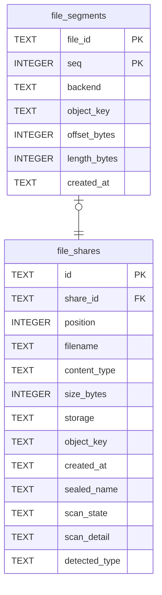

# file_segments

## Description

Where the bytes of one file actually are: a backend, a key, an offset and a length. A list rather than a column pair, because a file too large for any single backend has to be spread across several. Every row has one segment until splitting is turned on. `backend` is a name rather than a foreign key on purpose: the set of backends is configuration, and a row naming one nobody configures any more has to be readable enough to say so instead of failing at start-up.

<details>
<summary><strong>Table Definition</strong></summary>

```sql
CREATE TABLE file_segments (
    file_id       TEXT      NOT NULL REFERENCES file_shares (id) ON DELETE CASCADE,
    -- Position in the file, from zero. One row today, so always 0.
    seq           INTEGER    NOT NULL DEFAULT 0,
    -- Which configured backend holds this segment.
    backend       TEXT      NOT NULL,
    object_key    TEXT      NOT NULL,
    -- Where this segment starts within the file, and its length.
    offset_bytes  INTEGER    NOT NULL DEFAULT 0,
    length_bytes  INTEGER    NOT NULL,
    created_at    TEXT     NOT NULL,
    -- States the invariant instead of inventing an id for it: one segment per
    -- position, and no way to write two. It is also the index the reader needs,
    -- since every read is "this file, in order".
    PRIMARY KEY (file_id, seq)
)
```

</details>

## Columns

| Name | Type | Default | Nullable | Children | Parents | Comment |
| ---- | ---- | ------- | -------- | -------- | ------- | ------- |
| file_id | TEXT |  | false |  | [file_shares](file_shares.md) |  |
| seq | INTEGER | 0 | false |  |  |  |
| backend | TEXT |  | false |  |  |  |
| object_key | TEXT |  | false |  |  |  |
| offset_bytes | INTEGER | 0 | false |  |  |  |
| length_bytes | INTEGER |  | false |  |  |  |
| created_at | TEXT |  | false |  |  |  |

## Constraints

| Name | Type | Definition |
| ---- | ---- | ---------- |
| file_id | PRIMARY KEY | PRIMARY KEY (file_id) |
| seq | PRIMARY KEY | PRIMARY KEY (seq) |
| - (Foreign key ID: 0) | FOREIGN KEY | FOREIGN KEY (file_id) REFERENCES file_shares (id) ON UPDATE NO ACTION ON DELETE CASCADE MATCH NONE |
| sqlite_autoindex_file_segments_1 | PRIMARY KEY | PRIMARY KEY (file_id, seq) |

## Indexes

| Name | Definition |
| ---- | ---------- |
| sqlite_autoindex_file_segments_1 | PRIMARY KEY (file_id, seq) |

## Relations



---

> Generated by [tbls](https://github.com/k1LoW/tbls)
