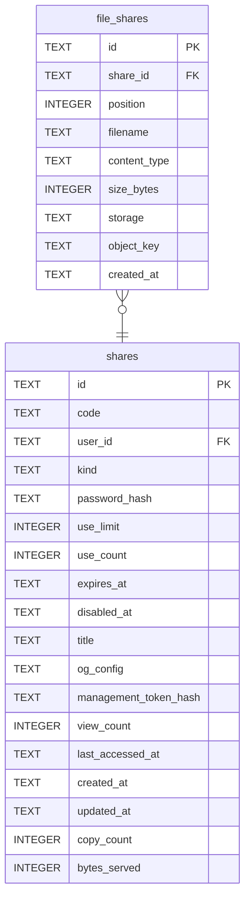

# file_shares

## Description

檔案分享的每一個檔案。現在一次分享一列,#42 之後會是多列,`position` 就是為此存在的。

<details>
<summary><strong>Table Definition</strong></summary>

```sql
CREATE TABLE file_shares (
    id            TEXT    NOT NULL PRIMARY KEY,
    share_id      TEXT    NOT NULL REFERENCES shares (id) ON DELETE CASCADE,
    position      INTEGER NOT NULL DEFAULT 0,
    filename      TEXT,
    -- Recorded, never echoed. The uploader chooses this value, and serving it
    -- back is how a text/html upload becomes stored XSS on our own origin.
    content_type  TEXT,
    size_bytes    INTEGER NOT NULL,
    -- Where the bytes live, carried over as they were. `object_key` is stored
    -- rather than derived so the layout can change without moving a byte.
    storage       TEXT    NOT NULL,
    object_key    TEXT,
    created_at    TEXT    NOT NULL
)
```

</details>

## Columns

| Name | Type | Default | Nullable | Children | Parents | Comment |
| ---- | ---- | ------- | -------- | -------- | ------- | ------- |
| id | TEXT |  | false |  |  |  |
| share_id | TEXT |  | false |  | [shares](shares.md) |  |
| position | INTEGER | 0 | false |  |  |  |
| filename | TEXT |  | true |  |  |  |
| content_type | TEXT |  | true |  |  |  |
| size_bytes | INTEGER |  | false |  |  |  |
| storage | TEXT |  | false |  |  |  |
| object_key | TEXT |  | true |  |  |  |
| created_at | TEXT |  | false |  |  |  |

## Constraints

| Name | Type | Definition |
| ---- | ---- | ---------- |
| id | PRIMARY KEY | PRIMARY KEY (id) |
| - (Foreign key ID: 0) | FOREIGN KEY | FOREIGN KEY (share_id) REFERENCES shares (id) ON UPDATE NO ACTION ON DELETE CASCADE MATCH NONE |
| sqlite_autoindex_file_shares_1 | PRIMARY KEY | PRIMARY KEY (id) |

## Indexes

| Name | Definition |
| ---- | ---------- |
| idx_file_shares_share | CREATE INDEX idx_file_shares_share ON file_shares (share_id, position) |
| sqlite_autoindex_file_shares_1 | PRIMARY KEY (id) |

## Relations



---

> Generated by [tbls](https://github.com/k1LoW/tbls)
