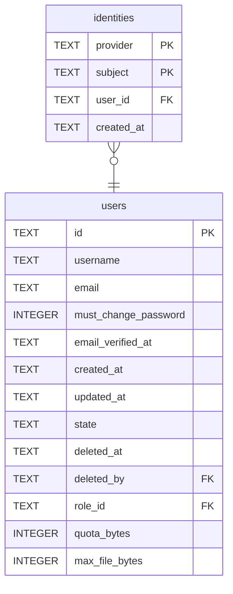

# identities

## Description

<details>
<summary><strong>Table Definition</strong></summary>

```sql
CREATE TABLE identities (
    -- Which provider vouched for this. One today; the column is here so that a
    -- second one needs configuration rather than a migration.
    provider   TEXT NOT NULL,
    -- The provider's own identifier for the person: the `sub` claim.
    subject    TEXT NOT NULL,
    user_id    TEXT NOT NULL REFERENCES users (id) ON DELETE CASCADE,
    created_at TEXT NOT NULL,
    -- One account per subject per provider, and no way to write two.
    PRIMARY KEY (provider, subject)
)
```

</details>

## Columns

| Name | Type | Default | Nullable | Children | Parents | Comment |
| ---- | ---- | ------- | -------- | -------- | ------- | ------- |
| provider | TEXT |  | false |  |  |  |
| subject | TEXT |  | false |  |  |  |
| user_id | TEXT |  | false |  | [users](users.md) |  |
| created_at | TEXT |  | false |  |  |  |

## Constraints

| Name | Type | Definition |
| ---- | ---- | ---------- |
| provider | PRIMARY KEY | PRIMARY KEY (provider) |
| subject | PRIMARY KEY | PRIMARY KEY (subject) |
| - (Foreign key ID: 0) | FOREIGN KEY | FOREIGN KEY (user_id) REFERENCES users (id) ON UPDATE NO ACTION ON DELETE CASCADE MATCH NONE |
| sqlite_autoindex_identities_1 | PRIMARY KEY | PRIMARY KEY (provider, subject) |

## Indexes

| Name | Definition |
| ---- | ---------- |
| idx_identities_user | CREATE INDEX idx_identities_user ON identities (user_id) |
| sqlite_autoindex_identities_1 | PRIMARY KEY (provider, subject) |

## Relations



---

> Generated by [tbls](https://github.com/k1LoW/tbls)
