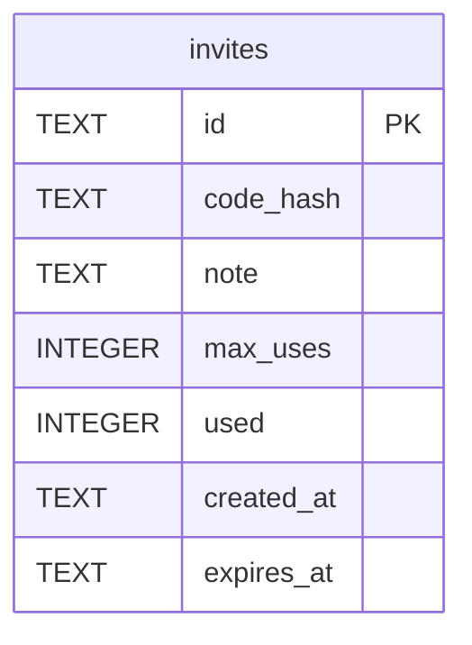

# invites

## Description

邀請碼。同樣只存摘要。

<details>
<summary><strong>Table Definition</strong></summary>

```sql
CREATE TABLE invites (
    id          TEXT    NOT NULL PRIMARY KEY,
    code_hash   TEXT    NOT NULL UNIQUE,
    note        TEXT,
    max_uses    INTEGER NOT NULL,
    used        INTEGER NOT NULL DEFAULT 0,
    created_at  TEXT    NOT NULL,
    expires_at  TEXT
)
```

</details>

## Columns

| Name | Type | Default | Nullable | Children | Parents | Comment |
| ---- | ---- | ------- | -------- | -------- | ------- | ------- |
| id | TEXT |  | false |  |  |  |
| code_hash | TEXT |  | false |  |  |  |
| note | TEXT |  | true |  |  |  |
| max_uses | INTEGER |  | false |  |  |  |
| used | INTEGER | 0 | false |  |  |  |
| created_at | TEXT |  | false |  |  |  |
| expires_at | TEXT |  | true |  |  |  |

## Constraints

| Name | Type | Definition |
| ---- | ---- | ---------- |
| id | PRIMARY KEY | PRIMARY KEY (id) |
| sqlite_autoindex_invites_2 | UNIQUE | UNIQUE (code_hash) |
| sqlite_autoindex_invites_1 | PRIMARY KEY | PRIMARY KEY (id) |

## Indexes

| Name | Definition |
| ---- | ---------- |
| idx_invites_expires_at | CREATE INDEX idx_invites_expires_at ON invites (expires_at) |
| sqlite_autoindex_invites_2 | UNIQUE (code_hash) |
| sqlite_autoindex_invites_1 | PRIMARY KEY (id) |

## Relations



---

> Generated by [tbls](https://github.com/k1LoW/tbls)
