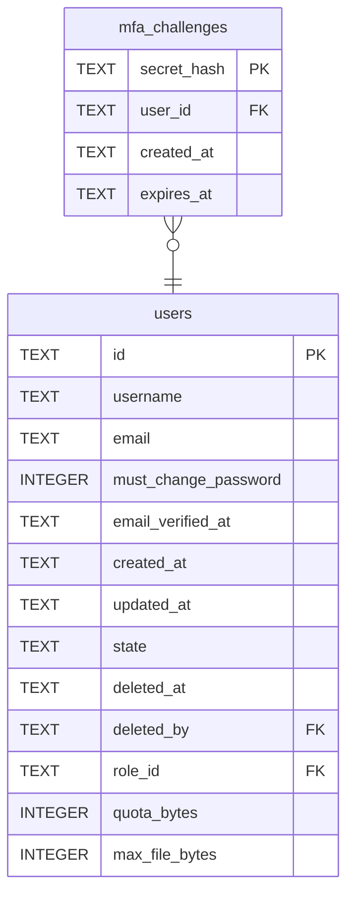

# mfa_challenges

## Description

A sign-in that passed its password and waits for a code. Keyed on the digest of the ticket the client holds, and deleted when the sign-in finishes, so a ticket works once. A row rather than a session with a flag, so nothing that accepts a session can mistake half a sign-in for a whole one.

<details>
<summary><strong>Table Definition</strong></summary>

```sql
CREATE TABLE mfa_challenges (
    secret_hash TEXT NOT NULL PRIMARY KEY,
    user_id     TEXT NOT NULL REFERENCES users (id) ON DELETE CASCADE,
    created_at  TEXT NOT NULL,
    expires_at  TEXT NOT NULL
)
```

</details>

## Columns

| Name | Type | Default | Nullable | Children | Parents | Comment |
| ---- | ---- | ------- | -------- | -------- | ------- | ------- |
| secret_hash | TEXT |  | false |  |  |  |
| user_id | TEXT |  | false |  | [users](users.md) |  |
| created_at | TEXT |  | false |  |  |  |
| expires_at | TEXT |  | false |  |  |  |

## Constraints

| Name | Type | Definition |
| ---- | ---- | ---------- |
| secret_hash | PRIMARY KEY | PRIMARY KEY (secret_hash) |
| - (Foreign key ID: 0) | FOREIGN KEY | FOREIGN KEY (user_id) REFERENCES users (id) ON UPDATE NO ACTION ON DELETE CASCADE MATCH NONE |
| sqlite_autoindex_mfa_challenges_1 | PRIMARY KEY | PRIMARY KEY (secret_hash) |

## Indexes

| Name | Definition |
| ---- | ---------- |
| idx_mfa_challenges_expires_at | CREATE INDEX idx_mfa_challenges_expires_at ON mfa_challenges (expires_at) |
| sqlite_autoindex_mfa_challenges_1 | PRIMARY KEY (secret_hash) |

## Relations



---

> Generated by [tbls](https://github.com/k1LoW/tbls)
