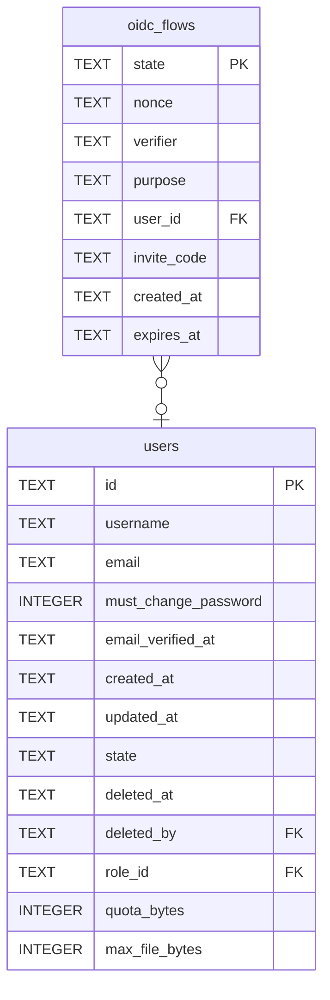

# oidc_flows

## Description

<details>
<summary><strong>Table Definition</strong></summary>

```sql
CREATE TABLE oidc_flows (
    state       TEXT NOT NULL PRIMARY KEY,
    nonce       TEXT NOT NULL,
    verifier    TEXT NOT NULL,
    -- `login` or `link`. The callback is one endpoint and this is how it knows
    -- whether it is signing somebody in or attaching a provider to the account
    -- that is already signed in.
    purpose     TEXT NOT NULL,
    -- Set when `purpose` is `link`: whose account this will be attached to.
    user_id     TEXT REFERENCES users (id) ON DELETE CASCADE,
    -- Carried through the provider and back, so an invitation can be spent by
    -- somebody who has never had a password here. The provider never sees it.
    invite_code TEXT,
    created_at  TEXT NOT NULL,
    expires_at  TEXT NOT NULL
)
```

</details>

## Columns

| Name | Type | Default | Nullable | Children | Parents | Comment |
| ---- | ---- | ------- | -------- | -------- | ------- | ------- |
| state | TEXT |  | false |  |  |  |
| nonce | TEXT |  | false |  |  |  |
| verifier | TEXT |  | false |  |  |  |
| purpose | TEXT |  | false |  |  |  |
| user_id | TEXT |  | true |  | [users](users.md) |  |
| invite_code | TEXT |  | true |  |  |  |
| created_at | TEXT |  | false |  |  |  |
| expires_at | TEXT |  | false |  |  |  |

## Constraints

| Name | Type | Definition |
| ---- | ---- | ---------- |
| state | PRIMARY KEY | PRIMARY KEY (state) |
| - (Foreign key ID: 0) | FOREIGN KEY | FOREIGN KEY (user_id) REFERENCES users (id) ON UPDATE NO ACTION ON DELETE CASCADE MATCH NONE |
| sqlite_autoindex_oidc_flows_1 | PRIMARY KEY | PRIMARY KEY (state) |

## Indexes

| Name | Definition |
| ---- | ---------- |
| idx_oidc_flows_expires | CREATE INDEX idx_oidc_flows_expires ON oidc_flows (expires_at) |
| sqlite_autoindex_oidc_flows_1 | PRIMARY KEY (state) |

## Relations



---

> Generated by [tbls](https://github.com/k1LoW/tbls)
