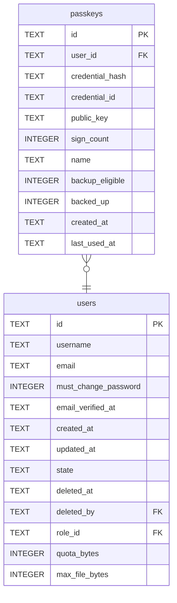

# passkeys

## Description

Passkeys: a fingerprint, a face or a hardware key in place of a password. Holds the credential id and its public key exactly as the authenticator sent it, a COSE structure, so nothing here depends on how the server checks one and a dump lets nobody in. Looked up by `credential_hash`, the SHA-256 of the id, because an id can be longer than MySQL will index. `sign_count` going backwards means two copies of one key; most synced passkeys keep it at zero.

<details>
<summary><strong>Table Definition</strong></summary>

```sql
CREATE TABLE passkeys (
    id              TEXT    NOT NULL PRIMARY KEY,
    user_id         TEXT    NOT NULL REFERENCES users (id) ON DELETE CASCADE,
    credential_hash TEXT    NOT NULL UNIQUE,
    credential_id   TEXT    NOT NULL,
    public_key      TEXT    NOT NULL,
    sign_count      INTEGER NOT NULL,
    name            TEXT    NOT NULL,
    backup_eligible INTEGER NOT NULL,
    backed_up       INTEGER NOT NULL,
    created_at      TEXT    NOT NULL,
    last_used_at    TEXT
)
```

</details>

## Columns

| Name | Type | Default | Nullable | Children | Parents | Comment |
| ---- | ---- | ------- | -------- | -------- | ------- | ------- |
| id | TEXT |  | false |  |  |  |
| user_id | TEXT |  | false |  | [users](users.md) |  |
| credential_hash | TEXT |  | false |  |  |  |
| credential_id | TEXT |  | false |  |  |  |
| public_key | TEXT |  | false |  |  |  |
| sign_count | INTEGER |  | false |  |  |  |
| name | TEXT |  | false |  |  |  |
| backup_eligible | INTEGER |  | false |  |  |  |
| backed_up | INTEGER |  | false |  |  |  |
| created_at | TEXT |  | false |  |  |  |
| last_used_at | TEXT |  | true |  |  |  |

## Constraints

| Name | Type | Definition |
| ---- | ---- | ---------- |
| id | PRIMARY KEY | PRIMARY KEY (id) |
| - (Foreign key ID: 0) | FOREIGN KEY | FOREIGN KEY (user_id) REFERENCES users (id) ON UPDATE NO ACTION ON DELETE CASCADE MATCH NONE |
| sqlite_autoindex_passkeys_2 | UNIQUE | UNIQUE (credential_hash) |
| sqlite_autoindex_passkeys_1 | PRIMARY KEY | PRIMARY KEY (id) |

## Indexes

| Name | Definition |
| ---- | ---------- |
| idx_passkeys_user | CREATE INDEX idx_passkeys_user ON passkeys (user_id) |
| sqlite_autoindex_passkeys_2 | UNIQUE (credential_hash) |
| sqlite_autoindex_passkeys_1 | PRIMARY KEY (id) |

## Relations



---

> Generated by [tbls](https://github.com/k1LoW/tbls)
