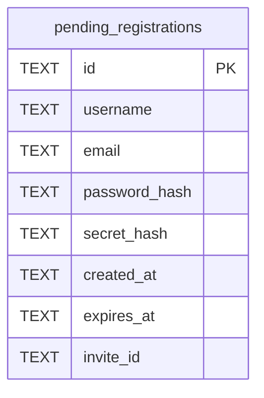

# pending_registrations

## Description

A registration waiting on its address. The account does not exist until the mail is opened, so what would become one waits here instead. That is also what keeps "is this address registered" from being a question anyone can ask.

<details>
<summary><strong>Table Definition</strong></summary>

```sql
CREATE TABLE pending_registrations (
    id            TEXT NOT NULL PRIMARY KEY,
    username      TEXT NOT NULL,
    email         TEXT NOT NULL UNIQUE,
    password_hash TEXT NOT NULL,
    secret_hash   TEXT NOT NULL UNIQUE,
    created_at    TEXT NOT NULL,
    expires_at    TEXT NOT NULL
, invite_id TEXT)
```

</details>

## Columns

| Name | Type | Default | Nullable | Children | Parents | Comment |
| ---- | ---- | ------- | -------- | -------- | ------- | ------- |
| id | TEXT |  | false |  |  |  |
| username | TEXT |  | false |  |  |  |
| email | TEXT |  | false |  |  |  |
| password_hash | TEXT |  | false |  |  |  |
| secret_hash | TEXT |  | false |  |  |  |
| created_at | TEXT |  | false |  |  |  |
| expires_at | TEXT |  | false |  |  |  |
| invite_id | TEXT |  | true |  |  |  |

## Constraints

| Name | Type | Definition |
| ---- | ---- | ---------- |
| id | PRIMARY KEY | PRIMARY KEY (id) |
| sqlite_autoindex_pending_registrations_3 | UNIQUE | UNIQUE (secret_hash) |
| sqlite_autoindex_pending_registrations_2 | UNIQUE | UNIQUE (email) |
| sqlite_autoindex_pending_registrations_1 | PRIMARY KEY | PRIMARY KEY (id) |

## Indexes

| Name | Definition |
| ---- | ---------- |
| idx_pending_registrations_expires_at | CREATE INDEX idx_pending_registrations_expires_at ON pending_registrations (expires_at) |
| sqlite_autoindex_pending_registrations_3 | UNIQUE (secret_hash) |
| sqlite_autoindex_pending_registrations_2 | UNIQUE (email) |
| sqlite_autoindex_pending_registrations_1 | PRIMARY KEY (id) |

## Relations



---

> Generated by [tbls](https://github.com/k1LoW/tbls)
