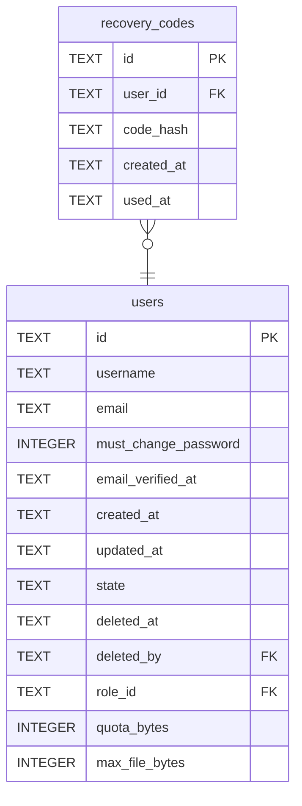

# recovery_codes

## Description

Single-use codes for an account whose authenticator is lost. Only the SHA-256 of each is stored. A used one keeps its row with `used_at` set, so how many are left can be counted.

<details>
<summary><strong>Table Definition</strong></summary>

```sql
CREATE TABLE recovery_codes (
    id         TEXT NOT NULL PRIMARY KEY,
    user_id    TEXT NOT NULL REFERENCES users (id) ON DELETE CASCADE,
    code_hash  TEXT NOT NULL,
    created_at TEXT NOT NULL,
    used_at    TEXT
)
```

</details>

## Columns

| Name | Type | Default | Nullable | Children | Parents | Comment |
| ---- | ---- | ------- | -------- | -------- | ------- | ------- |
| id | TEXT |  | false |  |  |  |
| user_id | TEXT |  | false |  | [users](users.md) |  |
| code_hash | TEXT |  | false |  |  |  |
| created_at | TEXT |  | false |  |  |  |
| used_at | TEXT |  | true |  |  |  |

## Constraints

| Name | Type | Definition |
| ---- | ---- | ---------- |
| id | PRIMARY KEY | PRIMARY KEY (id) |
| - (Foreign key ID: 0) | FOREIGN KEY | FOREIGN KEY (user_id) REFERENCES users (id) ON UPDATE NO ACTION ON DELETE CASCADE MATCH NONE |
| sqlite_autoindex_recovery_codes_1 | PRIMARY KEY | PRIMARY KEY (id) |

## Indexes

| Name | Definition |
| ---- | ---------- |
| idx_recovery_codes_user | CREATE INDEX idx_recovery_codes_user ON recovery_codes (user_id) |
| sqlite_autoindex_recovery_codes_1 | PRIMARY KEY (id) |

## Relations



---

> Generated by [tbls](https://github.com/k1LoW/tbls)
