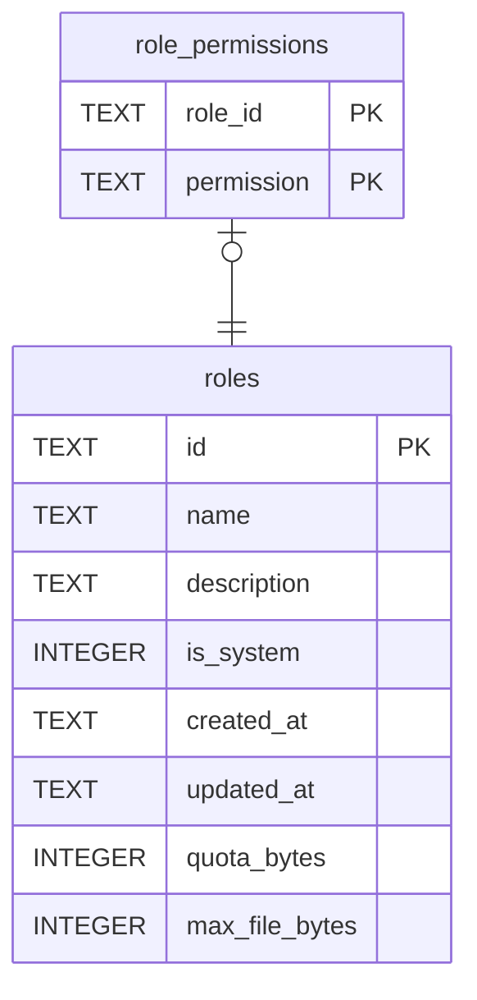

# role_permissions

## Description

Which permissions a role holds. The permissions themselves are defined in code rather than stored, because granting one nothing checks grants nothing.

<details>
<summary><strong>Table Definition</strong></summary>

```sql
CREATE TABLE role_permissions (
    role_id    TEXT NOT NULL REFERENCES roles (id) ON DELETE CASCADE,
    -- A `tessera_core::Permission`, stored as its `resource:verb` spelling.
    permission TEXT NOT NULL,
    PRIMARY KEY (role_id, permission)
)
```

</details>

## Columns

| Name | Type | Default | Nullable | Children | Parents | Comment |
| ---- | ---- | ------- | -------- | -------- | ------- | ------- |
| role_id | TEXT |  | false |  | [roles](roles.md) |  |
| permission | TEXT |  | false |  |  |  |

## Constraints

| Name | Type | Definition |
| ---- | ---- | ---------- |
| role_id | PRIMARY KEY | PRIMARY KEY (role_id) |
| permission | PRIMARY KEY | PRIMARY KEY (permission) |
| - (Foreign key ID: 0) | FOREIGN KEY | FOREIGN KEY (role_id) REFERENCES roles (id) ON UPDATE NO ACTION ON DELETE CASCADE MATCH NONE |
| sqlite_autoindex_role_permissions_1 | PRIMARY KEY | PRIMARY KEY (role_id, permission) |

## Indexes

| Name | Definition |
| ---- | ---------- |
| sqlite_autoindex_role_permissions_1 | PRIMARY KEY (role_id, permission) |

## Relations



---

> Generated by [tbls](https://github.com/k1LoW/tbls)
