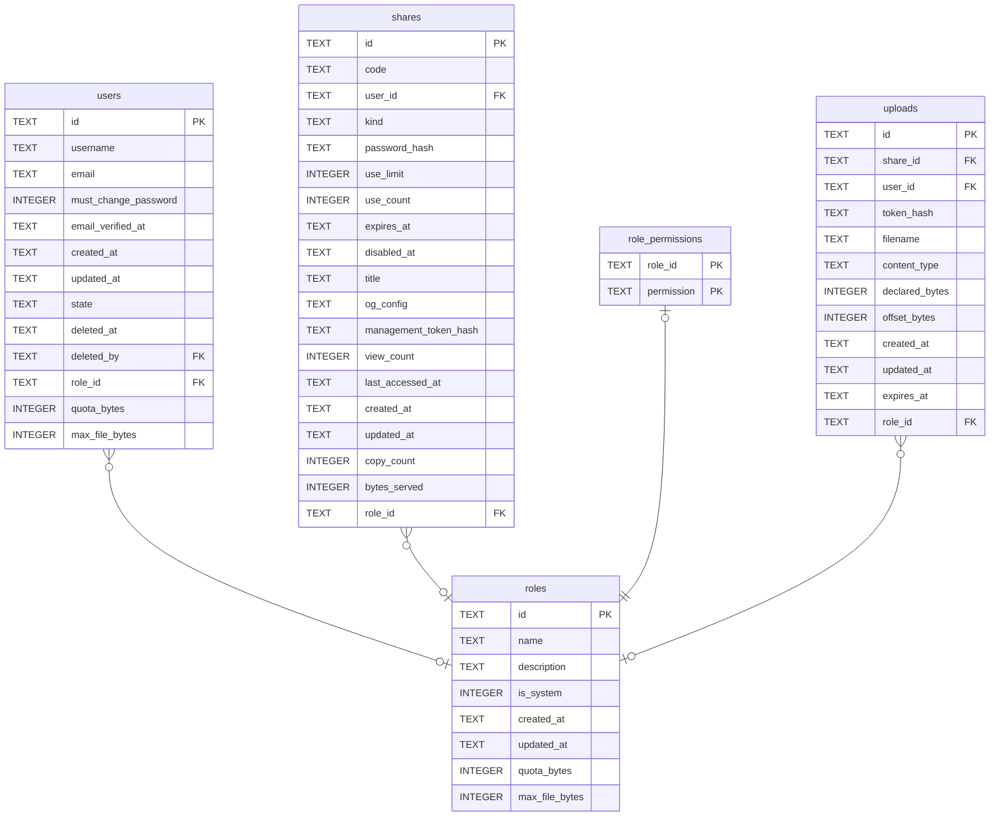

# roles

## Description

一組權限的名字。誰能做什麼只由這裡決定,沒有別的地方。

<details>
<summary><strong>Table Definition</strong></summary>

```sql
CREATE TABLE roles (
    id          TEXT NOT NULL PRIMARY KEY,
    -- What an operator types and reads. Unique, because a role is referred to
    -- by name in every conversation about one.
    name        TEXT NOT NULL,
    description TEXT,
    -- Whether removing it would leave the instance unadministrable.
    is_system   INTEGER NOT NULL DEFAULT 0,
    created_at  TEXT NOT NULL,
    updated_at  TEXT NOT NULL
, quota_bytes INTEGER, max_file_bytes INTEGER)
```

</details>

## Columns

| Name | Type | Default | Nullable | Children | Parents | Comment |
| ---- | ---- | ------- | -------- | -------- | ------- | ------- |
| id | TEXT |  | false | [users](users.md) [shares](shares.md) [role_permissions](role_permissions.md) [uploads](uploads.md) |  |  |
| name | TEXT |  | false |  |  |  |
| description | TEXT |  | true |  |  |  |
| is_system | INTEGER | 0 | false |  |  |  |
| created_at | TEXT |  | false |  |  |  |
| updated_at | TEXT |  | false |  |  |  |
| quota_bytes | INTEGER |  | true |  |  |  |
| max_file_bytes | INTEGER |  | true |  |  |  |

## Constraints

| Name | Type | Definition |
| ---- | ---- | ---------- |
| id | PRIMARY KEY | PRIMARY KEY (id) |
| sqlite_autoindex_roles_1 | PRIMARY KEY | PRIMARY KEY (id) |

## Indexes

| Name | Definition |
| ---- | ---------- |
| idx_roles_name | CREATE UNIQUE INDEX idx_roles_name ON roles (name) |
| sqlite_autoindex_roles_1 | PRIMARY KEY (id) |

## Relations



---

> Generated by [tbls](https://github.com/k1LoW/tbls)
