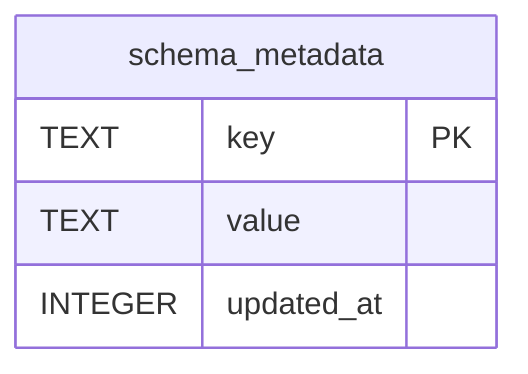

# schema_metadata

## Description

Which version wrote this database. Read at start-up to refuse a downgrade.

<details>
<summary><strong>Table Definition</strong></summary>

```sql
CREATE TABLE schema_metadata (
    key        TEXT    NOT NULL PRIMARY KEY,
    value      TEXT    NOT NULL,
    updated_at INTEGER NOT NULL DEFAULT (unixepoch())
)
```

</details>

## Columns

| Name | Type | Default | Nullable | Children | Parents | Comment |
| ---- | ---- | ------- | -------- | -------- | ------- | ------- |
| key | TEXT |  | false |  |  |  |
| value | TEXT |  | false |  |  |  |
| updated_at | INTEGER | unixepoch() | false |  |  |  |

## Constraints

| Name | Type | Definition |
| ---- | ---- | ---------- |
| key | PRIMARY KEY | PRIMARY KEY (key) |
| sqlite_autoindex_schema_metadata_1 | PRIMARY KEY | PRIMARY KEY (key) |

## Indexes

| Name | Definition |
| ---- | ---------- |
| sqlite_autoindex_schema_metadata_1 | PRIMARY KEY (key) |

## Relations



---

> Generated by [tbls](https://github.com/k1LoW/tbls)
