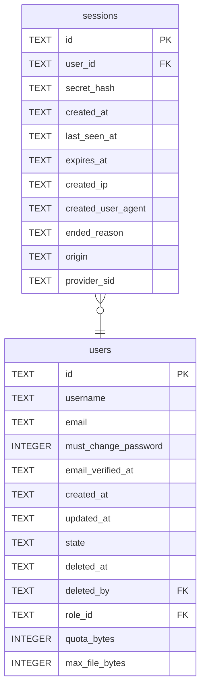

# sessions

## Description

One sign-in. Expired rows stay, because this table is also the sign-in history and a person needs to be able to see whether somebody else got in. Real removal is `auth.login_history_days`. `origin` says which credential started it, so a provider signing somebody out can end the sessions it issued and leave password ones alone. `provider_sid` is the provider's own identifier for its side, when it released one.

<details>
<summary><strong>Table Definition</strong></summary>

```sql
CREATE TABLE sessions (
    id           TEXT NOT NULL PRIMARY KEY,
    user_id      TEXT NOT NULL REFERENCES users (id) ON DELETE CASCADE,
    secret_hash  TEXT NOT NULL UNIQUE,
    created_at   TEXT NOT NULL,
    last_seen_at TEXT NOT NULL,
    expires_at   TEXT NOT NULL
, created_ip TEXT, created_user_agent TEXT, ended_reason TEXT, origin TEXT NOT NULL DEFAULT 'password', provider_sid TEXT)
```

</details>

## Columns

| Name | Type | Default | Nullable | Children | Parents | Comment |
| ---- | ---- | ------- | -------- | -------- | ------- | ------- |
| id | TEXT |  | false |  |  |  |
| user_id | TEXT |  | false |  | [users](users.md) |  |
| secret_hash | TEXT |  | false |  |  |  |
| created_at | TEXT |  | false |  |  |  |
| last_seen_at | TEXT |  | false |  |  |  |
| expires_at | TEXT |  | false |  |  |  |
| created_ip | TEXT |  | true |  |  |  |
| created_user_agent | TEXT |  | true |  |  |  |
| ended_reason | TEXT |  | true |  |  |  |
| origin | TEXT | 'password' | false |  |  |  |
| provider_sid | TEXT |  | true |  |  |  |

## Constraints

| Name | Type | Definition |
| ---- | ---- | ---------- |
| id | PRIMARY KEY | PRIMARY KEY (id) |
| - (Foreign key ID: 0) | FOREIGN KEY | FOREIGN KEY (user_id) REFERENCES users (id) ON UPDATE NO ACTION ON DELETE CASCADE MATCH NONE |
| sqlite_autoindex_sessions_2 | UNIQUE | UNIQUE (secret_hash) |
| sqlite_autoindex_sessions_1 | PRIMARY KEY | PRIMARY KEY (id) |

## Indexes

| Name | Definition |
| ---- | ---------- |
| idx_sessions_provider_sid | CREATE INDEX idx_sessions_provider_sid ON sessions (provider_sid) |
| idx_sessions_expires_at | CREATE INDEX idx_sessions_expires_at ON sessions (expires_at) |
| idx_sessions_user | CREATE INDEX idx_sessions_user ON sessions (user_id) |
| sqlite_autoindex_sessions_2 | UNIQUE (secret_hash) |
| sqlite_autoindex_sessions_1 | PRIMARY KEY (id) |

## Relations



---

> Generated by [tbls](https://github.com/k1LoW/tbls)
