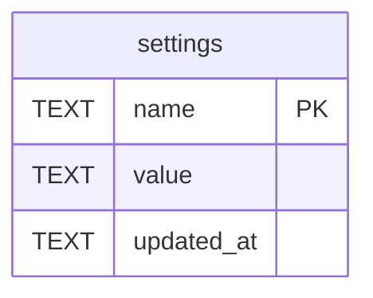

# settings

## Description

Settings changed from the panel, one row each. The load order is defaults, then the file, then the environment, then this, and this wins: it is the only layer somebody deliberately changed on this machine. Only what can take effect without a restart is here. A bound socket, a built connection pool and an installed log subscriber cannot, so those live in the environment, and the panel never has to say "saved, now restart". Secrets are excluded too: a stored one is plaintext in a table and comes back out of whatever endpoint reads settings. The column is `name` rather than `key` because `key` is reserved in MySQL.

<details>
<summary><strong>Table Definition</strong></summary>

```sql
CREATE TABLE settings (
    name        TEXT NOT NULL PRIMARY KEY,
    -- The value as JSON, so that a number stays a number and the layering
    -- below it sees the same shape the file and the environment produce.
    value       TEXT NOT NULL,
    updated_at  TEXT NOT NULL
)
```

</details>

## Columns

| Name | Type | Default | Nullable | Children | Parents | Comment |
| ---- | ---- | ------- | -------- | -------- | ------- | ------- |
| name | TEXT |  | false |  |  |  |
| value | TEXT |  | false |  |  |  |
| updated_at | TEXT |  | false |  |  |  |

## Constraints

| Name | Type | Definition |
| ---- | ---- | ---------- |
| name | PRIMARY KEY | PRIMARY KEY (name) |
| sqlite_autoindex_settings_1 | PRIMARY KEY | PRIMARY KEY (name) |

## Indexes

| Name | Definition |
| ---- | ---------- |
| sqlite_autoindex_settings_1 | PRIMARY KEY (name) |

## Relations



---

> Generated by [tbls](https://github.com/k1LoW/tbls)
