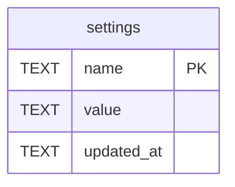

# settings

## Description

從後台改過的設定,一列一個。載入順序是 預設 → 設定檔 → 環境變數 → 這裡,這裡贏——因為它是唯一一層有人在這台機器上刻意改過的,其他都跟著部署來(image 自己就設了六個環境變數)。只放能熱改的東西:socket 已經 bind 的、pool 已經建好的(而且讀這張表需要它)、log subscriber 開機裝一次的,都不在這裡,那些走環境變數。所以後台永遠不用說「存好了請重啟」。機密也不放,會明文躺在這裡而且會被 API 回出去。欄位叫 name 不叫 key,因為 key 是 MySQL 保留字。

<details>
<summary><strong>Table Definition</strong></summary>

```sql
CREATE TABLE settings (
    name        TEXT NOT NULL PRIMARY KEY,
    -- The value as JSON, so that a number stays a number and the layering
    -- below it sees the same shape the file and the environment produce.
    value       TEXT NOT NULL,
    updated_at  TEXT NOT NULL
)
```

</details>

## Columns

| Name | Type | Default | Nullable | Children | Parents | Comment |
| ---- | ---- | ------- | -------- | -------- | ------- | ------- |
| name | TEXT |  | false |  |  |  |
| value | TEXT |  | false |  |  |  |
| updated_at | TEXT |  | false |  |  |  |

## Constraints

| Name | Type | Definition |
| ---- | ---- | ---------- |
| name | PRIMARY KEY | PRIMARY KEY (name) |
| sqlite_autoindex_settings_1 | PRIMARY KEY | PRIMARY KEY (name) |

## Indexes

| Name | Definition |
| ---- | ---------- |
| sqlite_autoindex_settings_1 | PRIMARY KEY (name) |

## Relations



---

> Generated by [tbls](https://github.com/k1LoW/tbls)
