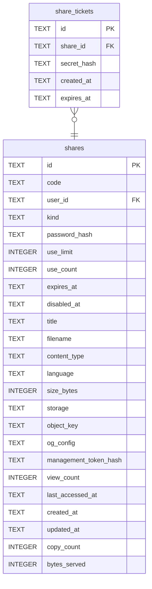

# share_tickets

## Description

輸對密碼之後拿到的通行證。存在的理由是「看得到」和「拿得到」要分開——預覽頁不該花掉一次取用次數。

<details>
<summary><strong>Table Definition</strong></summary>

```sql
CREATE TABLE share_tickets (
    id          TEXT NOT NULL PRIMARY KEY,
    share_id    TEXT NOT NULL REFERENCES shares (id) ON DELETE CASCADE,
    secret_hash TEXT NOT NULL UNIQUE,
    created_at  TEXT NOT NULL,
    expires_at  TEXT NOT NULL
)
```

</details>

## Columns

| Name | Type | Default | Nullable | Children | Parents | Comment |
| ---- | ---- | ------- | -------- | -------- | ------- | ------- |
| id | TEXT |  | false |  |  |  |
| share_id | TEXT |  | false |  | [shares](shares.md) |  |
| secret_hash | TEXT |  | false |  |  |  |
| created_at | TEXT |  | false |  |  |  |
| expires_at | TEXT |  | false |  |  |  |

## Constraints

| Name | Type | Definition |
| ---- | ---- | ---------- |
| id | PRIMARY KEY | PRIMARY KEY (id) |
| - (Foreign key ID: 0) | FOREIGN KEY | FOREIGN KEY (share_id) REFERENCES shares (id) ON UPDATE NO ACTION ON DELETE CASCADE MATCH NONE |
| sqlite_autoindex_share_tickets_2 | UNIQUE | UNIQUE (secret_hash) |
| sqlite_autoindex_share_tickets_1 | PRIMARY KEY | PRIMARY KEY (id) |

## Indexes

| Name | Definition |
| ---- | ---------- |
| idx_share_tickets_expires_at | CREATE INDEX idx_share_tickets_expires_at ON share_tickets (expires_at) |
| idx_share_tickets_share | CREATE INDEX idx_share_tickets_share ON share_tickets (share_id) |
| sqlite_autoindex_share_tickets_2 | UNIQUE (secret_hash) |
| sqlite_autoindex_share_tickets_1 | PRIMARY KEY (id) |

## Relations



---

> Generated by [tbls](https://github.com/k1LoW/tbls)
