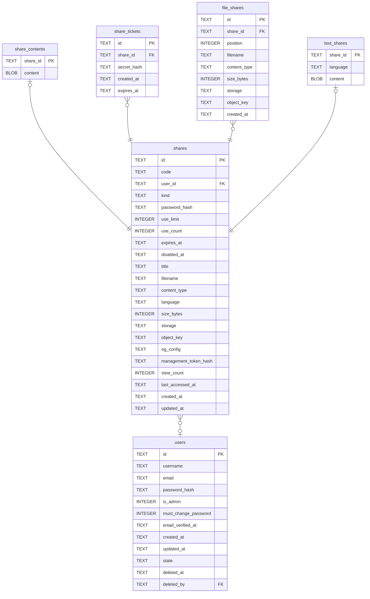

# shares

## Description

一次分享,不管內容是什麼。取用碼、密碼、次數、到期都在這裡,因為那些規則跟內容是什麼無關。內容本身在下面那幾張表。

<details>
<summary><strong>Table Definition</strong></summary>

```sql
CREATE TABLE shares (
    id             TEXT    NOT NULL PRIMARY KEY,
    -- The public retrieval code, as it appears in `/s/{code}`. Separate from the
    -- primary key so it can be rotated without rewriting foreign keys, and so
    -- inserts keep the locality a ULID primary key gives us.
    code           TEXT    NOT NULL UNIQUE,
    -- NULL for an anonymous upload. `ON DELETE SET NULL` rather than CASCADE:
    -- what happens to a departing account's shares is still undecided, and
    -- orphaning a row is recoverable where deleting it is not. Deleting here
    -- would also strand the objects, since no database action reaches the blob
    -- store.
    user_id        TEXT    REFERENCES users (id) ON DELETE SET NULL,
    kind           TEXT    NOT NULL,

    -- Everything the access gate reads.
    password_hash  TEXT,
    -- NULL means unlimited. A count plus a limit rather than a countdown: a
    -- countdown throws away how many times something was actually fetched, and
    -- that number cannot be reconstructed afterwards.
    use_limit      INTEGER,
    use_count      INTEGER NOT NULL DEFAULT 0,
    expires_at     TEXT,
    disabled_at    TEXT,

    -- Presentation.
    title          TEXT,
    filename       TEXT,
    -- Recorded, never echoed. The uploader chooses this value, and serving it
    -- back is how a text/html upload becomes stored XSS on our own origin.
    content_type   TEXT,
    language       TEXT,
    size_bytes     INTEGER NOT NULL,

    -- Where the bytes live. `object_key` is stored rather than derived from the
    -- id and date: storing it means the layout can change later without moving a
    -- single byte, because old rows keep the key they were written with.
    storage        TEXT    NOT NULL,
    object_key     TEXT,

    og_config      TEXT,
    -- Lets an anonymous uploader delete what they just posted. Without it a
    -- mistaken upload is permanent.
    management_token_hash TEXT,
    view_count     INTEGER NOT NULL DEFAULT 0,
    last_accessed_at TEXT,

    created_at     TEXT    NOT NULL,
    updated_at     TEXT    NOT NULL
)
```

</details>

## Columns

| Name | Type | Default | Nullable | Children | Parents | Comment |
| ---- | ---- | ------- | -------- | -------- | ------- | ------- |
| id | TEXT |  | false | [share_contents](share_contents.md) [share_tickets](share_tickets.md) [file_shares](file_shares.md) [text_shares](text_shares.md) |  |  |
| code | TEXT |  | false |  |  |  |
| user_id | TEXT |  | true |  | [users](users.md) |  |
| kind | TEXT |  | false |  |  |  |
| password_hash | TEXT |  | true |  |  |  |
| use_limit | INTEGER |  | true |  |  |  |
| use_count | INTEGER | 0 | false |  |  |  |
| expires_at | TEXT |  | true |  |  |  |
| disabled_at | TEXT |  | true |  |  |  |
| title | TEXT |  | true |  |  |  |
| filename | TEXT |  | true |  |  |  |
| content_type | TEXT |  | true |  |  |  |
| language | TEXT |  | true |  |  |  |
| size_bytes | INTEGER |  | false |  |  |  |
| storage | TEXT |  | false |  |  |  |
| object_key | TEXT |  | true |  |  |  |
| og_config | TEXT |  | true |  |  |  |
| management_token_hash | TEXT |  | true |  |  |  |
| view_count | INTEGER | 0 | false |  |  |  |
| last_accessed_at | TEXT |  | true |  |  |  |
| created_at | TEXT |  | false |  |  |  |
| updated_at | TEXT |  | false |  |  |  |

## Constraints

| Name | Type | Definition |
| ---- | ---- | ---------- |
| id | PRIMARY KEY | PRIMARY KEY (id) |
| - (Foreign key ID: 0) | FOREIGN KEY | FOREIGN KEY (user_id) REFERENCES users (id) ON UPDATE NO ACTION ON DELETE SET NULL MATCH NONE |
| sqlite_autoindex_shares_2 | UNIQUE | UNIQUE (code) |
| sqlite_autoindex_shares_1 | PRIMARY KEY | PRIMARY KEY (id) |

## Indexes

| Name | Definition |
| ---- | ---------- |
| idx_shares_expires_at | CREATE INDEX idx_shares_expires_at ON shares (expires_at) |
| idx_shares_user | CREATE INDEX idx_shares_user ON shares (user_id) |
| sqlite_autoindex_shares_2 | UNIQUE (code) |
| sqlite_autoindex_shares_1 | PRIMARY KEY (id) |

## Relations



---

> Generated by [tbls](https://github.com/k1LoW/tbls)
