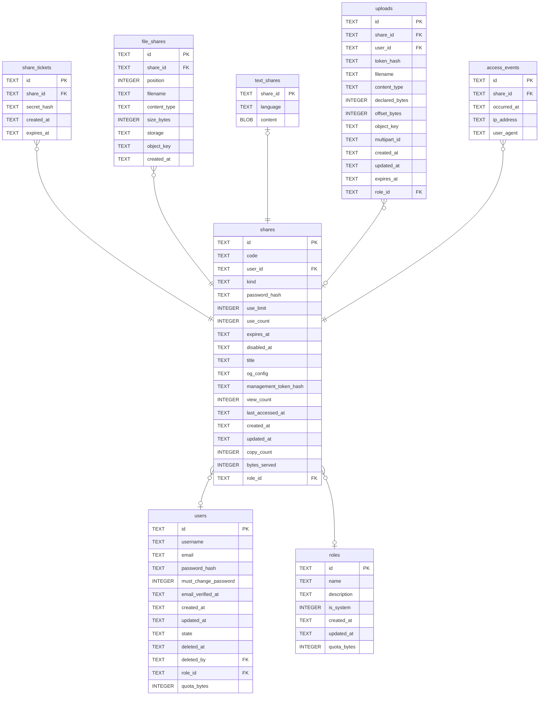

# shares

## Description

一次分享,不管內容是什麼。取用碼、密碼、次數、到期都在這裡,因為那些規則跟內容是什麼無關。內容完全不在這裡——它在 file_shares 和 text_shares,因為一份分享可以有好幾個檔案,而欄位裝不下「好幾個」。role_id 是上傳當下的角色快照,匿名上傳是 guest——事後改一個人的角色不會回溯改變舊分享算在誰頭上,而 user_id 是空同時代表「匿名」和「上傳者帳號被刪了」,分不出來。bytes_served 是「離開這個 process 的位元組」,不是「到達使用者的」——前面掛 proxy 的話它握著的那一小段會被多算,而 CDN 快取掉的請求根本不會被看到。

<details>
<summary><strong>Table Definition</strong></summary>

```sql
CREATE TABLE shares (
    id             TEXT    NOT NULL PRIMARY KEY,
    -- The public retrieval code, as it appears in `/s/{code}`. Separate from the
    -- primary key so it can be rotated without rewriting foreign keys, and so
    -- inserts keep the locality a ULID primary key gives us.
    code           TEXT    NOT NULL UNIQUE,
    -- NULL for an anonymous upload. `ON DELETE SET NULL` rather than CASCADE:
    -- what happens to a departing account's shares is still undecided, and
    -- orphaning a row is recoverable where deleting it is not. Deleting here
    -- would also strand the objects, since no database action reaches the blob
    -- store.
    user_id        TEXT    REFERENCES users (id) ON DELETE SET NULL,
    kind           TEXT    NOT NULL,

    -- Everything the access gate reads.
    password_hash  TEXT,
    -- NULL means unlimited. A count plus a limit rather than a countdown: a
    -- countdown throws away how many times something was actually fetched, and
    -- that number cannot be reconstructed afterwards.
    use_limit      INTEGER,
    use_count      INTEGER NOT NULL DEFAULT 0,
    expires_at     TEXT,
    disabled_at    TEXT,

    -- Presentation.
    title          TEXT,
    og_config      TEXT,
    -- Lets an anonymous uploader delete what they just posted. Without it a
    -- mistaken upload is permanent.
    management_token_hash TEXT,
    view_count     INTEGER NOT NULL DEFAULT 0,
    last_accessed_at TEXT,

    created_at     TEXT    NOT NULL,
    updated_at     TEXT    NOT NULL
, copy_count INTEGER NOT NULL DEFAULT 0, bytes_served INTEGER NOT NULL DEFAULT 0, role_id TEXT REFERENCES roles (id) ON DELETE SET NULL)
```

</details>

## Columns

| Name | Type | Default | Nullable | Children | Parents | Comment |
| ---- | ---- | ------- | -------- | -------- | ------- | ------- |
| id | TEXT |  | false | [share_tickets](share_tickets.md) [file_shares](file_shares.md) [text_shares](text_shares.md) [uploads](uploads.md) [access_events](access_events.md) |  |  |
| code | TEXT |  | false |  |  |  |
| user_id | TEXT |  | true |  | [users](users.md) |  |
| kind | TEXT |  | false |  |  |  |
| password_hash | TEXT |  | true |  |  |  |
| use_limit | INTEGER |  | true |  |  |  |
| use_count | INTEGER | 0 | false |  |  |  |
| expires_at | TEXT |  | true |  |  |  |
| disabled_at | TEXT |  | true |  |  |  |
| title | TEXT |  | true |  |  |  |
| og_config | TEXT |  | true |  |  |  |
| management_token_hash | TEXT |  | true |  |  |  |
| view_count | INTEGER | 0 | false |  |  |  |
| last_accessed_at | TEXT |  | true |  |  |  |
| created_at | TEXT |  | false |  |  |  |
| updated_at | TEXT |  | false |  |  |  |
| copy_count | INTEGER | 0 | false |  |  |  |
| bytes_served | INTEGER | 0 | false |  |  |  |
| role_id | TEXT |  | true |  | [roles](roles.md) |  |

## Constraints

| Name | Type | Definition |
| ---- | ---- | ---------- |
| id | PRIMARY KEY | PRIMARY KEY (id) |
| - (Foreign key ID: 0) | FOREIGN KEY | FOREIGN KEY (role_id) REFERENCES roles (id) ON UPDATE NO ACTION ON DELETE SET NULL MATCH NONE |
| - (Foreign key ID: 1) | FOREIGN KEY | FOREIGN KEY (user_id) REFERENCES users (id) ON UPDATE NO ACTION ON DELETE SET NULL MATCH NONE |
| sqlite_autoindex_shares_2 | UNIQUE | UNIQUE (code) |
| sqlite_autoindex_shares_1 | PRIMARY KEY | PRIMARY KEY (id) |

## Indexes

| Name | Definition |
| ---- | ---------- |
| idx_shares_role | CREATE INDEX idx_shares_role ON shares (role_id) |
| idx_shares_created | CREATE INDEX idx_shares_created ON shares (created_at) |
| idx_shares_user_created | CREATE INDEX idx_shares_user_created ON shares (user_id, created_at) |
| idx_shares_expires_at | CREATE INDEX idx_shares_expires_at ON shares (expires_at) |
| sqlite_autoindex_shares_2 | UNIQUE (code) |
| sqlite_autoindex_shares_1 | PRIMARY KEY (id) |

## Relations



---

> Generated by [tbls](https://github.com/k1LoW/tbls)
