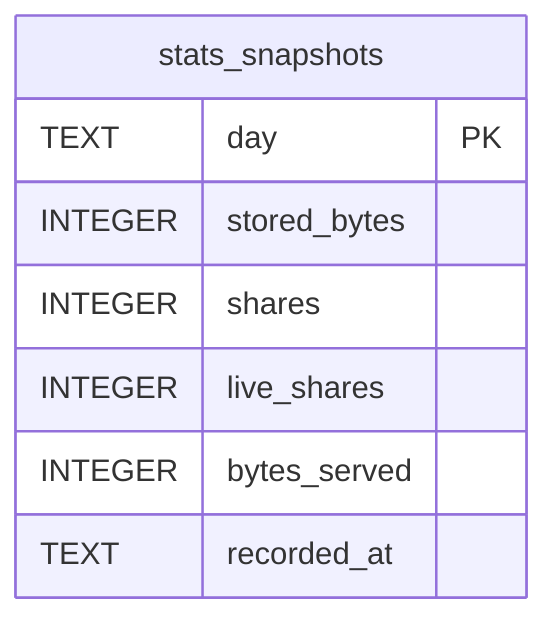

# stats_snapshots

## Description

<details>
<summary><strong>Table Definition</strong></summary>

```sql
CREATE TABLE stats_snapshots (
    day          TEXT    NOT NULL PRIMARY KEY,
    stored_bytes INTEGER NOT NULL,
    shares       INTEGER NOT NULL,
    live_shares  INTEGER NOT NULL,
    bytes_served INTEGER NOT NULL,
    recorded_at  TEXT    NOT NULL
)
```

</details>

## Columns

| Name | Type | Default | Nullable | Children | Parents | Comment |
| ---- | ---- | ------- | -------- | -------- | ------- | ------- |
| day | TEXT |  | false |  |  |  |
| stored_bytes | INTEGER |  | false |  |  |  |
| shares | INTEGER |  | false |  |  |  |
| live_shares | INTEGER |  | false |  |  |  |
| bytes_served | INTEGER |  | false |  |  |  |
| recorded_at | TEXT |  | false |  |  |  |

## Constraints

| Name | Type | Definition |
| ---- | ---- | ---------- |
| day | PRIMARY KEY | PRIMARY KEY (day) |
| sqlite_autoindex_stats_snapshots_1 | PRIMARY KEY | PRIMARY KEY (day) |

## Indexes

| Name | Definition |
| ---- | ---------- |
| sqlite_autoindex_stats_snapshots_1 | PRIMARY KEY (day) |

## Relations



---

> Generated by [tbls](https://github.com/k1LoW/tbls)
