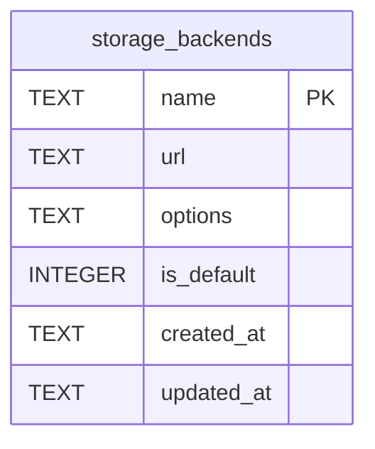

# storage_backends

## Description

<details>
<summary><strong>Table Definition</strong></summary>

```sql
CREATE TABLE storage_backends (
    name        TEXT NOT NULL PRIMARY KEY,
    -- Sealed. See `storage::secret`.
    url         TEXT NOT NULL,
    -- Sealed JSON object of backend-specific options.
    options     TEXT NOT NULL,
    -- Whether new uploads go here. Exactly one row should have it.
    is_default  INTEGER    NOT NULL DEFAULT FALSE,
    created_at  TEXT   NOT NULL,
    updated_at  TEXT   NOT NULL
)
```

</details>

## Columns

| Name | Type | Default | Nullable | Children | Parents | Comment |
| ---- | ---- | ------- | -------- | -------- | ------- | ------- |
| name | TEXT |  | false |  |  |  |
| url | TEXT |  | false |  |  |  |
| options | TEXT |  | false |  |  |  |
| is_default | INTEGER | FALSE | false |  |  |  |
| created_at | TEXT |  | false |  |  |  |
| updated_at | TEXT |  | false |  |  |  |

## Constraints

| Name | Type | Definition |
| ---- | ---- | ---------- |
| name | PRIMARY KEY | PRIMARY KEY (name) |
| sqlite_autoindex_storage_backends_1 | PRIMARY KEY | PRIMARY KEY (name) |

## Indexes

| Name | Definition |
| ---- | ---------- |
| sqlite_autoindex_storage_backends_1 | PRIMARY KEY (name) |

## Relations



---

> Generated by [tbls](https://github.com/k1LoW/tbls)
