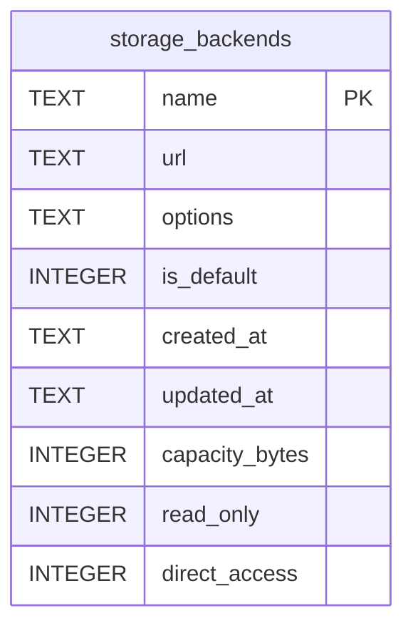

# storage_backends

## Description

A blob store this instance can write to, added from the panel. The credentials are sealed with `storage.secret_key`, which comes from the environment, so a database dump on its own opens nothing. Without a key, adding a backend is refused rather than written in plaintext. The name is the primary key because `file_segments.backend` names it and that reference has to stay readable after the row is gone. `direct_access` says whether a browser may be sent to the store directly, for a download or an upload's parts; off unless an operator turns it on, because only they know whether a browser can reach it.

<details>
<summary><strong>Table Definition</strong></summary>

```sql
CREATE TABLE storage_backends (
    name        TEXT NOT NULL PRIMARY KEY,
    -- Sealed. See `storage::secret`.
    url         TEXT NOT NULL,
    -- Sealed JSON object of backend-specific options.
    options     TEXT NOT NULL,
    -- Whether new uploads go here. Exactly one row should have it.
    is_default  INTEGER    NOT NULL DEFAULT FALSE,
    created_at  TEXT   NOT NULL,
    updated_at  TEXT   NOT NULL
, capacity_bytes INTEGER, read_only INTEGER NOT NULL DEFAULT FALSE, direct_access INTEGER NOT NULL DEFAULT FALSE)
```

</details>

## Columns

| Name | Type | Default | Nullable | Children | Parents | Comment |
| ---- | ---- | ------- | -------- | -------- | ------- | ------- |
| name | TEXT |  | false |  |  |  |
| url | TEXT |  | false |  |  |  |
| options | TEXT |  | false |  |  |  |
| is_default | INTEGER | FALSE | false |  |  |  |
| created_at | TEXT |  | false |  |  |  |
| updated_at | TEXT |  | false |  |  |  |
| capacity_bytes | INTEGER |  | true |  |  |  |
| read_only | INTEGER | FALSE | false |  |  |  |
| direct_access | INTEGER | FALSE | false |  |  |  |

## Constraints

| Name | Type | Definition |
| ---- | ---- | ---------- |
| name | PRIMARY KEY | PRIMARY KEY (name) |
| sqlite_autoindex_storage_backends_1 | PRIMARY KEY | PRIMARY KEY (name) |

## Indexes

| Name | Definition |
| ---- | ---------- |
| sqlite_autoindex_storage_backends_1 | PRIMARY KEY (name) |

## Relations



---

> Generated by [tbls](https://github.com/k1LoW/tbls)
