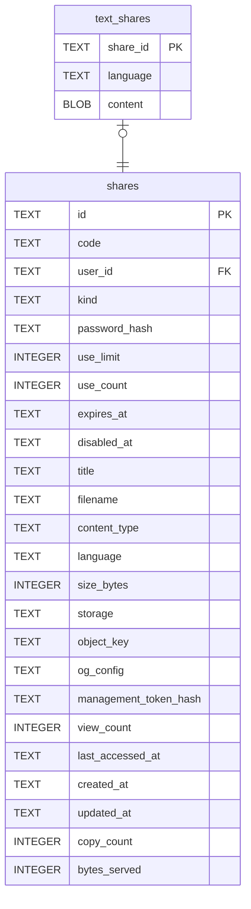

# text_shares

## Description

文字分享的內容本身。`content` 不可為空——「文字的內容在別的地方」正是這張表要消滅的狀態。

<details>
<summary><strong>Table Definition</strong></summary>

```sql
CREATE TABLE text_shares (
    share_id TEXT NOT NULL PRIMARY KEY REFERENCES shares (id) ON DELETE CASCADE,
    language TEXT,
    content  BLOB NOT NULL
)
```

</details>

## Columns

| Name | Type | Default | Nullable | Children | Parents | Comment |
| ---- | ---- | ------- | -------- | -------- | ------- | ------- |
| share_id | TEXT |  | false |  | [shares](shares.md) |  |
| language | TEXT |  | true |  |  |  |
| content | BLOB |  | false |  |  |  |

## Constraints

| Name | Type | Definition |
| ---- | ---- | ---------- |
| share_id | PRIMARY KEY | PRIMARY KEY (share_id) |
| - (Foreign key ID: 0) | FOREIGN KEY | FOREIGN KEY (share_id) REFERENCES shares (id) ON UPDATE NO ACTION ON DELETE CASCADE MATCH NONE |
| sqlite_autoindex_text_shares_1 | PRIMARY KEY | PRIMARY KEY (share_id) |

## Indexes

| Name | Definition |
| ---- | ---------- |
| sqlite_autoindex_text_shares_1 | PRIMARY KEY (share_id) |

## Relations



---

> Generated by [tbls](https://github.com/k1LoW/tbls)
