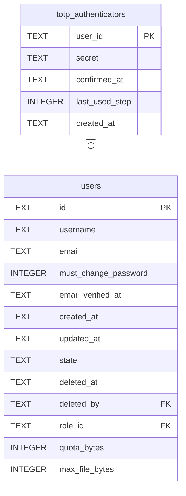

# totp_authenticators

## Description

An account's authenticator app, one at most. The secret is sealed with `security.secret_key` rather than hashed, because checking a code means computing it. `confirmed_at` is null while it is being set up, and then sign-in does not ask for a code, so a QR code scanned wrong cannot lock anybody out. `last_used_step` refuses the same code twice.

<details>
<summary><strong>Table Definition</strong></summary>

```sql
CREATE TABLE totp_authenticators (
    user_id        TEXT    NOT NULL PRIMARY KEY REFERENCES users (id) ON DELETE CASCADE,
    secret         TEXT    NOT NULL,
    confirmed_at   TEXT,
    last_used_step INTEGER,
    created_at     TEXT    NOT NULL
)
```

</details>

## Columns

| Name | Type | Default | Nullable | Children | Parents | Comment |
| ---- | ---- | ------- | -------- | -------- | ------- | ------- |
| user_id | TEXT |  | false |  | [users](users.md) |  |
| secret | TEXT |  | false |  |  |  |
| confirmed_at | TEXT |  | true |  |  |  |
| last_used_step | INTEGER |  | true |  |  |  |
| created_at | TEXT |  | false |  |  |  |

## Constraints

| Name | Type | Definition |
| ---- | ---- | ---------- |
| user_id | PRIMARY KEY | PRIMARY KEY (user_id) |
| - (Foreign key ID: 0) | FOREIGN KEY | FOREIGN KEY (user_id) REFERENCES users (id) ON UPDATE NO ACTION ON DELETE CASCADE MATCH NONE |
| sqlite_autoindex_totp_authenticators_1 | PRIMARY KEY | PRIMARY KEY (user_id) |

## Indexes

| Name | Definition |
| ---- | ---------- |
| sqlite_autoindex_totp_authenticators_1 | PRIMARY KEY (user_id) |

## Relations



---

> Generated by [tbls](https://github.com/k1LoW/tbls)
