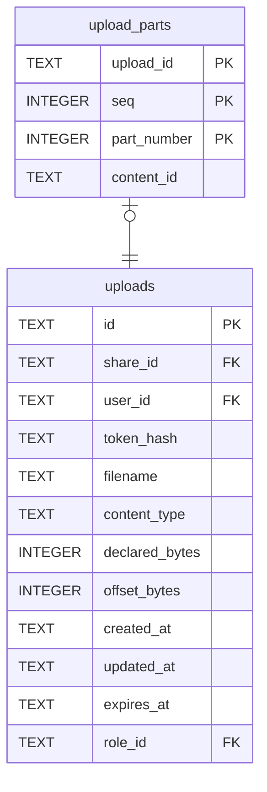

# upload_parts

## Description

分片上傳裡 store 已經收下的每一片。存著是因為 complete_multipart 要把每一片原封不動交回去,而沒有一種列法是三家雲端都同意的。本地檔案系統不會有這裡的列——它用 append。

<details>
<summary><strong>Table Definition</strong></summary>

```sql
CREATE TABLE upload_parts (
    upload_id   TEXT NOT NULL REFERENCES uploads (id) ON DELETE CASCADE,
    -- Position of the segment in the file. Zero until a file is split.
    seq         INTEGER NOT NULL DEFAULT 0,
    part_number INTEGER NOT NULL,
    -- The store's identifier for the part, its ETag on S3.
    content_id  TEXT NOT NULL,
    PRIMARY KEY (upload_id, seq, part_number)
)
```

</details>

## Columns

| Name | Type | Default | Nullable | Children | Parents | Comment |
| ---- | ---- | ------- | -------- | -------- | ------- | ------- |
| upload_id | TEXT |  | false |  | [uploads](uploads.md) |  |
| seq | INTEGER | 0 | false |  |  |  |
| part_number | INTEGER |  | false |  |  |  |
| content_id | TEXT |  | false |  |  |  |

## Constraints

| Name | Type | Definition |
| ---- | ---- | ---------- |
| upload_id | PRIMARY KEY | PRIMARY KEY (upload_id) |
| seq | PRIMARY KEY | PRIMARY KEY (seq) |
| part_number | PRIMARY KEY | PRIMARY KEY (part_number) |
| - (Foreign key ID: 0) | FOREIGN KEY | FOREIGN KEY (upload_id) REFERENCES uploads (id) ON UPDATE NO ACTION ON DELETE CASCADE MATCH NONE |
| sqlite_autoindex_upload_parts_1 | PRIMARY KEY | PRIMARY KEY (upload_id, seq, part_number) |

## Indexes

| Name | Definition |
| ---- | ---------- |
| sqlite_autoindex_upload_parts_1 | PRIMARY KEY (upload_id, seq, part_number) |

## Relations



---

> Generated by [tbls](https://github.com/k1LoW/tbls)
