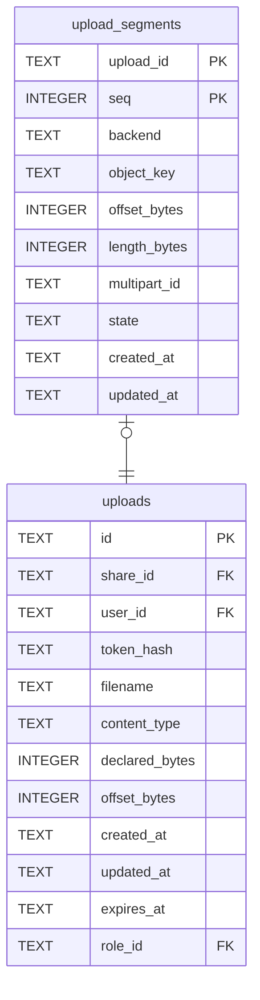

# upload_segments

## Description

<details>
<summary><strong>Table Definition</strong></summary>

```sql
CREATE TABLE upload_segments (
    upload_id     TEXT      NOT NULL REFERENCES uploads (id) ON DELETE CASCADE,
    -- Position in the file, from zero. One row today, so always 0.
    seq           INTEGER   NOT NULL DEFAULT 0,
    -- Which configured backend this piece goes to.
    backend       TEXT      NOT NULL,
    object_key    TEXT      NOT NULL,
    -- Where this piece starts within the whole file, and how long it will be.
    -- How much has actually landed is not here: `uploads.offset_bytes` already
    -- says it for the whole file, and a second copy is a second thing to keep
    -- true.
    offset_bytes  INTEGER   NOT NULL DEFAULT 0,
    length_bytes  INTEGER   NOT NULL,
    -- The store's own multipart identifier. `NULL` on a local filesystem, and
    -- until the segment is opened.
    multipart_id  TEXT,
    state         TEXT      NOT NULL,
    created_at    TEXT      NOT NULL,
    updated_at    TEXT      NOT NULL,
    -- One segment per position, and no way to write two.
    PRIMARY KEY (upload_id, seq)
)
```

</details>

## Columns

| Name | Type | Default | Nullable | Children | Parents | Comment |
| ---- | ---- | ------- | -------- | -------- | ------- | ------- |
| upload_id | TEXT |  | false |  | [uploads](uploads.md) |  |
| seq | INTEGER | 0 | false |  |  |  |
| backend | TEXT |  | false |  |  |  |
| object_key | TEXT |  | false |  |  |  |
| offset_bytes | INTEGER | 0 | false |  |  |  |
| length_bytes | INTEGER |  | false |  |  |  |
| multipart_id | TEXT |  | true |  |  |  |
| state | TEXT |  | false |  |  |  |
| created_at | TEXT |  | false |  |  |  |
| updated_at | TEXT |  | false |  |  |  |

## Constraints

| Name | Type | Definition |
| ---- | ---- | ---------- |
| upload_id | PRIMARY KEY | PRIMARY KEY (upload_id) |
| seq | PRIMARY KEY | PRIMARY KEY (seq) |
| - (Foreign key ID: 0) | FOREIGN KEY | FOREIGN KEY (upload_id) REFERENCES uploads (id) ON UPDATE NO ACTION ON DELETE CASCADE MATCH NONE |
| sqlite_autoindex_upload_segments_1 | PRIMARY KEY | PRIMARY KEY (upload_id, seq) |

## Indexes

| Name | Definition |
| ---- | ---------- |
| idx_upload_segments_state | CREATE INDEX idx_upload_segments_state ON upload_segments (state) |
| sqlite_autoindex_upload_segments_1 | PRIMARY KEY (upload_id, seq) |

## Relations



---

> Generated by [tbls](https://github.com/k1LoW/tbls)
