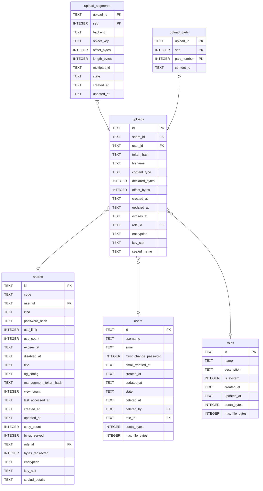

# uploads

## Description

A file still arriving. A half-uploaded thing is not a `file_shares` row, because every row of that table is content somebody can fetch and this is not yet. `object_key` is chosen when the upload opens and never recomputed, so a resumed upload writes back to the same place. `declared_bytes` is what the client said, and quota counts that rather than what has arrived, or two people could claim the same free space at once.

<details>
<summary><strong>Table Definition</strong></summary>

```sql
CREATE TABLE uploads (
    id             TEXT NOT NULL PRIMARY KEY,
    -- The share to append to, or NULL to create one on completion.
    share_id       TEXT REFERENCES shares (id) ON DELETE CASCADE,
    -- Whoever may continue it: the account, or NULL for an anonymous upload
    -- holding the token below.
    user_id        TEXT REFERENCES users (id) ON DELETE CASCADE,
    token_hash     TEXT NOT NULL,
    filename       TEXT,
    content_type   TEXT,
    -- What the client said it would send. The upload finishes when `offset`
    -- reaches it.
    declared_bytes INTEGER NOT NULL,
    -- How much has landed. The answer to a `HEAD`.
    offset_bytes   INTEGER NOT NULL DEFAULT 0,
    -- Decided once, at creation. See above.
    created_at     TEXT NOT NULL,
    updated_at     TEXT NOT NULL,
    expires_at     TEXT NOT NULL
, role_id TEXT REFERENCES roles (id) ON DELETE SET NULL, encryption TEXT, key_salt TEXT, sealed_name TEXT)
```

</details>

## Columns

| Name | Type | Default | Nullable | Children | Parents | Comment |
| ---- | ---- | ------- | -------- | -------- | ------- | ------- |
| id | TEXT |  | false | [upload_segments](upload_segments.md) [upload_parts](upload_parts.md) |  |  |
| share_id | TEXT |  | true |  | [shares](shares.md) |  |
| user_id | TEXT |  | true |  | [users](users.md) |  |
| token_hash | TEXT |  | false |  |  |  |
| filename | TEXT |  | true |  |  |  |
| content_type | TEXT |  | true |  |  |  |
| declared_bytes | INTEGER |  | false |  |  |  |
| offset_bytes | INTEGER | 0 | false |  |  |  |
| created_at | TEXT |  | false |  |  |  |
| updated_at | TEXT |  | false |  |  |  |
| expires_at | TEXT |  | false |  |  |  |
| role_id | TEXT |  | true |  | [roles](roles.md) |  |
| encryption | TEXT |  | true |  |  |  |
| key_salt | TEXT |  | true |  |  |  |
| sealed_name | TEXT |  | true |  |  |  |

## Constraints

| Name | Type | Definition |
| ---- | ---- | ---------- |
| id | PRIMARY KEY | PRIMARY KEY (id) |
| - (Foreign key ID: 0) | FOREIGN KEY | FOREIGN KEY (role_id) REFERENCES roles (id) ON UPDATE NO ACTION ON DELETE SET NULL MATCH NONE |
| - (Foreign key ID: 1) | FOREIGN KEY | FOREIGN KEY (user_id) REFERENCES users (id) ON UPDATE NO ACTION ON DELETE CASCADE MATCH NONE |
| - (Foreign key ID: 2) | FOREIGN KEY | FOREIGN KEY (share_id) REFERENCES shares (id) ON UPDATE NO ACTION ON DELETE CASCADE MATCH NONE |
| sqlite_autoindex_uploads_1 | PRIMARY KEY | PRIMARY KEY (id) |

## Indexes

| Name | Definition |
| ---- | ---------- |
| idx_uploads_role | CREATE INDEX idx_uploads_role ON uploads (role_id) |
| idx_uploads_expires | CREATE INDEX idx_uploads_expires ON uploads (expires_at) |
| sqlite_autoindex_uploads_1 | PRIMARY KEY (id) |

## Relations



---

> Generated by [tbls](https://github.com/k1LoW/tbls)
