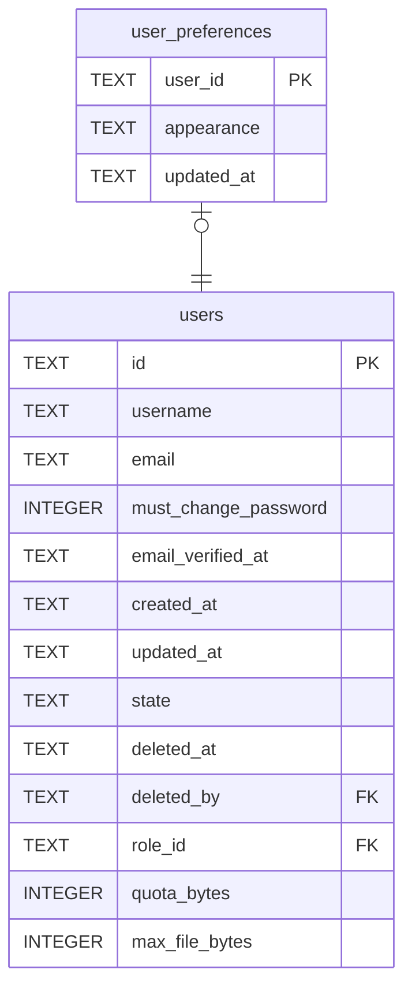

# user_preferences

## Description

One person's own choices, one row each. So far that is appearance: a mode, a neutral theme and an accent, held as JSON because language and time zone are already asked for and each would otherwise be a migration. Every field is optional, and absent means no opinion: somebody who picked only an accent keeps following the instance's default for the rest, including after the operator changes it. The names come from fixed lists in `tessera_core::appearance` and are checked before they are stored, because they end up as attributes on the `<html>` element. No colour is ever stored; each name selects a block of CSS that ships with the frontend.

<details>
<summary><strong>Table Definition</strong></summary>

```sql
CREATE TABLE user_preferences (
    user_id    TEXT NOT NULL PRIMARY KEY
               REFERENCES users (id) ON DELETE CASCADE,
    -- The appearance choices as JSON. `{}` and an absent row mean the same
    -- thing, and both are what somebody who has never opened the setting has.
    appearance TEXT NOT NULL DEFAULT '{}',
    updated_at TEXT NOT NULL
)
```

</details>

## Columns

| Name | Type | Default | Nullable | Children | Parents | Comment |
| ---- | ---- | ------- | -------- | -------- | ------- | ------- |
| user_id | TEXT |  | false |  | [users](users.md) |  |
| appearance | TEXT | '{}' | false |  |  |  |
| updated_at | TEXT |  | false |  |  |  |

## Constraints

| Name | Type | Definition |
| ---- | ---- | ---------- |
| user_id | PRIMARY KEY | PRIMARY KEY (user_id) |
| - (Foreign key ID: 0) | FOREIGN KEY | FOREIGN KEY (user_id) REFERENCES users (id) ON UPDATE NO ACTION ON DELETE CASCADE MATCH NONE |
| sqlite_autoindex_user_preferences_1 | PRIMARY KEY | PRIMARY KEY (user_id) |

## Indexes

| Name | Definition |
| ---- | ---------- |
| sqlite_autoindex_user_preferences_1 | PRIMARY KEY (user_id) |

## Relations



---

> Generated by [tbls](https://github.com/k1LoW/tbls)
