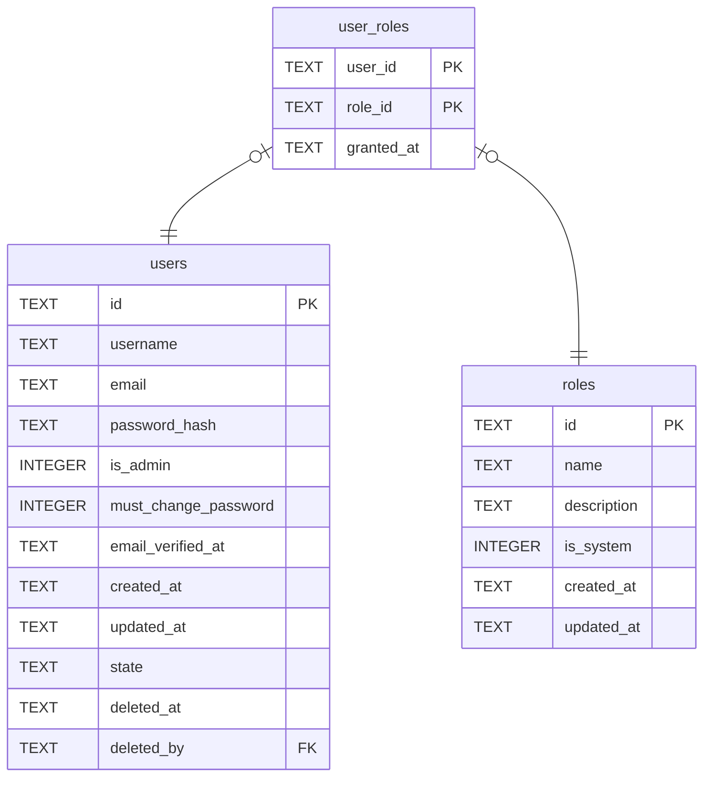

# user_roles

## Description

誰在哪些角色裡。沒有任何一列 = 登入了但什麼都不能做,那是真的狀態不是錯誤。

<details>
<summary><strong>Table Definition</strong></summary>

```sql
CREATE TABLE user_roles (
    user_id    TEXT NOT NULL REFERENCES users (id) ON DELETE CASCADE,
    role_id    TEXT NOT NULL REFERENCES roles (id) ON DELETE CASCADE,
    granted_at TEXT NOT NULL,
    PRIMARY KEY (user_id, role_id)
)
```

</details>

## Columns

| Name | Type | Default | Nullable | Children | Parents | Comment |
| ---- | ---- | ------- | -------- | -------- | ------- | ------- |
| user_id | TEXT |  | false |  | [users](users.md) |  |
| role_id | TEXT |  | false |  | [roles](roles.md) |  |
| granted_at | TEXT |  | false |  |  |  |

## Constraints

| Name | Type | Definition |
| ---- | ---- | ---------- |
| user_id | PRIMARY KEY | PRIMARY KEY (user_id) |
| role_id | PRIMARY KEY | PRIMARY KEY (role_id) |
| - (Foreign key ID: 0) | FOREIGN KEY | FOREIGN KEY (role_id) REFERENCES roles (id) ON UPDATE NO ACTION ON DELETE CASCADE MATCH NONE |
| - (Foreign key ID: 1) | FOREIGN KEY | FOREIGN KEY (user_id) REFERENCES users (id) ON UPDATE NO ACTION ON DELETE CASCADE MATCH NONE |
| sqlite_autoindex_user_roles_1 | PRIMARY KEY | PRIMARY KEY (user_id, role_id) |

## Indexes

| Name | Definition |
| ---- | ---------- |
| idx_user_roles_role | CREATE INDEX idx_user_roles_role ON user_roles (role_id) |
| idx_user_roles_user | CREATE INDEX idx_user_roles_user ON user_roles (user_id) |
| sqlite_autoindex_user_roles_1 | PRIMARY KEY (user_id, role_id) |

## Relations



---

> Generated by [tbls](https://github.com/k1LoW/tbls)
